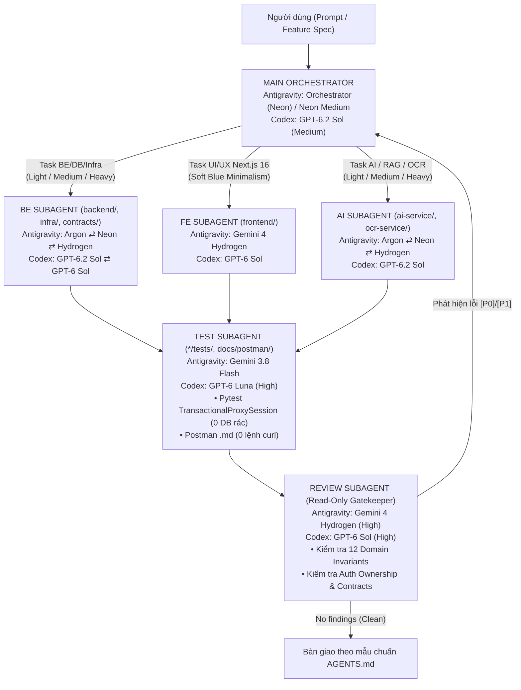

# Kiến Trúc Điều Phối Multi-AI (Dual-Harness: Antigravity Gemini & OpenAI Codex)

> **Dự án:** Personal Productivity & Time Management App  
> **Multi-Agent Model Preset:** `Balanced`  
> **Mục tiêu:** Thiết kế hệ thống Multi-Agent đồng nhất cho phép chuyển đổi mượt mà giữa **Antigravity (Gemini)** và **OpenAI Codex** trên cùng một repository mà không phải cấu hình lại vai trò, ranh giới thư mục hay quy chuẩn kiểm thử.

---

## 1. Tổng quan Kiến trúc & Bảng Phân Vai (`Balanced` Preset)

Hệ thống chia thành **6 vai trò chuyên biệt** (`Main`, `BE`, `FE`, `AI`, `Test`, `Review`), ánh xạ 1:1 giữa **Antigravity** và **Codex**:



### Bảng cấu hình Model chi tiết theo từng Vai trò

| Vai trò | Trách nhiệm cốt lõi | Antigravity (Gemini) | OpenAI Codex | File cấu hình trong Repo |
|---|---|---|---|---|
| **`Main`** | Điều phối trung tâm, phân tích nghiệp vụ, chốt API contract/DDL, chọn bậc model cho worker, tổng hợp kết quả | **`Orchestrator (Neon)`** hoặc **`Gemini 4 Neon (Medium)`** | **`gpt-6.2-sol`** (`reasoning_effort = "medium"`, Plan mode: `"high"`) | `AGENTS.md`, `.codex/config.toml` |
| **`BE`** | FastAPI Python 3.14 Hybrid (`backend/`), MySQL 8.4 LTS (`UUIDv7 BINARY(16)`), Alembic (`M1`–`M13`), MinIO, `contracts/`, `infra/` | **Chuyển động 3 model theo độ nặng nhẹ:**<br>• **Heavy:** `Gemini 4 Argon (High)`<br>• **Medium:** `Gemini 4 Neon (Medium/High)`<br>• **Light:** `Gemini 4 Hydrogen (Low/Medium)` | **Chuyển động 2 model theo độ nặng nhẹ:**<br>• **Heavy (`be_heavy`):** `gpt-6.2-sol` (`high`)<br>• **Light/Medium (`be`):** `gpt-6-sol` (`medium`/`high`) | `.agents/agents/be.md`<br>`.codex/agents/be.toml`<br>`.codex/agents/be-heavy.toml` |
| **`FE`** | Next.js 16, React 19, TypeScript, Tailwind CSS 4, shadcn/ui Base UI, TanStack Query, Soft Blue Pastel (`frontend/`) | **`Gemini 4 Hydrogen (Medium)`** *(nâng lên `Hydrogen (High)` khi xử lý Calendar/DnD phức tạp)* | **`gpt-6-sol`** (`reasoning_effort = "medium"`) | `.agents/agents/fe.md`<br>`.codex/agents/fe.toml` |
| **`AI`** | `ai-service/` (Python 3.14, Pydantic AI, Ollama, Qdrant, `ai_metadata_db`) & `ocr-service/` (Python 3.12, PaddleOCR 3.x) | **Chuyển động 3 model theo độ nặng nhẹ:**<br>• **Heavy:** `Gemini 4 Argon (High)`<br>• **Medium:** `Gemini 4 Neon (Medium/High)`<br>• **Light:** `Gemini 4 Hydrogen (Medium)` | **`gpt-6.2-sol`** (`medium` mặc định; nâng lên `high` cho thuật toán planning/evals) | `.agents/agents/ai.md`<br>`.codex/agents/ai.toml` |
| **`Test`** | Viết & chạy Python `pytest` qua `TransactionalProxySession` (không lưu vào DB thật), test FE, và viết tài liệu Postman `.md` (tuyệt đối không dùng `curl`) | **`Gemini 3.8 Flash (Medium)`** | **`gpt-6-luna`** (`reasoning_effort = "high"`) | `.agents/agents/test.md`<br>`.codex/agents/test.toml` |
| **`Review`** | Read-only code review: kiểm định 12 Domain Invariants, ownership, timezone, MySQL constraints, contracts, quy tắc test & Postman | **`Gemini 4 Hydrogen (High)`** | **`gpt-6-sol`** (`reasoning_effort = "high"`) | `.agents/agents/review.md`<br>`.codex/agents/review.toml` |

---

## 2. Quy tắc Chuyển Model Động (Dynamic Routing) cho `BE` và `AI`

Vì `BE` và `AI` trong dự án này có biên độ độ khó rất rộng (từ khai báo Pydantic DTO đơn giản tới thiết kế khoá đồng thời trên MySQL 8.4 hay thuật toán Smart Planning), **`Main` Orchestrator** áp dụng bộ tiêu chí định tuyến 3 tầng sau trước khi giao việc:

### 2.1. Định tuyến cho `BE` (`backend/`, `infra/`, `contracts/`)

1. **Tầng Light — Nhanh & Tiết kiệm (`Gemini 4 Hydrogen` | `GPT-6 Sol Medium/Low`)**:
   - **Khi nào dùng:** Task chạm 1–2 files, đã có sẵn bảng DB và contract rõ ràng.
   - **Ví dụ trong dự án:**
     - Viết Pydantic request/response schemas cho `categories`, `tags`, `projects`.
     - Sửa lỗi validation `422`, chuẩn hóa mã lỗi HTTP, sửa warning `ruff` hoặc `pyright`.
     - Thêm endpoint đọc danh mục đơn giản (`GET /api/v1/categories`).

2. **Tầng Medium — Cân bằng (`Gemini 4 Neon` / `Hydrogen High` | `GPT-6 Sol Medium/High`)**:
   - **Khi nào dùng:** Task nghiệp vụ tiêu chuẩn xuyên qua `api → services → repositories → models` (3–6 files).
   - **Ví dụ trong dự án:**
     - CRUD `Task` one-off kèm tự động sinh default `TaskOccurrence` (`ADR-CORE-02`).
     - CRUD `Goal`, `GoalLink`, `Habit`, `HabitLog`, `Project`, upload metadata `File` với MinIO presigned URL.
     - Xử lý partial `PATCH` phân biệt trường không gửi (`exclude_unset=True`) và trường gán `null`.
     - Truy vấn Dynamic View của kỳ kế hoạch (`Year/Quarter/Month/Week/Day`) theo khoảng `[start_date, end_date_exclusive)`.

3. **Tầng Heavy — Suy luận sâu & Kiến trúc (`Gemini 4 Argon High` | `GPT-6.2 Sol High` / `be_heavy`)**:
   - **Khi nào dùng:** Task liên quan tới **Domain Invariants phức tạp**, **MySQL 8.4 InnoDB internals**, **Concurrency/Locking**, hoặc **Bảo mật liên service**.
   - **Ví dụ trong dự án:**
     - Thiết kế & chạy Alembic migrations (`M1` → `M13`): `UUIDBinary16`, Virtual Generated Column `active_user_lock` trên `time_entries`, XOR `CHECK` constraints kết hợp `ON DELETE RESTRICT` (tránh MySQL Error 3823).
     - Engine sinh `TaskOccurrence` từ `recurrence_rules` (idempotent, xử lý ngoại lệ, sửa rule không ghi đè lịch sử `DONE`).
     - Rollover kế hoạch có kiểm soát giữa các kỳ, cắt phiên `TimeEntry` qua nửa đêm theo timezone người dùng, tính toán Analytics aggregates.
     - Worker gửi `reminders` dùng `FOR UPDATE SKIP LOCKED`, Optimistic Locking (`version` → `409 Conflict`), `idempotency_keys`.
     - Cổng `ai_gateway` và `/internal/v1/ai-tools/*` (kiểm tra scoped token, phát hành & xác nhận `ActionProposal`, chống vòng lặp `Backend ↔ AI`).

### 2.2. Định tuyến cho `AI` (`ai-service/`, `ocr-service/`)

1. **Tầng Light (`Gemini 4 Hydrogen` | `GPT-6.2 Sol Medium`)**:
   - Khai báo Pydantic v2 structured output schemas (`TaskDraft`, `ClarificationNeeded`, `SubtaskProposal`, `ChartSpec`, `ScheduleProposal`, `ActionProposal`).
   - Viết prompt template tĩnh, bộ lọc allowlist metric cho `ChartSpec`, cấu hình FastAPI router/healthcheck.

2. **Tầng Medium (`Gemini 4 Neon` | `GPT-6.2 Sol Medium`)**:
   - Tích hợp adapter Ollama local, pipeline bóc tách ảnh/PDF qua `ocr-service` (PaddleOCR 3.x / PP-StructureV3 / PyMuPDF).
   - Luồng chunking tài liệu, tạo embeddings, lưu và truy vấn Qdrant có lọc `user_id` + provenance (`file_id`, `chunk_id`, `page`).
   - Gọi Backend internal read tools (`search_tasks`, `get_calendar_range`, `get_goal_progress`, `get_analytics_metric`).

3. **Tầng Heavy (`Gemini 4 Argon High` | `GPT-6.2 Sol High`)**:
   - Xây dựng **Constraint-based Smart Planning Engine** (kết hợp kiểm tra ràng buộc cứng về giờ làm việc, lịch cố định, độ ưu tiên với đề xuất của LLM).
   - Thiết kế multi-step agent workflow với Pydantic AI, cơ chế phòng chống Prompt Injection từ tài liệu OCR/RAG, và bộ Golden Evaluation Dataset tiếng Việt.

---

## 3. Cấu trúc File Cấu hình Đã Triển Khai Trong Repository

Toàn bộ cấu hình đã được đặt sẵn tại thư mục gốc dự án để cả **Antigravity** và **Codex** tự động nạp:

```text
notion/
├── AGENTS.md                           # Quy chuẩn chung + Mục 11: Điều phối Multi-AI (Balanced)
├── .agents/
│   ├── agents/                         # Custom Subagents cho Antigravity (Gemini)
│   │   ├── be.md                       # BE Subagent (Argon / Neon / Hydrogen)
│   │   ├── fe.md                       # FE Subagent (Hydrogen)
│   │   ├── ai.md                       # AI & OCR Subagent (Argon / Neon / Hydrogen)
│   │   ├── test.md                     # Test & Postman Subagent (Gemini 3.8 Flash)
│   │   └── review.md                   # Read-only Reviewer Subagent (Hydrogen)
│   └── skills/
│       ├── multi-ai/SKILL.md           # Skill điều phối Multi-AI & Dynamic Model Routing
│       ├── be/SKILL.md
│       ├── fe/SKILL.md
│       ├── db/SKILL.md
│       ├── ai/SKILL.md
│       ├── ocr/SKILL.md
│       ├── storage/SKILL.md
│       ├── infra/SKILL.md
│       ├── contracts/SKILL.md
│       ├── product/SKILL.md
│       ├── qa/SKILL.md
│       └── test/SKILL.md
├── .codex/
│   ├── config.toml                     # Cấu hình Codex: Main = gpt-6.2-sol (medium), review = gpt-6-sol
│   └── agents/                         # Custom Subagents cho OpenAI Codex
│       ├── be.toml                     # BE Standard/Light: gpt-6-sol (medium)
│       ├── be-heavy.toml               # BE Heavy/Architect: gpt-6.2-sol (high)
│       ├── fe.toml                     # FE Engineer: gpt-6-sol (medium)
│       ├── ai.toml                     # AI & OCR Engineer: gpt-6.2-sol (medium)
│       ├── test.toml                   # Test & Postman: gpt-6-luna (high)
│       └── review.toml                 # Read-only Reviewer: gpt-6-sol (high)
└── docs/
    └── MULTI_AI_ORCHESTRATION.md       # Tài liệu thiết kế & playbook vận hành Multi-AI
```

---

## 4. Hướng Dẫn Vận Hành Khi Chuyển Đổi Giữa Antigravity & Codex

### 4.1. Khi làm việc trên **OpenAI Codex** (`codex` CLI / IDE / App)

1. **Khởi động**: Mở terminal tại `/home/vutienndat2302/Documents/notion` và chạy `codex`.
   - Codex tự động đọc `.codex/config.toml` → Đặt `Main` là **`gpt-6.2-sol` (`medium`)**, bật `multi_agent = true`, và nạp 6 custom agents từ `.codex/agents/*.toml`.
2. **Cách giao việc đa tác nhân (Prompt mẫu trên Codex)**:
   - **Luồng tính năng đơn (ví dụ Backend + Test + Review)**:
     > *"Triển khai module `categories` theo M2. Dùng subagent `be` để code API/Service/Repository, sau đó gọi `test` viết pytest qua `TransactionalProxySession` + tài liệu Postman (không dùng curl), cuối cùng gọi `review` kiểm tra diff."*
   - **Luồng tính năng nặng (ví dụ Recurrence / Migration phức tạp)**:
     > *"Triển khai engine sinh `TaskOccurrence` lặp idempotent. Giao phần core logic cho `be_heavy` (`gpt-6.2-sol` high), sau đó giao `test` (`gpt-6-luna`) chạy bộ test chống trùng và giao `review` (`gpt-6-sol`) kiểm định."*
   - **Luồng Full-stack song song (BE + FE + Test + Review)**:
     > *"Triển khai tính năng Today Workspace theo contract đã chốt: chạy song song `be` trong `backend/` và `fe` trong `frontend/`, đợi cả hai xong thì gọi `test` viết test & Postman doc, cuối cùng gọi `review`."*
3. **Theo dõi tiến trình**: Dùng lệnh `/subagents` trong Codex CLI để xem các luồng `be`, `fe`, `ai`, `test`, `review` đang chạy.

### 4.2. Khi làm việc trên **Antigravity (Gemini)** (`agy` CLI / IDE / App 2.0)

1. **Chọn Model cho Main Agent**:
   - Trong Settings hoặc thanh chọn model của Antigravity, chọn **`Orchestrator (Neon)`** hoặc **`Gemini 4 Neon (Medium)`** (hoặc `High` khi lập kế hoạch lớn).
2. **Hai chế độ chạy Multi-Agent trên Antigravity**:
   - **Cách 1 — Điều phối tự động qua Subagents (`invoke_subagent` / `run_workflow`)**:
     Chỉ cần yêu cầu trực tiếp trong khung chat:
     > *"Áp dụng skill `multi-ai` (preset Balanced): triển khai tính năng [Tên tính năng], chia cho subagent `be`, `fe`, sau đó chạy `test` và `review`."*
     Main Agent sẽ tự động kích hoạt `.agents/skills/multi-ai/SKILL.md` và gọi `.agents/agents/{be,fe,ai,test,review}.md` với đúng bậc model (`pro` cho Heavy, `inherit` cho Medium, `flash` cho FE/Review/Light, `flash_lite` cho Test).
   - **Cách 2 — Chế độ `/swarm` (Ghim chính xác tên Model Argon / Neon / Hydrogen / 3.8 Flash cho từng Worker)**:
     Khi làm một đợt tính năng lớn cần bảng điều phối trực quan (Message Board), gõ `/swarm`:
     > *"/swarm Triển khai Phase 1 Task & Occurrence theo preset Balanced trong skill multi-ai"*
     Coordinator sẽ khởi tạo đội hình trên bảng Swarm với đúng tên model:
     - `be`: `Gemini 4 Argon (High)` (khi làm migration/recurrence) hoặc chuyển sang `Gemini 4 Neon (High)` / `Gemini 4 Hydrogen (Medium)` bằng `swarm{action:"model"}` khi làm CRUD nhẹ.
     - `fe`: `Gemini 4 Hydrogen (Medium)` (`workspace: "share"`).
     - `ai`: `Gemini 4 Argon (High)` / `Gemini 4 Neon (High)` / `Gemini 4 Hydrogen (Medium)` tùy độ nặng của task.
     - `test`: `Gemini 3.8 Flash (Medium)`.
     - `review`: `Gemini 4 Hydrogen (High)`.
