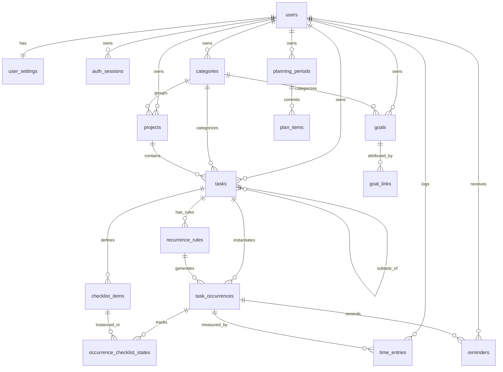
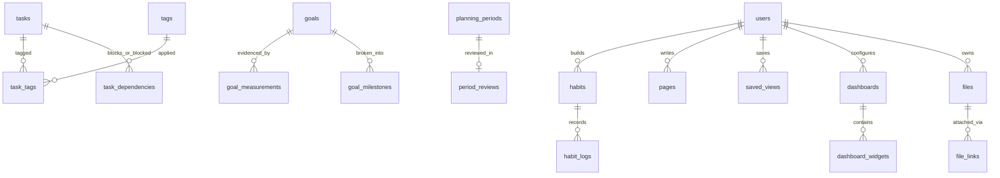

# Thiết Kế Cơ Sở Dữ Liệu Chi Tiết Theo Từng Giai Đoạn (MySQL 8.4 LTS)

> **Hệ quản trị:** MySQL 8.4 LTS · Engine `InnoDB` · Charset `utf8mb4` · Collation `utf8mb4_0900_ai_ci` · Server TZ `+00:00`  
> **ORM & Migrations:** SQLAlchemy 2.x (`asyncmy`) + Alembic (1 lịch sử migration cho `productivity_db`, 1 lịch sử riêng cho `ai_metadata_db`)  
> **Nguyên tắc cốt lõi:** Triển khai tăng dần theo **4 Giai đoạn (14 đợt migration, tổng 41 bảng)** — không tạo ồ ạt 81 bảng của bản v1 tham khảo khi chưa có use case thực tế.

---

## 1. Chuẩn Vật Lý MySQL 8.4 & Giải Pháp Chống Bẫy Kỹ Thuật

### 1.1. Quy ước kiểu dữ liệu & Khóa chính

| Thành phần | Chuẩn MySQL 8.4 | Lý do & Cách ánh xạ Python / API |
|---|---|---|
| **Primary Key (`id`)** | `BINARY(16)` | Sinh tại Python 3.14 bằng `uuid.uuid7().bytes` (không swap byte như UUIDv1). UUIDv7 tăng dần theo thời gian giúp **InnoDB Clustered Index** chèn tuần tự, giảm page split. API JSON serialize thành opaque UUID string chuẩn (`36` chars). |
| **SQL Inspect** | `BIN_TO_UUID(id, 0)` / `UUID_TO_BIN(?, 0)` | Dùng trên DataGrip khi cần đọc/query ID dạng chữ. |
| **UTC Instant** | `DATETIME(6)` | Lưu UTC thuần; MySQL `DATETIME(6)` **không lưu offset**, SQLAlchemy TypeDecorator `UTCDateTime` ép mọi datetime về `timezone.utc` khi ghi và gắn lại `tzinfo=UTC` khi đọc. |
| **Local Calendar Date** | `DATE` | Ngày nghiệp vụ theo timezone user (`Asia/Ho_Chi_Minh`), dùng cho `scheduled_date`, `start_date`, `end_date_exclusive`. |
| **Wall-clock Time** | `TIME(0)` | Giờ theo đồng hồ địa phương cho khung giờ làm việc / thói quen. |
| **Duration / Count** | `INT UNSIGNED` | Lưu bằng giây (`duration_seconds`) hoặc phút (`estimated_minutes`); không dùng `FLOAT`. |
| **Targets / Metrics** | `DECIMAL(18, 4)` | Số lượng mục tiêu định lượng (`200.0000` giờ, `12.0000` cuốn sách, `5.5000` km). |
| **Enums** | `VARCHAR(24)` + `CHECK (...)` | Dễ mở rộng giá trị mới qua migration hơn `MySQL ENUM`, đồng bộ với Python `StrEnum`. |
| **JSON** | `JSON` | Chỉ dùng cho config/payload linh hoạt có Pydantic schema validation (`preferences_json`, `chart_spec_json`, `changes_json`); **không** dùng thay thế FK/quan hệ cốt lõi. |
| **Optimistic Locking** | `version INT UNSIGNED NOT NULL DEFAULT 1` | Áp dụng cho thực thể dễ bị sửa đồng thời (Web + Mobile): `tasks`, `task_occurrences`, `planning_periods`, `goals`, `pages`. Trả `409 Conflict` khi mismatch. |

### 1.2. Giải pháp 3 bẫy kinh điển trên MySQL 8.4 InnoDB

1. **Bẫy `UNIQUE` với giá trị `NULL`:**
   - Trong MySQL InnoDB, nhiều dòng có cột `NULL` không vi phạm `UNIQUE(col_a, col_b)`.
   - **Giải pháp cho `task_occurrences`:** Dùng cột `recurrence_key VARCHAR(64) NOT NULL DEFAULT 'ONCE'` (one-off mặc định là `'ONCE'`, lặp là `'2026-11-19'`). Khi đó `UNIQUE(task_id, recurrence_key)` chặn 100% sinh trùng cả task lặp lẫn task đơn!
   - **Giải pháp cho `plan_items` & `goal_links` & `file_links`:** Dùng cột discriminator `target_key VARCHAR(80) NOT NULL` (ví dụ `'TASK:<uuid>'`, `'PROJECT:<uuid>'`, `'GOAL:<uuid>'`) kết hợp `UNIQUE(parent_id, target_key)`.
2. **Bẫy "Tối đa 1 Active Timer / User" (MySQL không có Partial Unique Index):**
   - Trong PostgreSQL có `CREATE UNIQUE INDEX ... WHERE status IN ('RUNNING', 'PAUSED')`, nhưng MySQL 8.4 không có cú pháp này.
   - **Giải pháp trên `time_entries`:** Tạo **Virtual Generated Column** + `UNIQUE`:
     ```sql
     active_user_lock BINARY(16) GENERATED ALWAYS AS (
       IF(status IN ('RUNNING', 'PAUSED'), user_id, NULL)
     ) VIRTUAL,
     CONSTRAINT uq_time_entries_active_user_lock UNIQUE (active_user_lock)
     ```
     Khi entry ở trạng thái `RUNNING`/`PAUSED`, giá trị bằng `user_id` nên **chỉ tồn tại tối đa 1 dòng/user** ở tầng InnoDB; khi `COMPLETED`/`CANCELLED`, cột trả `NULL` nên cho phép lưu vô hạn lịch sử!
3. **Bẫy `CHECK` constraint kết hợp `ON DELETE SET NULL / CASCADE`:**
   - MySQL 8.4 cấm một cột vừa tham gia `CHECK (...)` vừa có FK action `ON DELETE SET NULL` hoặc `ON DELETE CASCADE` (Error 3823).
   - **Giải pháp:** Mọi cột FK nằm trong `CHECK` (như polymorphic XOR columns trên `plan_items`, `goal_links`, `file_links`) bắt buộc dùng **`ON DELETE RESTRICT`**. Xóa dữ liệu được điều phối tường minh trong Domain Service.

### 1.3. SQLAlchemy Constraint Naming Convention

Cấu hình đồng bộ trong `backend/app/db/base.py`:
```python
NAMING_CONVENTION = {
    "ix": "ix_%(table_name)s_%(column_0_N_name)s",
    "uq": "uq_%(table_name)s_%(column_0_N_name)s",
    "ck": "ck_%(table_name)s_%(constraint_name)s",
    "fk": "fk_%(table_name)s_%(column_0_name)s_%(referred_table_name)s",
    "pk": "pk_%(table_name)s",
}
```

---

## 2. Tổng Quan Phân Kỳ Database (4 Giai Đoạn — 14 Đợt Migration)

| Giai đoạn | Tên giai đoạn | Database | Đợt Migration | Số bảng | Phạm vi nghiệp vụ mở khóa |
|---|---|---|---:|---:|---|
| **Giai đoạn 1** | **Core MVP** | `productivity_db` | `M1` → `M7` | **16** | Auth, Settings, Categories, Projects, Tasks, Occurrences, Recurrence, Checklists, Planning Y/Q/M/W/D, Time Tracking, Goals, Reminders |
| **Giai đoạn 2** | **Productivity+** | `productivity_db` | `M8` → `M11` | **16** | Multi-tags, Dependencies, Habits, Goal Measurements & Milestones, Period Reviews, Notes/Pages, Saved Views, Dashboards, Files (MinIO), Audit & Idempotency |
| **Giai đoạn 3** | **AI, OCR & RAG** | `productivity_db` + `ai_metadata_db` | `M12` + `AI-M1` | **6** | Action Proposals (BE confirm), AI Conversations/Messages/Runs, OCR & RAG Document Jobs/Chunks + Qdrant & MinIO |
| **Giai đoạn 4** | **Mobile & Automation** | `productivity_db` | `M13` | **3** | Multi-device Push/iOS SideStore sync (`user_devices`), Templates, Automation Rules |
| **Tổng cộng** | | | **14 đợt** | **41 bảng** | *(36 bảng `productivity_db` + 5 bảng `ai_metadata_db`)* |

---

## 3. Giai Đoạn 1 — Core MVP (`productivity_db`: 16 bảng, Migrations `M1` → `M7`)

### 3.1. Sơ đồ ERD Tổng Quan Giai Đoạn 1



---

### 3.2. Đợt `M1`: Identity, Settings & Auth (3 bảng)

#### Bảng 01: `users`
- **Owner module:** `users` / `auth`
- **Use case:** Tài khoản định danh người dùng (single-user bootstrap ban đầu, sẵn sàng mở rộng multi-user).

| Cột | Kiểu MySQL 8.4 | Null | Default | Ràng buộc & Ghi chú |
|---|---|---|---|---|
| `id` | `BINARY(16)` | NN | — | `PK`, UUIDv7 |
| `email` | `VARCHAR(254)` | NN | — | Email hiển thị nguyên bản |
| `email_normalized` | `VARCHAR(254)` | NN | — | Casefolded email, `UNIQUE(email_normalized)` |
| `password_hash` | `VARCHAR(255)` | NN | — | Argon2id hash (`pwdlib`), không bao giờ trả ra API |
| `display_name` | `VARCHAR(120)` | NN | — | Tên hiển thị |
| `status` | `VARCHAR(24)` | NN | `'ACTIVE'` | `CHECK (status IN ('ACTIVE','DISABLED','PENDING_DELETION'))` |
| `last_login_at` | `DATETIME(6)` | NULL | `NULL` | UTC timestamp |
| `created_at` | `DATETIME(6)` | NN | — | UTC timestamp |
| `updated_at` | `DATETIME(6)` | NN | — | UTC timestamp |

- **Indexes:** `uq_users_email_normalized (email_normalized)`, `ix_users_status (status)`.

#### Bảng 02: `user_settings`
- **Owner module:** `users`
- **Use case:** Lưu timezone, quy tắc đầu tuần, ngôn ngữ, theme Light/Dark/System và cấu hình working hours.

| Cột | Kiểu MySQL 8.4 | Null | Default | Ràng buộc & Ghi chú |
|---|---|---|---|---|
| `id` | `BINARY(16)` | NN | — | `PK`, UUIDv7 |
| `user_id` | `BINARY(16)` | NN | — | `FK -> users(id) ON DELETE RESTRICT`, `UNIQUE(user_id)` |
| `timezone` | `VARCHAR(64)` | NN | `'Asia/Ho_Chi_Minh'` | IANA timezone |
| `week_starts_on` | `TINYINT UNSIGNED` | NN | `1` | `1`=Thứ 2 … `7`=Chủ nhật, `CHECK (week_starts_on BETWEEN 1 AND 7)` |
| `locale` | `VARCHAR(16)` | NN | `'vi-VN'` | Định dạng hiển thị |
| `theme` | `VARCHAR(16)` | NN | `'SYSTEM'` | `CHECK (theme IN ('LIGHT','DARK','SYSTEM'))` |
| `color_theme` | `VARCHAR(32)` | NN | `'SOFT_BLUE'` | Bảng màu nền tảng |
| `working_hours_json` | `JSON` | NULL | `NULL` | Khung giờ làm việc chuẩn theo thứ để tính Capacity |
| `created_at` | `DATETIME(6)` | NN | — | UTC |
| `updated_at` | `DATETIME(6)` | NN | — | UTC |

- **Indexes:** `uq_user_settings_user_id (user_id)`.

#### Bảng 03: `auth_sessions`
- **Owner module:** `auth`
- **Use case:** Refresh token rotation, phát hiện reuse token (revoke toàn bộ `family_id`) và thu hồi phiên.

| Cột | Kiểu MySQL 8.4 | Null | Default | Ràng buộc & Ghi chú |
|---|---|---|---|---|
| `id` | `BINARY(16)` | NN | — | `PK`, UUIDv7 |
| `user_id` | `BINARY(16)` | NN | — | `FK -> users(id) ON DELETE CASCADE` |
| `refresh_token_hash` | `BINARY(32)` | NN | — | SHA-256 hash của refresh token, `UNIQUE(refresh_token_hash)` |
| `family_id` | `BINARY(16)` | NN | — | Nhóm phiên xoay vòng token |
| `device_label` | `VARCHAR(100)` | NULL | `NULL` | Nhãn trình duyệt/thiết bị |
| `issued_at` | `DATETIME(6)` | NN | — | UTC |
| `expires_at` | `DATETIME(6)` | NN | — | UTC |
| `revoked_at` | `DATETIME(6)` | NULL | `NULL` | UTC; khác NULL nghĩa là đã thu hồi |
| `last_used_at` | `DATETIME(6)` | NULL | `NULL` | UTC |
| `created_at` | `DATETIME(6)` | NN | — | UTC |

- **Indexes:** `uq_auth_sessions_refresh_token_hash (refresh_token_hash)`, `ix_auth_sessions_user_id_expires_at (user_id, expires_at)`, `ix_auth_sessions_family_id_revoked_at (family_id, revoked_at)`.

---

### 3.3. Đợt `M2`: Taxonomy & Projects (2 bảng)

#### Bảng 04: `categories`
- **Owner module:** `taxonomy`
- **Use case:** Phân loại công việc, gắn màu pastel cố định đồng bộ trên Tasks, Calendar, Analytics.

| Cột | Kiểu MySQL 8.4 | Null | Default | Ràng buộc & Ghi chú |
|---|---|---|---|---|
| `id` | `BINARY(16)` | NN | — | `PK`, UUIDv7 |
| `user_id` | `BINARY(16)` | NN | — | `FK -> users(id) ON DELETE RESTRICT` |
| `name` | `VARCHAR(80)` | NN | — | Tên nhóm (Work, Study, Health, Personal...) |
| `accent_token` | `VARCHAR(24)` | NN | `'SKY'` | `CHECK (accent_token IN ('LAVENDER','SAGE','PEACH','ROSE','BUTTER','SKY','SLATE'))` |
| `sort_order` | `INT UNSIGNED` | NN | `0` | Thứ tự hiển thị |
| `archived_at` | `DATETIME(6)` | NULL | `NULL` | Archive mềm, giữ nguyên lịch sử task/time entry |
| `created_at` | `DATETIME(6)` | NN | — | UTC |
| `updated_at` | `DATETIME(6)` | NN | — | UTC |

- **Indexes:** `ix_categories_user_id_archived_at_sort_order (user_id, archived_at, sort_order)`.

#### Bảng 05: `projects`
- **Owner module:** `projects`
- **Use case:** Gom nhóm công việc hướng đến đầu ra cụ thể; tiến độ tính động từ tasks/occurrences.

| Cột | Kiểu MySQL 8.4 | Null | Default | Ràng buộc & Ghi chú |
|---|---|---|---|---|
| `id` | `BINARY(16)` | NN | — | `PK`, UUIDv7 |
| `user_id` | `BINARY(16)` | NN | — | `FK -> users(id) ON DELETE RESTRICT` |
| `category_id` | `BINARY(16)` | NULL | `NULL` | `FK -> categories(id) ON DELETE SET NULL` |
| `title` | `VARCHAR(160)` | NN | — | Tên dự án |
| `description` | `TEXT` | NULL | `NULL` | Mô tả mục tiêu/bối cảnh dự án |
| `status` | `VARCHAR(24)` | NN | `'ACTIVE'` | `CHECK (status IN ('PLANNED','ACTIVE','ON_HOLD','COMPLETED','CANCELLED'))` |
| `start_date` | `DATE` | NULL | `NULL` | Ngày bắt đầu dự kiến |
| `target_date` | `DATE` | NULL | `NULL` | Mốc hoàn thành dự kiến |
| `version` | `INT UNSIGNED` | NN | `1` | Optimistic locking |
| `archived_at` | `DATETIME(6)` | NULL | `NULL` | Archive mềm |
| `created_at` | `DATETIME(6)` | NN | — | UTC |
| `updated_at` | `DATETIME(6)` | NN | — | UTC |

- **Indexes:** `ix_projects_user_id_status_archived_at (user_id, status, archived_at)`, `ix_projects_category_id (category_id)`.

---

### 3.4. Đợt `M3`: Tasks, Recurrence, Occurrences & Checklists (5 bảng lõi quan trọng nhất)

#### Bảng 06: `tasks`
- **Owner module:** `tasks`
- **Use case:** **Định nghĩa công việc gốc.** Tuyệt đối không chứa trạng thái `DONE` cho chuỗi lặp. Hỗ trợ subtask qua `parent_task_id` (chống cycle ở tầng Service).

| Cột | Kiểu MySQL 8.4 | Null | Default | Ràng buộc & Ghi chú |
|---|---|---|---|---|
| `id` | `BINARY(16)` | NN | — | `PK`, UUIDv7 |
| `user_id` | `BINARY(16)` | NN | — | `FK -> users(id) ON DELETE RESTRICT` |
| `project_id` | `BINARY(16)` | NULL | `NULL` | `FK -> projects(id) ON DELETE SET NULL` |
| `category_id` | `BINARY(16)` | NULL | `NULL` | `FK -> categories(id) ON DELETE SET NULL` |
| `parent_task_id` | `BINARY(16)` | NULL | `NULL` | `FK -> tasks(id) ON DELETE RESTRICT` (Subtask), `CHECK (parent_task_id <> id)` |
| `title` | `VARCHAR(255)` | NN | — | Không toàn khoảng trắng (validate Pydantic + Service) |
| `description` | `TEXT` | NULL | `NULL` | Ghi chú chi tiết của task |
| `priority` | `VARCHAR(16)` | NN | `'MEDIUM'` | `CHECK (priority IN ('LOW','MEDIUM','HIGH','URGENT'))` |
| `estimated_minutes` | `INT UNSIGNED` | NULL | `NULL` | Ước lượng thời lượng mặc định |
| `due_at` | `DATETIME(6)` | NULL | `NULL` | Deadline gốc (khác `scheduled_date`) |
| `is_recurring` | `BOOLEAN` | NN | `0` | Cờ phân biệt one-off vs recurring |
| `version` | `INT UNSIGNED` | NN | `1` | Optimistic locking |
| `archived_at` | `DATETIME(6)` | NULL | `NULL` | Archive mềm, không xóa history occurrences/time entries |
| `created_at` | `DATETIME(6)` | NN | — | UTC |
| `updated_at` | `DATETIME(6)` | NN | — | UTC |

- **Indexes:**
  - `ix_tasks_user_id_archived_at_created_at (user_id, archived_at, created_at)` — Query Inbox/All Tasks
  - `ix_tasks_user_id_project_id (user_id, project_id)` — Filter theo Project
  - `ix_tasks_parent_task_id (parent_task_id)` — Lấy subtasks

#### Bảng 07: `recurrence_rules`
- **Owner module:** `tasks`
- **Use case:** Quy tắc lặp của task (`DAILY`, `WEEKLY`, `MONTHLY`, `YEARLY`), giữ `rule_version` để chỉnh tương lai mà không mất lịch sử quá khứ.

| Cột | Kiểu MySQL 8.4 | Null | Default | Ràng buộc & Ghi chú |
|---|---|---|---|---|
| `id` | `BINARY(16)` | NN | — | `PK`, UUIDv7 |
| `task_id` | `BINARY(16)` | NN | — | `FK -> tasks(id) ON DELETE CASCADE` |
| `frequency` | `VARCHAR(16)` | NN | — | `CHECK (frequency IN ('DAILY','WEEKLY','MONTHLY','YEARLY'))` |
| `interval_value` | `SMALLINT UNSIGNED` | NN | `1` | `CHECK (interval_value >= 1)` (mỗi N ngày/tuần/tháng) |
| `weekdays_mask` | `TINYINT UNSIGNED` | NULL | `NULL` | Bitmask T2(`1`), T3(`2`), T4(`4`), T5(`8`), T6(`16`), T7(`32`), CN(`64`) |
| `month_day` | `TINYINT UNSIGNED` | NULL | `NULL` | Ngày 1..31 cho `MONTHLY`/`YEARLY` |
| `monthly_overflow_policy` | `VARCHAR(24)` | NN | `'SKIP'` | `CHECK (monthly_overflow_policy IN ('SKIP','CLAMP_TO_LAST_DAY'))` |
| `default_start_time` | `TIME(0)` | NULL | `NULL` | Giờ bắt đầu mặc định theo `timezone` của rule |
| `default_duration_minutes` | `INT UNSIGNED` | NULL | `NULL` | Thời lượng block lịch mặc định |
| `starts_on` | `DATE` | NN | — | Ngày bắt đầu hiệu lực |
| `ends_on` | `DATE` | NULL | `NULL` | Ngày kết thúc (optional) |
| `max_count` | `INT UNSIGNED` | NULL | `NULL` | Dừng sau N lần (optional) |
| `timezone` | `VARCHAR(64)` | NN | `'Asia/Ho_Chi_Minh'` | Múi giờ của quy tắc lặp |
| `is_paused` | `BOOLEAN` | NN | `0` | Tạm dừng sinh occurrence mới |
| `rule_version` | `INT UNSIGNED` | NN | `1` | Tăng khi sửa rule tương lai |
| `created_at` | `DATETIME(6)` | NN | — | UTC |
| `updated_at` | `DATETIME(6)` | NN | — | UTC |

- **Indexes:** `ix_recurrence_rules_task_id_is_paused (task_id, is_paused)`.

#### Bảng 08: `task_occurrences`
- **Owner module:** `tasks`
- **Use case:** Một lần thực hiện cụ thể. Theo **ADR-CORE-02**, cả one-off task chưa xếp lịch (Inbox) cũng có 1 default occurrence (`scheduled_date = NULL`, `recurrence_key = 'ONCE'`) để giữ thống nhất hoàn toàn vòng đời trạng thái và `TimeEntry`.

| Cột | Kiểu MySQL 8.4 | Null | Default | Ràng buộc & Ghi chú |
|---|---|---|---|---|
| `id` | `BINARY(16)` | NN | — | `PK`, UUIDv7 |
| `user_id` | `BINARY(16)` | NN | — | `FK -> users(id) ON DELETE RESTRICT` (Denormalize để filter query Today/Calendar cực nhanh theo owner) |
| `task_id` | `BINARY(16)` | NN | — | `FK -> tasks(id) ON DELETE CASCADE` |
| `recurrence_rule_id` | `BINARY(16)` | NULL | `NULL` | `FK -> recurrence_rules(id) ON DELETE SET NULL` |
| `recurrence_key` | `VARCHAR(64)` | NN | `'ONCE'` | `'ONCE'` hoặc ISO date `'2026-11-19'` theo rule |
| `scheduled_date` | `DATE` | NULL | `NULL` | `NULL` = Inbox unscheduled; có ngày = lên lịch theo ngày local |
| `start_at` | `DATETIME(6)` | NULL | `NULL` | Giờ bắt đầu time-block (UTC), `NULL` = all-day task |
| `end_at` | `DATETIME(6)` | NULL | `NULL` | Giờ kết thúc time-block (UTC), `CHECK (end_at IS NULL OR start_at IS NULL OR end_at > start_at)` |
| `due_at` | `DATETIME(6)` | NULL | `NULL` | Deadline riêng của occurrence này |
| `estimated_minutes` | `INT UNSIGNED` | NULL | `NULL` | Kế hoạch phút (không phải actual) |
| `status` | `VARCHAR(16)` | NN | `'NOT_STARTED'` | `CHECK (status IN ('NOT_STARTED','IN_PROGRESS','DONE','SKIPPED','CANCELLED'))` |
| `completed_at` | `DATETIME(6)` | NULL | `NULL` | Mốc hoàn thành UTC |
| `is_override` | `BOOLEAN` | NN | `0` | Đánh dấu nếu user đã dời lịch/sửa riêng lần này |
| `sort_order` | `INT UNSIGNED` | NN | `0` | Thứ tự kéo thả trong Today/Tasks |
| `version` | `INT UNSIGNED` | NN | `1` | Optimistic locking |
| `created_at` | `DATETIME(6)` | NN | — | UTC |
| `updated_at` | `DATETIME(6)` | NN | — | UTC |

- **Unique & Indexes:**
  - `uq_task_occurrences_task_id_recurrence_key (task_id, recurrence_key)` — **Chống sinh trùng recurrence ở mức engine DB**
  - `ix_task_occurrences_user_id_scheduled_date_status (user_id, scheduled_date, status)` — Query Today, Inbox (`scheduled_date IS NULL`), Calendar date range
  - `ix_task_occurrences_user_id_start_at_end_at (user_id, start_at, end_at)` — Query Calendar Timeline & Conflict check
  - `ix_task_occurrences_user_id_due_at_status (user_id, due_at, status)` — Query Due Today & Overdue động

#### Bảng 09: `checklist_items`
- **Owner module:** `tasks`
- **Use case:** Định nghĩa các bước con (template) trên task gốc; không chứa trạng thái tick.

| Cột | Kiểu MySQL 8.4 | Null | Default | Ràng buộc & Ghi chú |
|---|---|---|---|---|
| `id` | `BINARY(16)` | NN | — | `PK`, UUIDv7 |
| `task_id` | `BINARY(16)` | NN | — | `FK -> tasks(id) ON DELETE CASCADE` |
| `title` | `VARCHAR(255)` | NN | — | Nội dung bước |
| `sort_order` | `INT UNSIGNED` | NN | `0` | Thứ tự hiển thị |
| `archived_at` | `DATETIME(6)` | NULL | `NULL` | Xóa mềm để giữ lịch sử tick cũ |
| `created_at` | `DATETIME(6)` | NN | — | UTC |
| `updated_at` | `DATETIME(6)` | NN | — | UTC |

- **Indexes:** `ix_checklist_items_task_id_archived_at_sort_order (task_id, archived_at, sort_order)`.

#### Bảng 10: `occurrence_checklist_states`
- **Owner module:** `tasks`
- **Use case:** Trạng thái tick checklist riêng biệt cho từng `occurrence_id` (ngày hôm nay tick 4/4, ngày mai sinh mới vẫn 0/4).

| Cột | Kiểu MySQL 8.4 | Null | Default | Ràng buộc & Ghi chú |
|---|---|---|---|---|
| `id` | `BINARY(16)` | NN | — | `PK`, UUIDv7 |
| `occurrence_id` | `BINARY(16)` | NN | — | `FK -> task_occurrences(id) ON DELETE CASCADE` |
| `checklist_item_id` | `BINARY(16)` | NN | — | `FK -> checklist_items(id) ON DELETE CASCADE` |
| `is_checked` | `BOOLEAN` | NN | `0` | Trạng thái tick |
| `checked_at` | `DATETIME(6)` | NULL | `NULL` | UTC timestamp |
| `updated_at` | `DATETIME(6)` | NN | — | UTC |

- **Unique:** `uq_occurrence_checklist_states_occ_item (occurrence_id, checklist_item_id)`.

---

### 3.5. Đợt `M4`: Planning Workspaces `Year → Quarter → Month → Week → Day` (2 bảng)

#### Bảng 11: `planning_periods`
- **Owner module:** `planning`
- **Use case:** Lưu bản kế hoạch có chủ đích (focus, notes, status) khi người dùng viết kế hoạch/review cho một kỳ; view động của kỳ không bắt buộc phải tạo sẵn dòng trong bảng này.

| Cột | Kiểu MySQL 8.4 | Null | Default | Ràng buộc & Ghi chú |
|---|---|---|---|---|
| `id` | `BINARY(16)` | NN | — | `PK`, UUIDv7 |
| `user_id` | `BINARY(16)` | NN | — | `FK -> users(id) ON DELETE RESTRICT` |
| `period_type` | `VARCHAR(12)` | NN | — | `CHECK (period_type IN ('YEAR','QUARTER','MONTH','WEEK','DAY'))` |
| `period_key` | `VARCHAR(16)` | NN | — | Canonical key (`2026`, `2026-Q4`, `2026-11`, `2026-W47`, `2026-11-19`) |
| `start_date` | `DATE` | NN | — | Ngày bắt đầu (inclusive) |
| `end_date_exclusive` | `DATE` | NN | — | Ngày kết thúc (exclusive), `CHECK (start_date < end_date_exclusive)` |
| `timezone` | `VARCHAR(64)` | NN | `'Asia/Ho_Chi_Minh'` | Múi giờ lúc chốt kỳ |
| `title` | `VARCHAR(200)` | NULL | `NULL` | Chủ đề/tiêu đề kỳ |
| `focus_summary` | `TEXT` | NULL | `NULL` | Trọng tâm / Big 3 của kỳ |
| `notes` | `TEXT` | NULL | `NULL` | Ghi chú kế hoạch |
| `status` | `VARCHAR(16)` | NN | `'ACTIVE'` | `CHECK (status IN ('DRAFT','ACTIVE','CLOSED','ARCHIVED'))` |
| `closed_at` | `DATETIME(6)` | NULL | `NULL` | UTC timestamp |
| `version` | `INT UNSIGNED` | NN | `1` | Optimistic locking |
| `created_at` | `DATETIME(6)` | NN | — | UTC |
| `updated_at` | `DATETIME(6)` | NN | — | UTC |

- **Unique & Indexes:**
  - `uq_planning_periods_user_type_key (user_id, period_type, period_key)`
  - `ix_planning_periods_user_dates (user_id, start_date, end_date_exclusive)`

#### Bảng 12: `plan_items`
- **Owner module:** `planning`
- **Use case:** Ghim & xếp hạng ưu tiên Task/Occurrence/Project/Goal vào một kỳ mà **không sao chép dữ liệu gốc**. Tuân thủ quy tắc FK + `ON DELETE RESTRICT` do tham gia `CHECK` XOR.

| Cột | Kiểu MySQL 8.4 | Null | Default | Ràng buộc & Ghi chú |
|---|---|---|---|---|
| `id` | `BINARY(16)` | NN | — | `PK`, UUIDv7 |
| `period_id` | `BINARY(16)` | NN | — | `FK -> planning_periods(id) ON DELETE CASCADE` |
| `task_id` | `BINARY(16)` | NULL | `NULL` | `FK -> tasks(id) ON DELETE RESTRICT` |
| `occurrence_id` | `BINARY(16)` | NULL | `NULL` | `FK -> task_occurrences(id) ON DELETE RESTRICT` |
| `project_id` | `BINARY(16)` | NULL | `NULL` | `FK -> projects(id) ON DELETE RESTRICT` |
| `goal_id` | `BINARY(16)` | NULL | `NULL` | `FK -> goals(id) ON DELETE RESTRICT` |
| `target_key` | `VARCHAR(64)` | NN | — | Canonical key (`TASK:<uuid>`, `OCC:<uuid>`, `PROJECT:<uuid>`, `GOAL:<uuid>`) |
| `priority_rank` | `INT UNSIGNED` | NN | `0` | Thứ tự ưu tiên trong kỳ |
| `commitment` | `VARCHAR(16)` | NN | `'COMMITTED'` | `CHECK (commitment IN ('PLANNED','COMMITTED','OPTIONAL'))` |
| `created_at` | `DATETIME(6)` | NN | — | UTC |
| `updated_at` | `DATETIME(6)` | NN | — | UTC |

- **Constraints & Indexes:**
  - `CHECK (((task_id IS NOT NULL) + (occurrence_id IS NOT NULL) + (project_id IS NOT NULL) + (goal_id IS NOT NULL)) = 1)`
  - `uq_plan_items_period_target (period_id, target_key)`
  - `ix_plan_items_period_rank (period_id, priority_rank)`

---

### 3.6. Đợt `M5`: Time Tracking & Focus Timer (1 bảng)

#### Bảng 13: `time_entries`
- **Owner module:** `time_tracking`
- **Use case:** Bằng chứng thời gian làm việc thực tế. Hỗ trợ `start/pause/resume/stop` bền vững trên server (F5 hay đổi thiết bị không mất timer) và `MANUAL` entry.

| Cột | Kiểu MySQL 8.4 | Null | Default | Ràng buộc & Ghi chú |
|---|---|---|---|---|
| `id` | `BINARY(16)` | NN | — | `PK`, UUIDv7 |
| `user_id` | `BINARY(16)` | NN | — | `FK -> users(id) ON DELETE RESTRICT` |
| `occurrence_id` | `BINARY(16)` | NULL | `NULL` | `FK -> task_occurrences(id) ON DELETE SET NULL` (NULL = phiên tập trung độc lập) |
| `source` | `VARCHAR(16)` | NN | `'TIMER'` | `CHECK (source IN ('TIMER','MANUAL'))` |
| `status` | `VARCHAR(16)` | NN | `'RUNNING'` | `CHECK (status IN ('RUNNING','PAUSED','COMPLETED','CANCELLED'))` |
| `started_at` | `DATETIME(6)` | NN | — | Mốc bắt đầu UTC |
| `last_resumed_at` | `DATETIME(6)` | NULL | `NULL` | Mốc resume gần nhất (dùng khi `RUNNING`) |
| `paused_at` | `DATETIME(6)` | NULL | `NULL` | Mốc pause gần nhất (dùng khi `PAUSED`) |
| `paused_seconds` | `INT UNSIGNED` | NN | `0` | Tổng giây đã tạm dừng |
| `ended_at` | `DATETIME(6)` | NULL | `NULL` | Mốc kết thúc UTC (`COMPLETED`), `CHECK (ended_at IS NULL OR ended_at >= started_at)` |
| `duration_seconds` | `INT UNSIGNED` | NN | `0` | Thời lượng thực tế khi `COMPLETED` (hoặc nhập `MANUAL`) |
| `note` | `VARCHAR(500)` | NULL | `NULL` | Ghi chú phiên làm việc |
| `active_user_lock` | `BINARY(16)` | NULL | — | `GENERATED ALWAYS AS (IF(status IN ('RUNNING','PAUSED'), user_id, NULL)) VIRTUAL` |
| `created_at` | `DATETIME(6)` | NN | — | UTC |
| `updated_at` | `DATETIME(6)` | NN | — | UTC |

- **Unique & Indexes:**
  - `uq_time_entries_active_user_lock (active_user_lock)` — Bảo đảm 1 user chỉ có tối đa 1 timer active tại một thời điểm!
  - `ix_time_entries_user_started_ended (user_id, started_at, ended_at)` — Query Analytics & Heatmap & overlap check
  - `ix_time_entries_occurrence_id (occurrence_id)` — Lấy lịch sử phiên của một occurrence

---

### 3.7. Đợt `M6`: Goals & Attribution Links (2 bảng)

#### Bảng 14: `goals`
- **Owner module:** `goals`
- **Use case:** Mục tiêu định lượng/định tính theo đơn vị đo rõ ràng (`hours`, `tasks`, `count`, `milestones`).

| Cột | Kiểu MySQL 8.4 | Null | Default | Ràng buộc & Ghi chú |
|---|---|---|---|---|
| `id` | `BINARY(16)` | NN | — | `PK`, UUIDv7 |
| `user_id` | `BINARY(16)` | NN | — | `FK -> users(id) ON DELETE RESTRICT` |
| `category_id` | `BINARY(16)` | NULL | `NULL` | `FK -> categories(id) ON DELETE SET NULL` |
| `parent_goal_id` | `BINARY(16)` | NULL | `NULL` | `FK -> goals(id) ON DELETE RESTRICT` (Goal năm → Goal quý) |
| `title` | `VARCHAR(200)` | NN | — | Tên mục tiêu |
| `description` | `TEXT` | NULL | `NULL` | Mô tả |
| `goal_type` | `VARCHAR(24)` | NN | — | `CHECK (goal_type IN ('QUANTITATIVE','COUNT_BASED','HABIT_BASED','TASK_BASED','MILESTONE_BASED','QUALITATIVE'))` |
| `metric_unit` | `VARCHAR(32)` | NN | `'hours'` | Đơn vị: `hours`, `tasks`, `sessions`, `pages`, `km`, ... |
| `target_value` | `DECIMAL(18, 4)` | NN | — | `CHECK (target_value > 0)` |
| `baseline_value` | `DECIMAL(18, 4)` | NN | `0.0000` | Giá trị khởi điểm |
| `measurement_mode` | `VARCHAR(16)` | NN | `'AUTO'` | `CHECK (measurement_mode IN ('AUTO','MANUAL','HYBRID'))` |
| `start_date` | `DATE` | NN | — | Ngày bắt đầu kỳ mục tiêu |
| `end_date` | `DATE` | NN | — | Hạn đạt mục tiêu, `CHECK (start_date <= end_date)` |
| `status` | `VARCHAR(16)` | NN | `'ACTIVE'` | `CHECK (status IN ('NOT_STARTED','ACTIVE','ON_HOLD','ACHIEVED','CANCELLED'))` |
| `version` | `INT UNSIGNED` | NN | `1` | Optimistic locking |
| `archived_at` | `DATETIME(6)` | NULL | `NULL` | Archive mềm |
| `created_at` | `DATETIME(6)` | NN | — | UTC |
| `updated_at` | `DATETIME(6)` | NN | — | UTC |

- **Indexes:** `ix_goals_user_status_dates (user_id, status, start_date, end_date)`.

#### Bảng 15: `goal_links`
- **Owner module:** `goals`
- **Use case:** Nối Goal ↔ Project hoặc Goal ↔ Task để tự động tính tiến độ (`AUTO` mode) mà không cộng trùng nếu Task nằm trong Project đã link.

| Cột | Kiểu MySQL 8.4 | Null | Default | Ràng buộc & Ghi chú |
|---|---|---|---|---|
| `id` | `BINARY(16)` | NN | — | `PK`, UUIDv7 |
| `goal_id` | `BINARY(16)` | NN | — | `FK -> goals(id) ON DELETE CASCADE` |
| `project_id` | `BINARY(16)` | NULL | `NULL` | `FK -> projects(id) ON DELETE RESTRICT` |
| `task_id` | `BINARY(16)` | NULL | `NULL` | `FK -> tasks(id) ON DELETE RESTRICT` |
| `target_key` | `VARCHAR(64)` | NN | — | `'PROJECT:<uuid>'` hoặc `'TASK:<uuid>'` |
| `weight` | `DECIMAL(8, 4)` | NN | `1.0000` | Hệ số đóng góp |
| `created_at` | `DATETIME(6)` | NN | — | UTC |

- **Constraints & Indexes:**
  - `CHECK (((project_id IS NOT NULL) + (task_id IS NOT NULL)) = 1)`
  - `uq_goal_links_goal_target (goal_id, target_key)`

---

### 3.8. Đợt `M7`: Reminders & Durable Delivery (1 bảng)

#### Bảng 16: `reminders`
- **Owner module:** `reminders`
- **Use case:** Nhắc nhở gắn `occurrence_id` với hàng đợi bền vững hỗ trợ `FOR UPDATE SKIP LOCKED`, chống gửi trùng và khôi phục khi worker restart.

| Cột | Kiểu MySQL 8.4 | Null | Default | Ràng buộc & Ghi chú |
|---|---|---|---|---|
| `id` | `BINARY(16)` | NN | — | `PK`, UUIDv7 |
| `user_id` | `BINARY(16)` | NN | — | `FK -> users(id) ON DELETE RESTRICT` |
| `occurrence_id` | `BINARY(16)` | NN | — | `FK -> task_occurrences(id) ON DELETE CASCADE` |
| `offset_minutes` | `INT` | NULL | `NULL` | Nhắc trước N phút (ví dụ `-15`); NULL nếu đặt giờ tuyệt đối |
| `remind_at` | `DATETIME(6)` | NN | — | Thời điểm nhắc UTC đã tính theo timezone user |
| `channel` | `VARCHAR(16)` | NN | `'IN_APP'` | `CHECK (channel IN ('IN_APP','WEB_PUSH','IOS_LOCAL'))` |
| `status` | `VARCHAR(24)` | NN | `'PENDING'` | `CHECK (status IN ('PENDING','CLAIMED','SENT','FAILED_RETRYABLE','FAILED_PERMANENT','CANCELLED','DISMISSED'))` |
| `idempotency_key` | `VARCHAR(128)` | NN | — | `<occurrence_id>:<channel>:<revision>`, `UNIQUE(idempotency_key)` |
| `attempt_count` | `TINYINT UNSIGNED` | NN | `0` | Số lần đã thử gửi |
| `lease_owner` | `VARCHAR(64)` | NULL | `NULL` | Worker ID đang giữ job |
| `lease_until` | `DATETIME(6)` | NULL | `NULL` | Hạn lease UTC để recover nếu worker crash |
| `sent_at` | `DATETIME(6)` | NULL | `NULL` | UTC |
| `read_at` | `DATETIME(6)` | NULL | `NULL` | UTC (cho `IN_APP` notification inbox) |
| `last_error_code` | `VARCHAR(64)` | NULL | `NULL` | Mã lỗi lần thử cuối |
| `created_at` | `DATETIME(6)` | NN | — | UTC |
| `updated_at` | `DATETIME(6)` | NN | — | UTC |

- **Unique & Indexes:**
  - `uq_reminders_idempotency_key (idempotency_key)`
  - `ix_reminders_status_remind_at_lease (status, remind_at, lease_until)` — Tối ưu cho worker query `WHERE status IN ('PENDING','FAILED_RETRYABLE') AND remind_at <= NOW(6)`
  - `ix_reminders_user_channel_read_at (user_id, channel, read_at)` — Query In-app Notification Inbox

---

## 4. Giai Đoạn 2 — Productivity+ (`productivity_db`: 16 bảng mở rộng, Migrations `M8` → `M11`)

Triển khai ngay khi **Core MVP (16 bảng)** và luồng **BE-1→5 / FE-0→4** vận hành ổn định.



### 4.1. Đợt `M8`: Multi-Tags & Task Dependencies (3 bảng)

| # | Bảng | Module | Cột chính & Ràng buộc |
|---:|---|---|---|
| 17 | `tags` | `taxonomy` | `id`, `user_id` FK, `name` (`VARCHAR(60)`), `name_normalized` (`VARCHAR(60)`), `color_token` (`VARCHAR(24)`). `UNIQUE(user_id, name_normalized)`. |
| 18 | `task_tags` | `taxonomy` | `id`, `task_id` FK `ON DELETE CASCADE`, `tag_id` FK `ON DELETE CASCADE`, `created_at`. `UNIQUE(task_id, tag_id)`. |
| 19 | `task_dependencies` | `tasks` | `id`, `blocking_task_id` FK `tasks(id)`, `blocked_task_id` FK `tasks(id)`, `relation_type` (`FINISH_TO_START`), `created_at`. `CHECK (blocking_task_id <> blocked_task_id)`, `UNIQUE(blocking_task_id, blocked_task_id)`. *(Service kiểm tra chống cycle DAG A→B→A).* |

### 4.2. Đợt `M9`: Habits, Goal Measurements & Milestones (4 bảng)

| # | Bảng | Module | Cột chính & Ràng buộc |
|---:|---|---|---|
| 20 | `habits` | `habits` | `id`, `user_id` FK, `category_id` FK, `title`, `habit_type` (`BOOLEAN`/`QUANTITATIVE`), `target_value` (`DECIMAL(12,3)`), `unit` (`VARCHAR(32)`), `schedule_type` (`DAILY`/`WEEKDAYS`/`X_PER_WEEK`), `weekdays_mask`, `target_per_week`, `starts_on`, `archived_at`. |
| 21 | `habit_logs` | `habits` | `id`, `habit_id` FK `ON DELETE CASCADE`, `user_id` FK, `log_date` (`DATE`), `value` (`DECIMAL(12,3)`), `status` (`COMPLETED`/`SKIPPED`), `note`, `logged_at` (`DATETIME(6)`). `UNIQUE(habit_id, log_date)` (hoặc `CHECK` policy check-in/ngày). |
| 22 | `goal_measurements` | `goals` | `id`, `goal_id` FK `ON DELETE CASCADE`, `user_id` FK, `measured_value` (`DECIMAL(18,4)`), `measured_at` (`DATETIME(6)`), `source` (`MANUAL`/`HABIT`/`IMPORT`), `note`, `idempotency_key` (`UNIQUE`). Giúp ghi tiến độ định lượng thủ công/evidence mà không sửa lịch sử. |
| 23 | `goal_milestones` | `goals` | `id`, `goal_id` FK `ON DELETE CASCADE`, `title`, `target_date` (`DATE`), `status` (`PENDING`/`COMPLETED`), `completed_at` (`DATETIME(6)`), `sort_order`. |

### 4.3. Đợt `M10`: Period Reviews, Notes/Pages, Saved Views & Dashboards (5 bảng)

| # | Bảng | Module | Cột chính & Ràng buộc |
|---:|---|---|---|
| 24 | `period_reviews` | `planning` | `id`, `period_id` FK `planning_periods(id) ON DELETE CASCADE` (`UNIQUE(period_id)`), `user_id` FK, `answers_json` (`JSON`), `metric_snapshot_json` (`JSON`), `snapshot_as_of` (`DATETIME(6)`), `status` (`DRAFT`/`SUBMITTED`), `submitted_at`, `version`. |
| 25 | `pages` | `content` | `id`, `user_id` FK, `parent_page_id` FK `pages(id) ON DELETE RESTRICT`, `title`, `content_markdown` (`MEDIUMTEXT`) hoặc `content_json` (`JSON`), `version`, `archived_at`, `deleted_at`. *(Không tạo bảng `page_blocks` trong Giai đoạn 2).* |
| 26 | `saved_views` | `views` | `id`, `user_id` FK, `resource_type` (`TASKS`/`PROJECTS`/`PAGES`), `name`, `view_type` (`LIST`/`TABLE`/`BOARD`/`CALENDAR`/`TIMELINE`), `config_json` (`JSON` chứa filter/sort/columns allowlisted), `is_default`. |
| 27 | `dashboards` | `dashboards` | `id`, `user_id` FK, `title`, `description`, `layout_mode` (`RESPONSIVE_GRID`), `is_default`, `archived_at`. |
| 28 | `dashboard_widgets` | `dashboards` | `id`, `dashboard_id` FK `dashboards(id) ON DELETE CASCADE`, `widget_kind` (`METRIC_CARD`/`CHART`/`HEATMAP`/`PROGRESS`/`TASK_LIST`), `title`, `spec_json` (`JSON` — chỉ lưu `ChartSpec` allowlist, tuyệt đối không lưu JS/SQL), `position_x`, `position_y`, `width`, `height`. |

### 4.4. Đợt `M11`: Files Metadata (MinIO), Audit Events & Idempotency (4 bảng)

| # | Bảng | Module | Cột chính & Ràng buộc |
|---:|---|---|---|
| 29 | `files` | `files` | `id`, `user_id` FK, `bucket` (`VARCHAR(64)`), `object_key` (`VARCHAR(255)` `UNIQUE`), `original_filename` (`VARCHAR(255)`), `mime_type` (`VARCHAR(128)`), `size_bytes` (`BIGINT UNSIGNED`), `sha256_hex` (`CHAR(64)`), `current_version` (`INT UNSIGNED DEFAULT 1`), `status` (`PENDING_UPLOAD`/`READY`/`FAILED`/`PENDING_DELETE`/`DELETED`). |
| 30 | `file_links` | `files` | `id`, `file_id` FK `files(id) ON DELETE RESTRICT`, `task_id` FK, `project_id` FK, `goal_id` FK, `page_id` FK, `target_key` (`VARCHAR(64)`), `created_at`. `CHECK` XOR = 1 (`ON DELETE RESTRICT`), `UNIQUE(file_id, target_key)`. |
| 31 | `activity_events` | `activity` | `id`, `user_id` FK, `entity_type` (`VARCHAR(32)`), `entity_id` (`BINARY(16)`), `event_type` (`VARCHAR(64)` — ví dụ `OCCURRENCE_COMPLETED`, `RECURRENCE_UPDATED`, `ROLLOVER_APPLIED`), `payload_json` (`JSON`), `request_id` (`VARCHAR(64)`), `created_at`. Index `(user_id, entity_type, entity_id, created_at)` — immutable (không có `updated_at`). |
| 32 | `idempotency_keys` | `shared` | `id`, `user_id` FK, `scope` (`VARCHAR(64)`), `idempotency_key` (`VARCHAR(128)`), `request_hash` (`BINARY(32)`), `response_status` (`SMALLINT UNSIGNED`), `response_body_json` (`JSON`), `expires_at` (`DATETIME(6)`), `created_at`. `UNIQUE(user_id, scope, idempotency_key)`. |

---

## 5. Giai Đoạn 3 — AI, OCR & Knowledge RAG (`productivity_db` + `ai_metadata_db` + MinIO + Qdrant)

### 5.1. Kiến trúc phân tách Store & Ownership

```text
productivity_db (Backend user ONLY)       ai_metadata_db (AI user ONLY)
  └── action_proposals (M12)                ├── ai_conversations (AI-M1)
  └── files / file_links                    ├── ai_messages
                                            ├── ai_runs
                                            ├── ai_document_jobs
                                            └── ai_document_chunks
        │                                         │
        ▼                                         ▼
MinIO (personal-uploads, ai-artifacts)    Qdrant (personal_knowledge_v1)
```

> **Tuyệt đối không** tạo SQL Foreign Key nối từ `ai_metadata_db` sang `productivity_db`. Tham chiếu chéo giữa hai DB chỉ lưu dưới dạng logical UUID (`owner_user_id BINARY(16)`, `file_id BINARY(16)`) và được xác thực thông qua **Backend Internal Tool APIs**.

### 5.2. Đợt `M12` trong `productivity_db` (Backend owned — 1 bảng)

#### Bảng 33: `action_proposals`
- **Owner module:** `ai_gateway`
- **Use case:** Lưu đề xuất thay đổi dữ liệu do AI tạo (`TaskDraft`, `ScheduleProposal`, `RescheduleBatch`, `DashboardSpec`) để chờ người dùng xem trước và xác nhận. AI Service không thể tự confirm.

| Cột | Kiểu MySQL 8.4 | Null | Default | Ràng buộc & Ghi chú |
|---|---|---|---|---|
| `id` | `BINARY(16)` | NN | — | `PK`, UUIDv7 (`proposal_id`) |
| `user_id` | `BINARY(16)` | NN | — | `FK -> users(id) ON DELETE RESTRICT` |
| `action_type` | `VARCHAR(48)` | NN | — | `CREATE_TASK`, `RESCHEDULE_OCCURRENCES`, `SAVE_DASHBOARD`, `CREATE_TASKS_FROM_OCR` |
| `status` | `VARCHAR(24)` | NN | `'AWAITING_CONFIRMATION'` | `CHECK (status IN ('AWAITING_CONFIRMATION','EXECUTED','REJECTED','EXPIRED','FAILED'))` |
| `changes_json` | `JSON` | NN | — | Payload thay đổi kèm `expected_version` của target resources |
| `impact_summary` | `VARCHAR(500)` | NN | — | Tóm tắt tác động hiển thị cho user |
| `idempotency_key` | `VARCHAR(128)` | NN | — | `UNIQUE(user_id, idempotency_key)` chống confirm đúp |
| `expires_at` | `DATETIME(6)` | NN | — | Hết hạn TTL → Backend từ chối confirm |
| `confirmed_at` | `DATETIME(6)` | NULL | `NULL` | UTC |
| `ai_run_id` | `BINARY(16)` | NULL | `NULL` | Logical ref sang `ai_metadata_db.ai_runs.id` |
| `created_at` | `DATETIME(6)` | NN | — | UTC |
| `updated_at` | `DATETIME(6)` | NN | — | UTC |

### 5.3. Đợt `AI-M1` trong `ai_metadata_db` (AI Service owned — 5 bảng)

| # | Bảng | Vai trò | Cột cốt lõi & Ràng buộc |
|---:|---|---|---|
| A1 | `ai_conversations` | Hội thoại AI | `id BINARY(16) PK`, `owner_user_id BINARY(16) NN`, `title`, `context_summary`, `last_message_at`, `expires_at`, `deleted_at`. Index `(owner_user_id, deleted_at, last_message_at)`. |
| A2 | `ai_messages` | Lịch sử tin nhắn | `id`, `conversation_id FK`, `role` (`USER`/`ASSISTANT`/`SYSTEM`), `content_text`, `structured_result_json` (`ChartSpec`/`TaskDraft` ref), `provenance_json`, `created_at`. |
| A3 | `ai_runs` | Telemetry & Eval trace | `id`, `owner_user_id`, `request_id` (`UNIQUE`), `intent`, `provider` (`OLLAMA`/`CLOUD`), `model_id`, `tool_calls_count`, `latency_ms`, `status` (`SUCCESS`/`FAILED`/`TIMEOUT`), `error_code`, `created_at`. |
| A4 | `ai_document_jobs` | State machine OCR & RAG | `id`, `owner_user_id`, `file_id BINARY(16)`, `file_version INT UNSIGNED`, `pipeline_version VARCHAR(32)`, `embedding_model VARCHAR(64)`, `idempotency_key VARCHAR(160) UNIQUE` (`file_id+version+pipeline+model`), `status` (`PENDING`/`EXTRACTING`/`CHUNKING`/`EMBEDDING`/`INDEXING`/`COMPLETED`/`FAILED_RETRYABLE`/`FAILED_PERMANENT`/`STALE_VERSION`), `ocr_artifact_key`, `page_count`, `attempt_count`, `lease_owner`, `lease_until`, `last_error_code`. |
| A5 | `ai_document_chunks` | Provenance RAG citations | `id`, `owner_user_id`, `file_id`, `file_version`, `chunk_index INT UNSIGNED`, `page_number INT UNSIGNED`, `bbox_json`, `content_sha256 CHAR(64)`, `qdrant_point_id BINARY(16)`, `is_active BOOLEAN`. `UNIQUE(file_id, file_version, chunk_index)`. |

### 5.4. Hợp đồng MinIO & Qdrant đi kèm Giai đoạn 3

- **MinIO Buckets & Object Keys:**
  - `personal-uploads`: `uploads/{owner_id}/{file_id}/v{version}/original` (không chứa tên file gốc chưa sanitize).
  - `ai-artifacts`: `artifacts/{owner_id}/{file_id}/v{version}/ocr.json`, `.../extracted.txt`, `.../thumb/p0001.webp`.
  - `personal-exports`: `exports/{owner_id}/{export_id}/report.pdf`.
- **Qdrant Collection `personal_knowledge_v1`:**
  - Point ID xác định tất định từ `(file_id, file_version, chunk_index, embedding_model_version)` để upsert idempotent.
  - Payload bắt buộc có `owner_id`, `file_id`, `file_version`, `chunk_id`, `page_number`, `source_type` (`pdf_native`/`pdf_ocr`/`image_ocr`/`page`), `embedding_model`, `is_active`. Mọi truy vấn RAG **bắt buộc** gắn filter `owner_id == trusted_actor_id` AND `is_active == true`.

---

## 6. Giai Đoạn 4 — Mobile iOS Sync & Automation (`productivity_db`: 3 bảng, Migration `M13`)

| # | Bảng | Module | Cột chính & Ràng buộc |
|---:|---|---|---|
| 34 | `user_devices` | `users` / `reminders` | `id`, `user_id` FK, `installation_id_hash` (`BINARY(32)`), `platform` (`WEB`/`IOS`), `device_label`, `push_endpoint_or_token` (mã hóa ở tầng app), `last_seen_at`, `revoked_at`. `UNIQUE(user_id, installation_id_hash)`. Phục vụ Web Push + đồng bộ local notification cho app iPhone iOS 18 (SideStore). |
| 35 | `templates` | `templates` | `id`, `user_id` FK, `template_kind` (`TASK`/`PROJECT`/`PLAN`/`REVIEW`), `name`, `schema_version`, `payload_json`, `archived_at`. |
| 36 | `automation_rules` | `automation` | `id`, `user_id` FK, `name`, `trigger_event`, `condition_json`, `action_json` (chỉ allowlist actions an toàn), `is_enabled`, `last_triggered_at`. |

---

## 7. Quy Chuẩn SQL Mẫu Cho Analytics Metric Registry (Chống Sai Số)

1. **`completion_rate` theo khoảng ngày local `[start_date, end_date)`:**
   - Mẫu số (`eligible`): chỉ gồm occurrence có `scheduled_date` nằm trong `[start_date, end_date)` **và** `scheduled_date <= local_today` (không phạt occurrence tương lai), **loại trừ** `status = 'CANCELLED'`.
   - Tử số (`completed`): subset có `status = 'DONE'`.
   - Nếu `eligible = 0` → API trả `value: null`, `status: "NO_DATA"` (tuyệt đối không trả `100%` hay `0%`).
2. **`active_minutes` chia phiên chạy qua nửa đêm (`00:00` local time):**
   - Trong `time_entries`, mỗi entry được chuyển `[started_at, ended_at)` sang local timezone của user.
   - Nếu một phiên bắt đầu `23:30` ngày `19/11` và kết thúc `01:00` ngày `20/11`, SQL/Python Analytics cắt interval tại `2026-11-20 00:00:00+07:00`: cộng **30 phút** cho ngày `19/11` và **60 phút** cho ngày `20/11`.
   - Nếu tồn tại hai entry chồng lấp thời gian (ví dụ 1 `TIMER` và 1 `MANUAL` cùng khung giờ), hợp nhất (interval union) trước khi cộng tổng để không bao giờ tính gấp đôi thời gian thực tế.
3. **`activity_heatmap`:**
   - Join với bảng ngày liên tục (calendar series trong Python) để trả đủ từng ngày trong khoảng chọn, kèm cờ `has_activity: bool` giúp FE phân biệt rõ **ngày chưa ghi dữ liệu** với **ngày có phiên 0 phút**.
