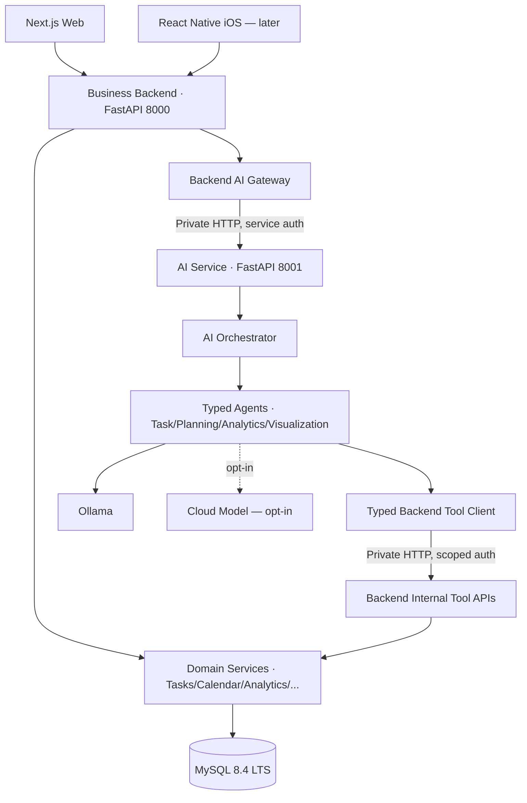

# Personal Productivity App — AI Technical Specification (Independent Service + Hybrid)

> **Tên tài liệu:** AI Service Architecture, Framework & Implementation Standards  
> **Dự án:** Personal Productivity & Time Management App  
> **Phiên bản:** **2.0.0 — Independent AI Service / Hybrid Architecture**  
> **Ngày cập nhật:** 17/11/2026  
> **Trạng thái:** Technical specification — **thiết kế, chưa triển khai production**  
> **Đối tượng:** Developer, reviewer, Codex / Claude Code / AI coding assistants  
> **Tài liệu liên quan:** Frontend Specification v1.0; Backend Hybrid Specification v2.0; Database Architecture v1.0  
> **Thay thế:** AI Technical Specification v1.0 (AI module nằm trong backend)

---

## 0. Executive Summary & Architecture Decisions

### 0.1. Quyết định cuối cùng

**AI là một service chạy độc lập, không phải `app/modules/ai/` trong Backend.** Hệ thống gồm ít nhất ba ứng dụng triển khai độc lập: Next.js frontend, FastAPI business backend và FastAPI AI service. AI service có Dockerfile, `pyproject.toml`, `uv.lock`, API, tests, logs và vòng đời deployment riêng. Dùng **Hybrid Architecture (feature-first, layered-inside)** ở cả Backend và AI Service.

```text
Next.js / iOS ─HTTPS─► Backend (FastAPI, 8000)
                            ├─► MySQL 8.4 LTS (thông qua repository)
                            └─► AI Gateway ─private HTTP─► AI Service (FastAPI, 8001)
                                                        ├─► Ollama local
                                                        ├─► Cloud LLM (opt-in)
                                                        └─► Typed Tool Client
                                                                │
                                                                └─private HTTP─► Backend Internal APIs
                                                                                   └─► Domain Services → MySQL
```

**AI Service không truy cập trực tiếp MySQL.** Không có đường gọi: Frontend → AI Service trực tiếp; AI Service → MySQL nghiệp vụ; LLM → SQL/JS/shell. AI service chỉ yêu cầu dữ liệu thông qua internal APIs có authentication + authorization và chỉ trả **draft / insight / chart spec / action proposal**; các thay đổi dữ liệu được thực thi tại Backend sau xác nhận của người dùng.

### 0.2. Technology baseline

| Nhóm | Quyết định | Ghi chú |
|---|---|---|
| AI Service Runtime | **Python 3.14** | Dùng `requires-python = ">=3.14,<3.15"` khi bắt đầu; test trước nâng minor |
| Service HTTP | **FastAPI + Uvicorn** | Process độc lập, private/internal API |
| Architecture | **Hybrid — Feature First + Layers** | `modules/<domain>/{api,services,agents,tools,schemas,...}` tùy nhu cầu |
| Agent Framework | **Pydantic AI** | Typed tools, model/provider abstraction, structured outputs |
| Validation / Settings | **Pydantic v2 + pydantic-settings** | Strict DTOs, settings validation |
| Local inference | **Ollama** | Chạy tách process/container, benchmark model trước |
| Cloud inference | Provider tùy chọn | Chỉ dùng khi chủ app opt-in và config cho phép |
| API ↔ AI | **HTTPX + REST + JSON/OpenAPI** | HTTP private, service auth, trace ID |
| AI ↔ Backend tools | **Internal Backend APIs** | Không import ORM/DB của Backend; không kết nối MySQL |
| Business data | **MySQL 8.4 LTS / InnoDB** | **Chỉ Backend sở hữu truy cập database** |
| AI chart output | **Typed `ChartSpec` / `DashboardSpec`** | Next.js Recharts/shadcn Charts render |
| Analytics correctness | **Backend Metrics Registry + Query Services** | AI diễn giải, không tự đặt số liệu |
| Planning | **Python rules + optional solver** | Backend kiểm lại constraints trước khi áp dụng |
| Testing / Evals | **pytest + HTTPX + Pydantic Evals** | Contract tests giữa hai service |
| Tooling | **uv, Ruff, Pyright, Docker Compose** | File lock riêng cho AI service |
| Observability | **Structured logs, trace IDs, optional OpenTelemetry** | Không log prompt riêng tư mặc định |

**Compatibility gate:** chỉ khóa các phiên bản thư viện sau khi `uv lock`, import check và test suite chạy thật trên Python 3.14. Không khẳng định model/provider nào hỗ trợ mọi chế độ structured output nếu chưa benchmark.

### 0.3. Nguyên tắc kiến trúc

1. **Backend là single source of truth** cho task, occurrence, calendar, time entries, goals, habits, reminders, analytics metrics và lưu/áp dụng proposal.
2. **AI là decision-support service**, không phải service CRUD nghiệp vụ hoặc đường vòng truy cập MySQL.
3. **Independent deployment:** dừng/nâng cấp AI không được làm hỏng tạo task thủ công hay xem lịch trên web/iOS.
4. **Typed boundaries:** mọi request/response Backend ↔ AI, AI ↔ tools có OpenAPI/Pydantic và contract tests.
5. **Human-in-control:** thay đổi dữ liệu phải preview → confirm tại Backend → revalidate → transaction → audit.
6. **Privacy-first:** local model mặc định, cloud fallback tắt trừ khi người dùng chủ động bật.
7. **UI:** Intelligent Minimalism, Soft Blue + pastel accents, ít icon, ít thông tin, kết quả dạng cấu trúc thay vì chat dài.
8. **No overengineering:** chưa triển khai service mesh, Kafka, Redis, Qdrant, Celery, Kubernetes chỉ để phục vụ một user.

### 0.4. Out of scope trong v2.0

- Không thiết kế ERD chi tiết hoặc migration cho các bảng nghiệp vụ.
- Không chọn model Ollama cụ thể khi chưa có benchmark CPU/RAM/VRAM và chất lượng tiếng Việt.
- Không đưa trực tiếp AI Service lên public Internet; không cấp credential MySQL nghiệp vụ cho nó.
- Không tự động thực thi action, xử lý email, voice, web-browsing hoặc RAG ngoài các use case đã duyệt.

---

## 1. Product Scope — AI cần giải quyết điều gì?

### 1.1. Ba câu hỏi cốt lõi

- **Planning:** Hôm nay/tuần này nên làm gì, khi nào, theo thứ tự nào?
- **Tracking:** Thời gian thực tế đã dành cho việc nào, khác kế hoạch bao nhiêu?
- **Improvement:** Những xu hướng nào được dữ liệu xác nhận và hành động cải thiện nào phù hợp?

### 1.2. Nhóm năng lực và độ ưu tiên

| Nhóm | Tính năng | Ưu tiên | Đầu ra chính |
|---|---|---|---|
| Task Intelligence | Smart Task Creation | P0 | `TaskDraft` để xác nhận |
| Data Q&A | Natural Language Search | P0 | Text ngắn + dữ liệu có nguồn |
| Visualization | AI Chart Generator | P0 | `ChartSpec` an toàn |
| Analytics | Chart Interpretation & Comparison | P0 | Insight kèm metric |
| Planning | Daily Planner | P0/P1 | `ScheduleProposal` |
| Planning | Smart Rescheduling | P1 | `ActionProposal` |
| Productivity | Task Breakdown | P1 | Subtask draft |
| Visualization | AI Dashboard Builder | P1 | `DashboardSpec` |
| Productivity | Weekly / Monthly Review | P1 | Summary + charts |
| Productivity | Smart Prioritization | P1 | Suggested ranking |
| Quality | AI Data Quality Auditor | P1 | Cảnh báo dữ liệu bất thường |
| Goal & Habits | Goal Feasibility / Habit Insights | P1/P2 | Đánh giá có căn cứ |
| Simulation | What-if Planning | P2 | Các kịch bản tính toán |
| Prediction | Duration/Completion Forecasting | P2/P3 | Dự báo có khoảng bất định |
| Personalization | User Preferences / AI Memory | P2 | Tùy chọn được duyệt |
| Interaction | Voice Task Input | P3 | Speech → text → draft |
| Automation | Multi-step AI Action Assistant | P3 | Đề xuất chuỗi hành động |

**P0** = MVP; **P1** = mở rộng giá trị thực; **P2/P3** = chỉ làm khi có đủ dữ liệu, nhu cầu và ngân sách.

### 1.3. Những việc AI không nên làm

- Không “suy luận” tổng giờ bằng cách cộng số liệu chưa được trả về.
- Không coi task *được lên lịch* là đã hoàn thành/đã hoạt động.
- Không tự thay đổi recurrence rule hoặc lịch sử đã Done.
- Không gắn nhãn nguyên nhân trì hoãn khi dữ liệu chỉ thể hiện sự tương quan.
- Không đề xuất biểu đồ chỉ để trang trí dashboard.

---

## 2. System Architecture & Trust Boundaries

### 2.1. End-to-end architecture



**Mỗi đường mũi tên là ranh giới giao tiếp hoặc phụ thuộc, không phải mọi request đều đi qua tất cả component.** Ví dụ, tạo task bằng tay chỉ đi Frontend → Backend → MySQL; không gọi AI.

### 2.2. Quyền sở hữu của từng service

| Capability | Frontend | Backend | AI Service |
|---|---|---|---|
| User login/session | UI | **Owner** | Không xác thực người dùng trực tiếp |
| Tasks, occurrences, recurrence | UI | **Owner** | Parse / đề xuất |
| Time tracking, reminders | UI | **Owner** | Gợi ý nếu được phép |
| MySQL, migration, constraints | Không | **Owner** | **Không có DB credentials** |
| Metrics, SQL aggregation | Render | **Owner** | Query có kiểm soát + diễn giải |
| Conversation state | UI | Owner nếu lưu bền | Context tạm thời trong request |
| Action proposal status | UI | **Owner** | Sinh proposal candidate |
| LLM prompts/providers | Không | Không | **Owner** |
| Agent/tool execution | Không | Chính sách tool | **Owner điều phối**, không có quyền vượt scope |
| Chart display | **Recharts** | Validate/publish data ref | Sinh typed chart config |
| Authorization | Không tin UI | **Enforce mỗi truy vấn/ghi** | Enforce service scope, không thay Backend authz |

### 2.3. Các API boundaries

**A. Public boundary**: Web/iOS → Backend `https://api.example/...` với cơ chế auth chuẩn. Frontend không giữ khóa model hay service credential.

**B. AI invocation boundary**: Backend `ai_gateway` → AI Service `/internal/v1/...` qua private Docker network/VPN. Auth bằng service token ngắn hạn (khuyến nghị JWT có `iss`, `aud=ai-service`, scopes, expiry) hoặc HMAC được xoay vòng; không tin headers không ký từ client.

**C. AI tool boundary**: AI service → Backend `/internal/v1/ai-tools/...` qua typed client. Service token ràng buộc actor + scopes + correlation ID; Backend quyết định quyền đọc/ghi trên dữ liệu. AI tool **chỉ được gọi endpoints trong allowlist**, không nhận arbitrary URL, hostname, SQL hoặc script từ model.

**D. Model boundary**: AI → Ollama / Cloud. Provider không được quyền gọi Backend internal APIs; chỉ Agent/tool runner được cấp quyền và có giới hạn.

### 2.4. Tránh vòng lặp Backend ↔ AI

- Backend request tới AI có deadline và `request_id`.
- Khi cần dữ liệu, AI gọi **tool endpoints riêng** của Backend; các endpoint này chỉ gọi domain/query service, **tuyệt đối không gọi ngược `ai_gateway`**.
- `max_tool_calls`, response payload size, cursor pagination, max range và timeout bảo vệ vòng lặp/tốn chi phí.
- Áp dụng circuit breaker hoặc fail-fast theo nhu cầu; không retry vô hạn hoặc tự fallback cloud.

### 2.5. Data minimization & session identity

Backend lấy user identity từ session/token đã xác thực. Khi gọi AI, gửi `actor_context` tối thiểu và token scope. Không tin `user_id` trong prompt; user IDs trong tool args chỉ là filters cần Backend xác minh. Dữ liệu Analytics nên trả aggregates, không trả cả lịch 1 năm nếu yêu cầu 7 ngày.

### 2.6. Nonfunctional requirements

- Web và task CRUD không phụ thuộc AI availability.
- Tất cả network call có timeout, retry hữu hạn và trace ID.
- Read-only operations có thể retry theo chính sách; write action có idempotency.
- Internal API không public port và không sử dụng cookie user từ Frontend làm service credential.
- Nếu AI unavailable: Backend trả lỗi AI có thể hiểu được; trải nghiệm manual vẫn dùng bình thường.

---

## 3. AI Technology Stack & Dependency Policy

### 3.1. Runtime packages

| Nhóm | Công nghệ / package | Tính bắt buộc |
|---|---|---|
| Python | **3.14**, `>=3.14,<3.15` | Required |
| HTTP | `fastapi`, `uvicorn[standard]` | Required |
| Pydantic Agent | `pydantic-ai-slim[openai]` | Required cho transport OpenAI-compatible (kiểm tra phiên bản dùng thực tế) |
| Typed schema | `pydantic>=2`, `pydantic-settings` | Required |
| Backend tool client | `httpx` | Required |
| Configuration | `pydantic-settings`, environment variables | Required |
| Logging | Python logging / structured JSON logging | Required |
| Testing | `pytest`, `pytest-asyncio`, `httpx` | Dev |
| AI evaluation | `pydantic-evals` | Dev / CI |
| Lint/format/type | `ruff`, `pyright` | Dev / CI |
| Local model runtime | Ollama | Optional infrastructure |
| Cloud provider SDK | Extra `pydantic-ai-slim[google]` hoặc adapter tùy chọn | Optional |
| Analytics post-process | Standard library; `numpy`/`pandas` khi cần | Optional |
| Constraint solver | OR-Tools khi deterministic greedy không đủ | Optional |
| Telemetry | OpenTelemetry instrumentation | Optional |

**Không cài trong AI Service:** `sqlalchemy`, `asyncmy`, Alembic, MySQL client cho mục đích truy vấn database nghiệp vụ. Những package đó chỉ nằm trong Backend. Nếu về sau cần persistence chuyên biệt, phải có ADR riêng; mặc định conversation/proposal persistence do Backend quản lý.

### 3.2. Vì sao Pydantic AI?

- Typed tool arguments và structured outputs, phù hợp với Pydantic v2 ở hai service.
- Agent framework không buộc dùng LangChain hay graph orchestration phức tạp.
- Hỗ trợ provider abstraction, local/cloud selection bằng settings.
- Dễ unit test/mock model, đo schema validity, tool choice và structured eval.
- Không đồng nghĩa agent được phép tự chủ vô hạn: mọi tool vẫn có allowlist, timeout và chi phí.

### 3.3. Runtime version policy

```toml
# ai-service/pyproject.toml — illustrative extract
[project]
name = "personal-productivity-ai-service"
version = "0.1.0"
requires-python = ">=3.14,<3.15"
```

`uv.lock` của **AI Service độc lập** với backend (`backend/uv.lock`), giúp nâng AI SDK mà không ảnh hưởng SQLAlchemy. Chỉ nâng khi CI, contract tests và golden evals đạt ngưỡng. Không pin bừa package version trong tài liệu; dùng resolver kiểm tra khả năng cài trên Ubuntu/Python 3.14.

### 3.4. Provider modes

| Mode | Hành vi | Dữ liệu cá nhân |
|---|---|---|
| `local` | Chỉ Ollama local | Không gửi lên cloud |
| `cloud` | Dùng provider đã cấu hình và người dùng đã cho phép | Tuân thủ data policy của provider |
| `auto` | Local trước, cloud fallback **chỉ khi opt-in** | Không fallback ngầm |

AI service không phơi public Ollama, không gửi API key xuống client; model cụ thể phải chọn qua benchmark tiếng Việt, tool calling, structured output, P95 latency và RAM/VRAM.

### 3.5. Tính toán và trực quan hóa

- **Metric & data aggregation:** SQL/Backend Query Services.
- **LLM:** chọn intent, format chart spec, diễn giải kết quả có căn cứ.
- **AI Service pure-Python engines:** validation, chart suitability, scheduling heuristic, consistency checks; không sở hữu bảng nguồn.
- **Frontend:** Recharts + shadcn Charts hiển thị; không thực thi code model sinh ra.

---

## 4. Hybrid Architecture — Canonical Repository Structure

### 4.1. Monorepo, tách process/container

```text
personal-productivity/
├── frontend/                            # Next.js 16 + TypeScript
│   ├── src/
│   └── package.json
├── backend/                             # Business FastAPI, Hybrid
│   ├── app/
│   │   ├── api/
│   │   ├── core/
│   │   ├── db/
│   │   └── modules/
│   │       ├── auth/
│   │       ├── tasks/
│   │       ├── calendar/
│   │       ├── time_tracking/
│   │       ├── analytics/
│   │       ├── reminders/
│   │       └── ai_gateway/             # HTTP client/gateway; NO agents/models
│   ├── tests/
│   ├── alembic/
│   ├── pyproject.toml
│   ├── uv.lock
│   └── Dockerfile
├── ai-service/                          # Independent AI process; Hybrid
│   ├── app/
│   │   ├── main.py
│   │   ├── api/
│   │   │   ├── router.py              # Đăng ký router nội bộ
│   │   │   └── dependencies.py
│   │   ├── core/
│   │   │   ├── config.py
│   │   │   ├── security.py
│   │   │   ├── exceptions.py
│   │   │   ├── logging.py
│   │   │   └── limits.py
│   │   ├── shared/
│   │   │   ├── providers/
│   │   │   │   ├── model_factory.py
│   │   │   │   ├── model_router.py
│   │   │   │   └── provider_settings.py
│   │   │   ├── clients/
│   │   │   │   ├── backend_client.py    # Typed authenticated HTTPX
│   │   │   │   └── backend_auth.py
│   │   │   ├── contracts/
│   │   │   │   ├── envelopes.py
│   │   │   │   ├── actor_context.py
│   │   │   │   └── provenance.py
│   │   │   ├── observability/
│   │   │   └── policies/
│   │   │       ├── tool_policy.py
│   │   │       ├── privacy_policy.py
│   │   │       └── output_policy.py
│   │   ├── modules/                    # FEATURE FIRST; LAYERS INSIDE
│   │   │   ├── assistant/
│   │   │   │   ├── api/
│   │   │   │   │   └── assistant_controller.py
│   │   │   │   ├── services/
│   │   │   │   │   ├── assistant_orchestrator.py
│   │   │   │   │   └── context_service.py
│   │   │   │   ├── agents/
│   │   │   │   │   └── assistant_agent.py
│   │   │   │   ├── schemas/
│   │   │   │   │   ├── requests.py
│   │   │   │   │   └── responses.py
│   │   │   │   └── prompts/
│   │   │   │       └── assistant_instructions.py
│   │   │   ├── task_intelligence/
│   │   │   │   ├── api/
│   │   │   │   │   └── task_ai_controller.py
│   │   │   │   ├── services/
│   │   │   │   │   └── task_intelligence_service.py
│   │   │   │   ├── agents/
│   │   │   │   │   └── task_agent.py
│   │   │   │   ├── tools/
│   │   │   │   │   └── task_lookup_tool.py
│   │   │   │   ├── schemas/
│   │   │   │   │   ├── task_draft.py
│   │   │   │   │   └── requests.py
│   │   │   │   ├── prompts/
│   │   │   │   └── validators/
│   │   │   ├── planning/
│   │   │   │   ├── api/
│   │   │   │   │   └── planning_controller.py
│   │   │   │   ├── services/
│   │   │   │   │   └── planning_service.py
│   │   │   │   ├── agents/
│   │   │   │   │   └── planning_agent.py
│   │   │   │   ├── tools/
│   │   │   │   │   └── availability_tool.py
│   │   │   │   ├── engines/
│   │   │   │   │   └── deterministic_scheduler.py
│   │   │   │   ├── schemas/
│   │   │   │   │   └── schedule_proposal.py
│   │   │   │   └── validators/
│   │   │   ├── analytics/
│   │   │   │   ├── api/
│   │   │   │   │   └── analytics_ai_controller.py
│   │   │   │   ├── services/
│   │   │   │   │   └── insight_service.py
│   │   │   │   ├── agents/
│   │   │   │   │   └── analytics_agent.py
│   │   │   │   ├── tools/
│   │   │   │   │   └── metric_query_tool.py
│   │   │   │   ├── schemas/
│   │   │   │   │   ├── analytics_query.py
│   │   │   │   │   └── grounded_insight.py
│   │   │   │   └── validators/
│   │   │   └── visualization/
│   │   │       ├── api/
│   │   │       │   └── visualization_controller.py
│   │   │       ├── services/
│   │   │       │   ├── chart_service.py
│   │   │       │   └── dashboard_service.py
│   │   │       ├── agents/
│   │   │       │   └── visualization_agent.py
│   │   │       ├── tools/
│   │   │       │   └── dataset_tool.py
│   │   │       ├── schemas/
│   │   │       │   ├── chart_spec.py
│   │   │       │   └── dashboard_spec.py
│   │   │       ├── mappers/
│   │   │       │   └── chart_response_mapper.py
│   │   │       └── validators/
│   │   └── health/
│   │       ├── readiness.py
│   │       └── liveness.py
│   ├── tests/
│   │   ├── unit/
│   │   ├── integration/
│   │   ├── contract/
│   │   ├── security/
│   │   └── evals/
│   ├── pyproject.toml
│   ├── uv.lock
│   ├── Dockerfile
│   ├── .dockerignore
│   └── .env.example
├── contracts/
│   ├── backend-ai-openapi.yaml
│   └── shared-json-schemas/
├── infra/
│   ├── docker-compose.yml
│   ├── mysql/
│   └── ollama/
└── docs/
```

**Cây thư mục trên là reference architecture, không yêu cầu tạo tất cả file rỗng.** Chỉ tạo layer khi tính năng thực sự cần. `shared/` chỉ chứa năng lực dùng chung, **không chứa business logic của một feature**.

### 4.2. Feature ownership

| AI Module | Sở hữu | Không sở hữu |
|---|---|---|
| `assistant` | Intent routing, conversation orchestration, response selection | Task CRUD, analytics computation |
| `task_intelligence` | Parse ngôn ngữ tự nhiên, draft, breakdown | Task entity, recurrence generation, INSERT |
| `planning` | Time-block proposal, feasibility heuristic, scenario explanation | Calendar actual state, update task occurrence |
| `analytics` | NL query parsing, insights based on returned metrics | MySQL, metric formula/source |
| `visualization` | ChartSpec/DashboardSpec và lựa chọn chart | Recharts renderer, raw SQL, source values |
| `shared/clients` | Typed Backend internal API transport | Ownership/permission decisions cuối cùng |
| `shared/providers` | Model configuration, fallback/limits | Feature-specific prompts/tools |

### 4.3. Layer responsibilities

| Layer | Vai trò | Không được làm |
|---|---|---|
| `api/` | HTTP routes, validate input, call service | Prompt engineering, gọi MySQL |
| `services/` | Điều phối workflow use case, timeout/validation | Tự thực thi SQL hoặc sửa business rules |
| `agents/` | Pydantic AI agent, tool selection, structured result | Ghi dữ liệu; cầm database secret |
| `tools/` | Adapters tới typed Backend tool APIs | Fetch URL tùy ý; raw SQL; bypass auth |
| `engines/` | Deterministic algorithms/constraint checks | Đọc DB trực tiếp |
| `schemas/` | DTOs, enums, strict contracts | I/O hoặc side effects |
| `validators/` | Business-independent checks, chart spec validation | Thay domain validation của Backend |
| `mappers/` | Convert typed outputs thành response DTO | Truy cập DB/LLM |
| `prompts/` | Instruction templates, versioning | Cấu hình auth/permissions |
| `shared/` | Cross-cutting infra, reusable clients, provider factory | Trở thành chỗ chứa mọi logic |

### 4.4. Dependency direction

```text
AI Controller
   ↓
AI Feature Service
   ├──► Agent ──► Model Router ──► Ollama / Cloud
   ├──► Typed Tool ──► BackendClient ──► Backend Internal API ──► Domain Service → DB
   ├──► Pure Python Engine
   └──► Mapper → Response DTO
```

Không import `backend.app.modules.*` trong `ai-service`; hai app giao tiếp **qua network contract**, không dùng Python object nội bộ của nhau.

### 4.5. Quy tắc AI coding

- **Không có `ai-service/app/db/` cho MySQL nghiệp vụ, không có `DATABASE_URL` trong AI `.env.example`.**
- Không copy SQLAlchemy models từ Backend sang AI. DTO phục vụ API chỉ phản ánh dữ liệu cần thiết.
- Controller không xử lý LLM calls trực tiếp; agent không quyết định quyền user.
- Tool chỉ gọi Backend internal routes đã định nghĩa, phải có token + timeout.
- Không gửi payload chứa secrets/credentials/cookie sang LLM.
- CI fail nếu import từ backend source vào ai-service hoặc phát sinh dependency MySQL client không được duyệt.
- Backend `ai_gateway` chỉ làm proxy/validation/error mapping, không triển khai agents.

---

## 5. Functional Design — AI Task Intelligence

### 5.1. Smart Task Creation

**Input ví dụ:** “Thứ hai, tư, sáu học tiếng Anh 90 phút, bắt đầu 20h, nhắc trước 15 phút.”

**Extraction fields** (không ép trường thiếu thành giá trị giả):

- `title`: tiêu đề, không tự thêm nội dung không có cơ sở;
- `description`: ghi chú tùy chọn;
- `start_at_local`: thời gian nếu xác định đủ;
- `scheduled_date` / `recurrence`: phân biệt một lần và lịch lặp;
- `estimated_minutes`, `priority`, `category`, `project`;
- `reminder_offset_minutes`;
- `missing_fields` và `ambiguities`;
- `evidence_spans`: đoạn lời người dùng làm bằng chứng khi cần debug.

**Rules:**

1. “Tối mai” chỉ xác định ngày; **không tự suy luận 20:00** nếu chưa được cấu hình là default được người dùng chấp nhận.
2. “Mỗi thứ hai” không đồng nghĩa *task đã hoàn thành* mỗi thứ hai.
3. Tạo recurrence rule và occurrences theo nghiệp vụ của Task Service thuộc Backend (sau bước xác nhận); AI không tự sinh hàng loạt record.
4. Preview trước khi ghi; khi cần hỏi lại thì chỉ hỏi thông tin bắt buộc còn thiếu.
5. Timezone hiển thị theo user settings; timestamps API chuẩn hóa.

### 5.2. Task Breakdown

- Input: mục tiêu lớn, deadline, mức độ chi tiết.
- Output: danh sách bước có tên, thời lượng *ước tính*, thứ tự và quan hệ phụ thuộc dạng **đề xuất**.
- Không tự khẳng định các bước là bắt buộc nếu thiếu ngữ cảnh.
- Không tự tạo hàng chục tasks nếu chưa được xác nhận.

### 5.3. Smart Prioritization

Dùng quy tắc deterministic tính ưu tiên từ deadline, priority hiện có, phụ thuộc và thời lượng còn lại; LLM có thể diễn giải lý do. Không thay priority gốc chỉ vì model nói “urgent”.

---

## 6. Functional Design — AI Natural Language Search

### 6.1. Câu hỏi hỗ trợ

- “Tối nay còn việc gì?”
- “Tháng này tổng thời gian học tiếng Anh bao nhiêu giờ?”
- “Tuần trước task nào bị hoãn nhiều lần?”
- “Tổng thời gian làm dự án X so với dự án Y?”
- “Hôm qua tao đã hoàn thành bao nhiêu task occurrence?”

### 6.2. Query contract

LLM sinh **typed query intent** thuộc tập được hỗ trợ:

```json
{
  "intent": "GET_TIME_ALLOCATION",
  "time_range": {
    "preset": "LAST_30_DAYS",
    "timezone": "Asia/Ho_Chi_Minh"
  },
  "filters": { "category_ids": [], "project_ids": [] },
  "group_by": "DAY",
  "unit": "MINUTES"
}
```

Backend `AnalyticsService` (qua internal API có kiểm soát) xác thực `group_by`, filters, metric, khoảng thời gian và quyền truy cập, rồi tự tạo SQL an toàn qua SQLAlchemy. **LLM không được sinh raw SQL rồi execute.**

### 6.3. Grounded answer

Kết quả trả kèm metric keys, time range, filters, sample size, `computed_at` và trạng thái chất lượng dữ liệu. Không được nói “không hoạt động” khi ngày đó chỉ là *không có dữ liệu*.

---

## 7. Functional Design — AI Planning & Rescheduling

### 7.1. AI Daily Planner

**Inputs:** Task occurrences chưa hoàn thành, deadline, estimated duration, time windows, calendar busy intervals, preferences được duyệt, timezone.

**Outputs:** Danh sách time blocks được đề xuất, xung đột, task không thể xếp, những giả định cần xác nhận.

**Hard constraints** — không được vi phạm:

- Khoảng giờ bận đã được khóa.
- Không cho hai task cùng chiếm một nguồn thời gian nếu không cho phép overlap.
- Không đè lên lịch sử đã hoàn thành.
- Giữ deadline cố định; nếu không thể đáp ứng thì báo không khả thi.
- Không tạo giờ bắt đầu/kết thúc sai timezone hoặc duration âm.

**Soft preferences:** ưu tiên việc gấp, gom task tương tự, thời lượng nghỉ, sở thích buổi sáng/tối đã được người dùng cấu hình.

### 7.2. Solver strategy

1. MVP: deterministic greedy scheduling (sort theo deadline/priority, fit vào free slots).
2. Đánh giá bằng test set: conflict rate, deadline violations, unscheduled tasks.
3. Chỉ thêm OR-Tools nếu cần giải nhiều ràng buộc hoặc chất lượng greedy chưa đủ.
4. LLM có thể đề xuất nguyên tắc xếp lịch, nhưng solver quyết định tính hợp lệ.

### 7.3. Smart Rescheduling

- Không tự dời task quá hạn sang ngày mai nếu ngày mai không đủ chỗ.
- Cho phép `keep`, `reschedule`, `skip`, `split` là **proposals**; `skip/cancel` phải được xác nhận rõ.
- Backend phải kiểm tra lại khi áp dụng: version hoặc `updated_at` để tránh ghi đè lịch đã thay đổi sau lúc preview.
- Idempotency key ngăn thực thi lặp do double click/retry.

### 7.4. What-if Simulation

Ví dụ: “Nếu mỗi ngày dành 90 phút cho IELTS, khi nào đủ 200 giờ?”. Phần tính toán chạy bằng công thức/solver, AI giải thích giả định và kết quả; **không lưu các task mới** nếu chỉ đang mô phỏng.

---

## 8. Functional Design — AI Analytics Engine

### 8.1. Nguyên tắc bất biến

- **Planned ≠ Actual:** scheduled duration không phải recorded active time.
- **Definition ≠ Occurrence:** task lặp có nhiều occurrence, completion thuộc occurrence.
- **No double counting:** khi task completion và time entry cùng xuất hiện, không tự cộng hai nguồn thành giờ hoạt động.
- **Missing ≠ Zero:** không có dữ liệu không đồng nghĩa xác nhận không làm việc.
- **Time boundaries:** nhóm theo ngày trong timezone người dùng; dữ liệu lưu UTC.
- **Explainability:** insight phải tham chiếu metric và phạm vi đã tính.

### 8.2. Metric Registry (không cho AI tùy ý đặt công thức)

| Metric key | Ý nghĩa | Nguồn dữ liệu |
|---|---|---|
| `completed_occurrences` | Số lần thực hiện đã DONE | Task occurrences |
| `completion_rate` | Tỷ lệ hoàn thành theo denominator đã định nghĩa | Occurrences |
| `active_minutes` | Tổng thời gian hoạt động hợp lệ, xử lý overlap | Time entries |
| `estimated_minutes` | Tổng thời gian dự kiến | Task/Occurrence |
| `planned_actual_variance_minutes` | Chênh lệch thực tế - kế hoạch | Scheduled + time entries |
| `overdue_count` | Số occurrence quá hạn chưa hoàn thành | Occurrences |
| `focus_sessions` | Số phiên tập trung | Time entries |
| `habit_consistency` | Tỷ lệ check-in theo quy tắc đã chốt | Habit logs (future) |
| `goal_progress` | Tiến độ theo đơn vị từng goal | Goals (future) |

**Bắt buộc:** Mỗi metric có `definition`, `Backend SQL/service implementation`, `timezone policy`, `inclusion/exclusion`, `unit`, `tests` và `data_quality_notes`. Công thức chi tiết cần chốt ở tài liệu Analytics/DB domain; AI không tự đổi định nghĩa.

### 8.3. Insight generation

**Pipeline:** định nghĩa câu hỏi → fetch metrics → kiểm tra chất lượng dữ liệu → rule/statistical analysis → LLM diễn giải ngắn → validate claims against metrics → trả lời.

Không dùng lời lẽ nhân quả khi chỉ có tương quan. Với tập dữ liệu nhỏ, dùng ngôn ngữ “dữ liệu ghi nhận”, “có xu hướng”, “chưa đủ bằng chứng”.

---

## 9. AI Chart Generator — Safe Visualization Architecture

### 9.1. Mục tiêu

Biến yêu cầu tự nhiên như “Vẽ biểu đồ so sánh thời gian học từng ngày trong 30 ngày” thành **ChartSpec** để frontend vẽ bằng Recharts; hỗ trợ line, bar, stacked bar, area, donut/pie, scatter, calendar heatmap và progress.

### 9.2. Chuỗi xử lý

```text
Natural-language prompt
  → Intent + metric identification
  → Validated AnalyticsQuery
  → Authenticated Backend internal Analytics API (read-only)
  → Backend-computed Dataset + metadata
  → ChartSpec selection/validation
  → Frontend Recharts renderer
  → Optional AI explanation grounded in dataset
```

### 9.3. Contract đề xuất

```json
{
  "type": "chart",
  "schema_version": "1.0",
  "title": "Study time — Last 30 days",
  "visualization": {
    "kind": "line",
    "x_field": "date",
    "series": [
      { "field": "active_minutes", "label": "Actual study time" }
    ],
    "unit": "minutes"
  },
  "query": {
    "metric": "active_minutes",
    "range": "LAST_30_DAYS",
    "group_by": "DAY",
    "filters": { "category_ids": [] }
  },
  "data_ref": "dataset_opaque_id",
  "insight": null
}
```

**`data_ref` là ID opaque do Backend cấp sau khi query**, không phải URL tùy ý hay SQL do LLM đặt. Endpoint dữ liệu phải kiểm tra ownership và TTL. Có thể trả dataset inline nếu nhỏ để giảm số HTTP requests; cả hai phương án phải theo cùng contract.

### 9.4. Security allowlists

- Enum `ChartKind`: `line`, `bar`, `stacked_bar`, `area`, `donut`, `scatter`, `heatmap`, `progress`.
- Enum `Metric`: chỉ các metric trong registry.
- Enum `GroupBy`: `DAY`, `WEEK`, `MONTH`, `PROJECT`, `CATEGORY` và các nhóm được triển khai.
- Giới hạn khoảng thời gian, số series, số điểm dữ liệu và kích thước response.
- Reject `javascript:`, HTML, JS expressions, raw SQL, custom render functions, arbitrary CSS và remote image URLs.
- Tooltip và axis formatter là các **component do frontend sở hữu**.
- Không dùng prompt trực tiếp để chọn bảng MySQL hoặc cấu trúc query.

### 9.5. Chart correctness

- Line/area dùng dữ liệu có thứ tự thời gian rõ ràng.
- Donut chỉ dùng khi các phần có cùng mẫu số / tổng có ý nghĩa.
- Heatmap phải phân biệt missing/zero, có legend, unit và timezone.
- Trường hợp có ít hơn 2 điểm dữ liệu: cân nhắc số liệu tóm tắt thay vì line chart.
- Nếu dữ liệu không đủ, trả `insufficient_data` và gợi ý khoảng thời gian khác thay vì chart giả.

---

## 10. AI Dashboard Builder

### 10.1. Khái niệm

Người dùng nói: “Tạo dashboard theo dõi IELTS gồm giờ học mỗi tuần, số buổi học, tiến độ 200 giờ, tỷ lệ hoàn thành.” AI sinh **DashboardSpec** đã được validate; FE render từ tập widget có sẵn.

### 10.2. Ví dụ `DashboardSpec` (rút gọn)

```json
{
  "schema_version": "1.0",
  "name": "IELTS Overview",
  "layout": "responsive_grid",
  "widgets": [
    {
      "id": "hours_kpi",
      "kind": "metric_card",
      "metric": "active_minutes",
      "filters": { "project_id": "project_uuid_placeholder" },
      "range": "THIS_MONTH"
    },
    {
      "id": "weekly_trend",
      "kind": "chart",
      "chart_kind": "bar",
      "metric": "active_minutes",
      "group_by": "WEEK",
      "range": "LAST_12_WEEKS"
    }
  ]
}
```

`project_uuid_placeholder` là ký hiệu minh họa, **không phải giá trị có thể ghi vào database**.

### 10.3. Widget policy

- Widget types tối thiểu: metric card, chart, progress, short insight, task list (read-only).
- Việc lưu dashboard do Backend xác nhận/thực thi; mỗi widget có schema version, ID, metric/filter hợp lệ.
- Khi mở lại dashboard, Backend **tính lại dữ liệu**, không dùng số liệu do LLM từng viết.
- Trên mobile tối đa ưu tiên 1–2 thông tin quan trọng mỗi vùng; không nhét 8 biểu đồ vào màn hình Today.
- Tối đa một số lượng widget được định cấu hình cho MVP (ví dụ 8), điều chỉnh theo performance.

---

## 11. AI Action & Confirmation Architecture

### 11.1. Action classification

| Loại | Ví dụ | Chính sách |
|---|---|---|
| Read-only | Liệt kê task, thống kê | Cho phép sau authentication |
| Draft-only | Tạo task draft, lịch đề xuất | Không ghi domain data |
| Confirmed write | Tạo task, đổi giờ, cập nhật reminder | Bắt buộc confirm |
| Destructive | Xóa/hủy hàng loạt, sửa recurrence ảnh hưởng lịch | Confirm nổi bật + impact preview |
| Unsupported | Chạy SQL/JS/shell, quyền admin | Từ chối |

### 11.2. ActionProposal lifecycle

`DRAFT → VALIDATED → AWAITING_CONFIRMATION → EXECUTED` hoặc `REJECTED / EXPIRED / FAILED`.

Trường bắt buộc: `proposal_id`, `owner_id`, `action_type`, `target_ids`, `changes`, `impact_summary`, `preconditions`, `expires_at`, `idempotency_key`, `status`.

### 11.3. Revalidation khi confirm

- Backend authenticated owner phải khớp chủ sở hữu proposal.
- Kiểm tra proposal chưa hết hạn/chưa dùng lại.
- Kiểm tra các target còn tồn tại và version/status chưa thay đổi bất tương thích.
- Re-run domain constraints/transaction trong service; không tin việc đã validate ở bước draft.
- Backend thực hiện đúng **một lần** theo idempotency key.
- Trả summary và audit ID; không “báo thành công” trước khi commit.

> **Service boundary:** AI chỉ tạo `ActionProposalCandidate`. Backend cấp `proposal_id`, lưu lifecycle state, giải quyết optimistic lock, idempotency và transaction. Khi confirm, frontend **chỉ gọi Backend**, không gọi AI Service.

---

## 12. API Design — Public Backend, AI Internal, Backend Tool Internal

### 12.1. Ba nhóm endpoint, tuyệt đối không lẫn

| Boundary | Route ví dụ | Người gọi | Quyền |
|---|---|---|---|
| **Public Backend** | `POST /api/v1/ai/assistant/query` | Next.js / iOS | User auth |
| **Public Backend** | `POST /api/v1/ai/charts/generate` | Next.js / iOS | User auth |
| **Public Backend** | `POST /api/v1/ai/tasks/parse` | Next.js / iOS | User auth |
| **Public Backend** | `POST /api/v1/ai/proposals/{id}/confirm` | Next.js / iOS | User auth + explicit confirmation |
| **Internal AI Service** | `POST /internal/v1/assistant/query` | Backend AI Gateway | Signed service token |
| **Internal AI Service** | `POST /internal/v1/tasks/parse` | Backend AI Gateway | Signed service token |
| **Internal AI Service** | `POST /internal/v1/analytics/query` | Backend AI Gateway | Signed service token |
| **Internal AI Service** | `POST /internal/v1/charts/generate` | Backend AI Gateway | Signed service token |
| **Internal AI Service** | `POST /internal/v1/planning/draft` | Backend AI Gateway | Signed service token |
| **Internal AI Service** | `POST /internal/v1/dashboards/generate` | Backend AI Gateway | Signed service token |
| **Backend Tool API** | `POST /internal/v1/ai-tools/tasks/search` | AI typed tool client | Scope `tasks:read` |
| **Backend Tool API** | `POST /internal/v1/ai-tools/calendar/availability` | AI typed tool client | Scope `calendar:read` |
| **Backend Tool API** | `POST /internal/v1/ai-tools/analytics/query` | AI typed tool client | Scope `analytics:read` |
| **Backend Tool API** | `POST /internal/v1/ai-tools/goals/progress` | AI typed tool client | Scope `goals:read` |

Đây là **đề xuất contracts**, chưa phải routes đang chạy. `ai-service` không có `/proposals/{id}/confirm` vì Backend là nơi thực thi thay đổi nghiệp vụ.

### 12.2. Public request từ Web/iOS tới Backend

```json
{
  "message": "Vẽ biểu đồ thời gian học IELTS trong 30 ngày gần nhất",
  "conversation_id": null,
  "context": {
    "current_page": "analytics",
    "selected_project_id": null
  }
}
```

Không nhận `user_id`, role, service scopes hoặc cloud permission từ request body. Backend lấy từ authenticated session và settings đã được lưu/kiểm tra.

### 12.3. Backend → AI Service invocation (illustrative)

```json
{
  "request_id": "req_01_example",
  "schema_version": "1.0",
  "intent": "generate_chart",
  "message": "Vẽ biểu đồ thời gian học IELTS trong 30 ngày gần nhất",
  "actor": {
    "subject_ref": "signed-actor-reference",
    "timezone": "Asia/Ho_Chi_Minh"
  },
  "context": {
    "selected_project_id": null,
    "current_page": "analytics"
  },
  "policy": {
    "cloud_allowed": false,
    "max_tool_calls": 6
  }
}
```

`subject_ref` và `policy` phải được ràng buộc với authenticated service token hoặc signed invocation context; không coi object JSON tự nó là bằng chứng xác thực. AI Service xác minh `iss`, `aud`, `exp`, scope và issuer của token, đồng thời phân biệt dữ liệu do user nhập với dữ liệu tin cậy.

### 12.4. AI → Backend Tool API (illustrative)

```json
{
  "metric": "active_minutes",
  "time_range": "LAST_30_DAYS",
  "group_by": "DAY",
  "filters": {
    "project_ids": []
  }
}
```

Backend xác minh actor/scope từ service token, validate metric enum + giới hạn phạm vi + quyền truy cập, thực thi Analytics Service và trả dataset + provenance. Không cho AI gửi SQL, ORM expression hay host URL.

### 12.5. AI Service response → Backend

```json
{
  "request_id": "req_01_example",
  "schema_version": "1.0",
  "status": "success",
  "result": {
    "type": "chart",
    "payload": {
      "chart_spec": {
        "schema_version": "1.0",
        "title": "IELTS study time — last 30 days",
        "visualization": {
          "kind": "line",
          "metric": "active_minutes",
          "group_by": "DAY",
          "unit": "minutes"
        }
      }
    }
  },
  "provenance": {
    "source": "backend_analytics_service",
    "computed_at": "2026-11-17T07:20:00Z"
  },
  "warnings": []
}
```

Backend **validate response lần nữa**, ràng buộc chart spec với dataset của owner rồi mới gửi ra FE. Dữ liệu trong JSON là minh họa, không đại diện cho dữ liệu thật.

### 12.6. Error mapping

| AI Internal Error | Backend Public Result | Hành vi |
|---|---|---|
| Invalid input/output schema | 422 / controlled 502 | Không pass raw output đến client |
| Unauthenticated/invalid service token | 401/403 nội bộ | Cảnh báo bảo mật, không retry mù |
| Model unavailable | 503 | Manual workflow vẫn hoạt động |
| Model/tool timeout | 504 | Có nút thử lại; kiểm soát retry |
| Rate/token budget exceeded | 429 | Thông báo hạn mức |
| Stale proposal / changed task | Backend 409 khi confirm | Yêu cầu refresh preview |
| Insufficient data | 200 typed `insufficient_data` | Không tạo chart giả |

Từng boundary phải có `X-Request-ID` hoặc trace ID, response schema version, timeout, body-size limit và lỗi được sanitize. Chỉ Backend gửi response tới Web/iOS.

### 12.7. Contract versioning

- Path `/internal/v1` cho private service contracts; thay đổi không tương thích phải tăng version hoặc có compatibility window.
- Pydantic DTOs/OpenAPI được lưu ở `contracts/`, có snapshot/diff kiểm tra CI.
- Backend/AI có thể deploy độc lập chỉ khi contract tests kiểm tra backward compatibility.
- Không chia sẻ trực tiếp SQLAlchemy model hoặc import Python source giữa hai service.

---

## 13. Typed Schemas, Client & Agent Implementation Patterns

### 13.1. Strict Pydantic outputs

```python
from datetime import date
from enum import StrEnum
from pydantic import BaseModel, ConfigDict, Field

class TaskDraft(BaseModel):
    model_config = ConfigDict(extra="forbid")

    title: str = Field(min_length=1, max_length=255)
    scheduled_date: date | None = None
    estimated_minutes: int | None = Field(default=None, ge=1, le=1440)
    missing_fields: list[str] = Field(default_factory=list)
    ambiguities: list[str] = Field(default_factory=list)

class ChartKind(StrEnum):
    LINE = "line"
    BAR = "bar"
    DONUT = "donut"
    HEATMAP = "heatmap"

class ChartSpec(BaseModel):
    model_config = ConfigDict(extra="forbid")

    schema_version: str = "1.0"
    title: str = Field(min_length=1, max_length=120)
    kind: ChartKind
    metric: str
    group_by: str
```

Đây là **kiểu dữ liệu minh họa**. `TaskDraft` không tương đương ORM entity và không được ghi vào database chỉ vì qua Pydantic validation.

### 13.2. Agent đơn giản trong AI Service

```python
from pydantic_ai import Agent
from pydantic_ai.models.ollama import OllamaModel
from pydantic_ai.providers.ollama import OllamaProvider

# Base URL phải lấy từ settings, không hardcode trong production.
model = OllamaModel(
    "your-tested-local-model",
    provider=OllamaProvider(base_url="http://ollama:11434/v1"),
)

agent = Agent(
    model,
    output_type=TaskDraft,
    instructions=(
        "Extract only facts explicitly provided by the user. "
        "Do not invent deadlines or start times. "
        "Report ambiguities and missing fields."
    ),
)

# Service code sẽ gọi: result = await agent.run(user_message)
# Sau đó validate domain-relevant constraints, trả draft tới Backend.
```

Signature Pydantic AI/Ollama phải được kiểm tra với package thực tế đã `uv.lock`; đây là pattern minh họa, không thay thế test chạy trên Python 3.14.

### 13.3. Typed BackendClient — only allowed host

```python
import httpx
from pydantic import BaseModel

class AnalyticsQuery(BaseModel):
    metric: str
    time_range: str
    group_by: str

class BackendToolClient:
    def __init__(self, base_url: str, token: str):
        self.base_url = base_url.rstrip("/")
        self.token = token

    async def query_analytics(self, query: AnalyticsQuery) -> dict:
        async with httpx.AsyncClient(
            base_url=self.base_url,
            timeout=httpx.Timeout(10.0),
            follow_redirects=False,
        ) as client:
            response = await client.post(
                "/internal/v1/ai-tools/analytics/query",
                headers={"Authorization": f"Bearer {self.token}"},
                json=query.model_dump(mode="json"),
            )
            response.raise_for_status()
            return response.json()
```

Trong production, token được cấp qua service-identity mechanism, không lấy từ LLM, và response phải parse thành **Pydantic DTO** thay vì giữ `dict` tràn lan. `base_url` chỉ đọc từ trusted settings; không lấy URL từ user prompt. Không gửi user JWT thô sang tool khi chưa có thiết kế delegation phù hợp.

### 13.4. Tool calling guardrails

- Mỗi tool cố định route, method, schema, timeout, scope; không có `fetch_any_url`, `execute_sql`, `run_shell`.
- Agent chỉ được gọi tools đã đăng ký; tool input cần Pydantic validation.
- Backend luôn kiểm tra scopes và ownership **sau khi nhận tool request**.
- AI không dùng tool để bypass các business rules của Backend.
- Tools cập nhật dữ liệu nghiệp vụ không được expose; writes chỉ đi qua Backend confirmation flow.

### 13.5. Proposal handling across services

1. AI tạo `ActionProposalCandidate` chỉ chứa hành động được phép, targets, changes, assumptions, rationale.
2. Backend validate và **cấp `proposal_id`, TTL, idempotency key**, có thể lưu vào MySQL sau khi ERD được duyệt.
3. FE hiển thị preview; user xác nhận qua Backend public endpoint.
4. Backend revalidate current state + ownership, thực hiện Domain Service transaction, audit và trả response.
5. AI Service **không** quản lý commit hoặc rollback của business DB.

---

## 14. Model Routing, Context & Memory

### 14.1. Provider modes

| Mode | Hành vi | Privacy |
|---|---|---|
| `local` | Chỉ Ollama local | Không gửi nội dung tới cloud |
| `cloud` | Provider được người dùng cấu hình và bật | Dữ liệu ra ngoài theo chính sách đã công bố |
| `auto` | Local trước; cloud chỉ khi **cloud_opt_in=true** | Mặc định không tự fallback ra cloud |

### 14.2. Model selection policy

- Chọn model riêng cho `parse_task`, `tool_call`, `reasoning`, `summarize` **chỉ khi** thực nghiệm cho thấy cần thiết.
- Kiểm thử tiếng Việt đời thường, các cụm “mai”, “chiều”, “thứ ba tuần sau”, câu thiếu thông tin.
- Local model phải được benchmark theo RAM/VRAM, 95th percentile latency, output validity, tool accuracy.
- Cho phép fail closed: local down → lỗi rõ ràng / trả lựa chọn xử lý thủ công; không gửi sang cloud âm thầm.

### 14.3. Context management

- Ưu tiên `user message + selected page context + authorized structured data`, không gửi toàn bộ database.
- Giới hạn độ dài hội thoại và tóm tắt conversation history khi cần.
- Chỉ gửi tối thiểu dữ liệu liên quan, ẩn dữ liệu nhạy cảm không cần thiết.
- User preference **không đồng nghĩa system instructions**; preferences phải có schema, nguồn và thời điểm cập nhật.

### 14.4. Long-term memory

MVP có thể **không lưu hội thoại** hoặc chỉ lưu giới hạn tại Backend; AI Service không giữ conversation persistence mặc định. Khi thêm Memory, phân biệt:

1. **App facts:** dữ liệu thật trong MySQL do Backend sở hữu; tuyệt đối không nhân bản dưới dạng “AI nhớ” rồi dùng thay dữ liệu nguồn.
2. **Preferences:** sở thích đã được người dùng duyệt (giờ học ưa thích, đơn vị thời gian, mức verbosity).
3. **Conversation summaries:** nội dung phục vụ tiếp nối hội thoại, có TTL/xóa được.
4. **Proposals:** workflow state do Backend sở hữu, phải có expiry và audit.

Cần UI cho xem/sửa/xóa memory; không tự suy diễn thông tin cá nhân nhạy cảm để lưu dài hạn.

---

## 15. Security, Privacy & Prompt Injection Defense

### 15.1. Threat model

| Mối nguy | Phòng vệ |
|---|---|
| LLM tự bịa số liệu | Domain metric service + provenance + tests |
| Prompt injection trong task title/notes | Treat user data as data, không phải system instruction |
| Tool overreach | Allowlist, typed parameters, role/owner authorization |
| Arbitrary SQL/JS | Không có tool thực thi raw code; chart schemas có enums |
| Cross-user access khi mở multi-user | Backend authz mọi internal tool/lookup; AI không tin IDs từ LLM |
| Insecure proposal execution | Explicit confirmation + optimistic locking + idempotency |
| Data leak to cloud | Cloud opt-in, minimization, provider allowlist |
| Secret exposure | Secret manager/env, redacted logs, không trả key ra FE |
| Denial of wallet | Token/request/tool budgets, rate limiting |
| Unbounded agent loops | Max requests, max retries, timeout, cancellation |
| Over-persistence | Retention/TTL, user deletion/export |

### 15.2. Prompt treatment

- System/developer instructions do not come from database notes, task descriptions or tool output.
- Dữ liệu ngoài (ghi chú, labels, lịch) được đặt trong cấu trúc dữ liệu và giới hạn scope.
- Tools chỉ dùng những arguments đã được Pydantic validate.
- Response không được chứa chain-of-thought nội bộ, tokens, secrets hoặc source code nguy hiểm.

### 15.3. API protection

- Public Backend: HTTPS, CORS allowlist, CSRF/session protection theo auth scheme; AI private API: signed service token và private networking.
- Backend public route có request size limit/per-user rate limit; AI private route có service identity, quotas và timeout.
- Local Ollama chỉ bind private interface, chặn inbound không tin cậy.
- Nếu FastAPI ở cloud còn Ollama ở PC Ubuntu: cần private VPN/tunnel bảo mật và cơ chế dự phòng máy offline; không tự mở port công khai.

---

### 15.4. Service-to-service security checklist

- [ ] Only Backend may invoke AI internal endpoints (`aud=ai-service`).
- [ ] Only AI typed tools may invoke Backend tool endpoints (`aud=backend-tools`, least privilege).
- [ ] `iss`, `aud`, `sub`/actor reference, `exp`, `scope` được validate, token ngắn hạn, secret rotation có kế hoạch.
- [ ] Request identity/provenance không dựa vào prompt text hoặc unsigned headers.
- [ ] AI không có quyền trực tiếp tới port MySQL production.
- [ ] No SSRF: `BackendClient` dùng base URL cố định từ trusted config.
- [ ] Audit các tool calls, proposal candidates và user confirmation riêng.

---

## 16. Observability & Cost Control

### 16.1. Metrics tối thiểu

| Metric | Mục tiêu |
|---|---|
| `ai_request_count` | Tổng request theo intent |
| `ai_success_rate` | Tỷ lệ trả kết quả đúng schema, không lỗi |
| `ai_p50_latency_ms` / `ai_p95_latency_ms` | Thời gian phản hồi theo intent/model |
| `ai_output_validation_failure_rate` | Tần suất output không qua Pydantic |
| `ai_tool_call_failure_rate` | Lỗi khi gọi tool |
| `ai_clarification_rate` | Tỷ lệ phải hỏi lại |
| `ai_unnecessary_clarification_rate` | Hỏi lại khi đủ dữ liệu |
| `ai_hallucination_rate` | Khẳng định không có căn cứ |
| `ai_false_update_rate` | Cập nhật sai hoặc không được phép |
| `ai_chart_validity_rate` | ChartSpec hợp lệ và render được |
| `ai_grounded_answer_rate` | Đáp án có cơ sở từ metric/source |
| `ai_local_fallback_rate` | Tần suất fallback từ local |
| `ai_cost_per_1000_requests` | Chi phí ước tính theo model/provider |
| `ai_total_tokens` | Theo dõi token nếu provider cung cấp |

### 16.2. Trace policy

- Mỗi request xuyên Backend ↔ AI ↔ Backend Tools có `request_id`/trace ID, `intent`, `provider`, `model_alias`, `duration_ms`, `tool_names`, `status`.
- Mặc định không log toàn bộ prompt/chat/data nhạy cảm; nếu bật debug phải có redaction và retention ngắn.
- Không ghi secrets, Authorization header, cookies, raw cloud API key.
- Sample traces có cấu hình; tracing không được làm hỏng nghiệp vụ khi monitoring gặp lỗi.

### 16.3. Cost controls

- Mỗi endpoint giới hạn số model requests, tool calls, tokens và thời gian thực thi.
- Cache deterministic analytics có TTL khi phù hợp; không cache response riêng tư giữa users.
- Backend Tool API không trả toàn bộ lịch 1 năm khi câu hỏi chỉ cần 7 ngày.
- Không dùng LLM để vẽ chart thuần túy khi metric/chart đã định nghĩa sẵn.
- Luôn có manual flow cho tạo task, lọc dữ liệu và xem lịch khi AI unavailable.

---

## 17. Evaluation & Test Strategy

### 17.1. Testing pyramid

1. **Unit tests:** parsers, schemas, metrics, timezone, chart validation, policies, solver.
2. **Integration tests:** AI typed tools → Backend internal APIs (mock/staging) → Domain Service → MySQL test instance; kiểm tra service auth + owner authorization.
3. **Contract tests:** cả FE ↔ Backend, Backend ↔ AI, AI ↔ Backend internal tools; schema/versioning.
4. **Offline AI evals:** dataset hội thoại tiếng Việt có expected intents, entities, tool calls.
5. **End-to-end:** User → Backend → AI preview → Backend confirm → MySQL; đo lỗi duplicate và rollback.

### 17.2. Bộ test dữ liệu MVP gợi ý

| Nhóm | Số case ban đầu | Kiểm tra |
|---|---:|---|
| Smart Task Creation | 25 | Date, time, recurrence, ambiguity |
| Natural Language Analytics | 20 | Filters, periods, metric ownership |
| Chart Generation | 20 | Chart type, schema, dataset correctness |
| Planning & Rescheduling | 15 | Conflict, deadlines, stale proposals |
| Security / Prompt Injection | 10 | SQL injection, tool misuse, data exfiltration |
| **Tổng** | **90** | Tăng theo lỗi thực tế |

Đây là **đề xuất coverage test**, không phải hiện trạng đã có 90 tests.

### 17.3. Quality gates ban đầu (mục tiêu dự kiến)

- `TaskDraft` schema validity: **≥ 99%** sau repair/retry có giới hạn.
- Intent classification trên golden dataset: **≥ 95%**.
- ChartSpec render validity: **100%** với accepted outputs.
- Không có truy vấn SQL/JS tự do từ LLM: **0 cases**.
- Unauthorized action execution: **0 cases**.
- False updates trên golden tests: **0 cases**.
- Planner hard-constraint violations: **0 cases**.
- Chart factual grounding: **≥ 98%** trên golden datasets.

Ngưỡng ở đây là **acceptance targets** để đo, không phải thành tích sẵn có; có thể điều chỉnh sau baseline thực nghiệm.

### 17.4. Evals chi tiết

- **Intent Accuracy:** đúng nhu cầu `create_task`, `ask_analytics`, `generate_chart`, `plan_day`.
- **Entity Extraction F1:** title, duration, dates, project, priority, recurrence.
- **Context Resolution:** hiểu “đổi nó sang thứ sáu” khi context đủ; hỏi lại nếu thiếu.
- **Tool Selection Accuracy:** chỉ gọi tool hợp lệ đúng mục đích.
- **Chart Selection Accuracy:** chọn chart thích hợp metric/dataset.
- **Numeric Faithfulness:** câu trả lời khớp số được analytics service trả về.
- **Action Safety:** không thực hiện write ngoài confirmation flow.
- **Latency/Cost:** đo P50/P95 và chi phí mỗi loại request.

Không đánh giá bằng cảm giác “AI có vẻ thông minh”. Evals phải lưu dataset, expected outputs, model version và kết quả theo thời gian.

---

### 17.5. Additional cross-service tests

- AI Service stopped: Backend CRUD/Calendar still work.
- Backend tool API denies expired/wrong-audience token: AI fail closed.
- AI tool attempts to request foreign user data: Backend returns 403/404 safely.
- AI timeout: Backend returns stable public error, does not commit write.
- Double confirm / retry: Backend idempotency prevents duplicate mutation.
- ChartSpec valid but dataset missing: Backend returns typed `insufficient_data`.
- Deployed API contract older/newer: compatibility tests protect rollouts.

---

## 18. Configuration & Environment Variables

### 18.1. `ai-service/.env.example`

```dotenv
# AI Service only — no MySQL DATABASE_URL, no user session secret.
APP_ENV=development
AI_SERVICE_HOST=0.0.0.0
AI_SERVICE_PORT=8001
AI_DEFAULT_PROVIDER=local
AI_ALLOW_CLOUD=false
AI_REQUEST_TIMEOUT_SECONDS=45
AI_MAX_MODEL_REQUESTS=4
AI_MAX_TOOL_CALLS=8
AI_LOG_PROMPT_CONTENT=false

# Backend internal API — fixed trusted destination, private network
BACKEND_INTERNAL_BASE_URL=http://backend:8000
BACKEND_TOOL_AUDIENCE=backend-tools
# Service-to-service signing/verification credentials are provisioned separately.
AI_SERVICE_AUDIENCE=ai-service

# Ollama in Docker Compose private network
OLLAMA_BASE_URL=http://ollama:11434/v1
OLLAMA_MODEL=replace-with-benchmarked-model

# Optional cloud provider (default disabled)
AI_CLOUD_PROVIDER=
AI_CLOUD_MODEL=
AI_CLOUD_API_KEY=

DEFAULT_TIMEZONE=Asia/Ho_Chi_Minh
```

### 18.2. `backend/.env.example` (fragment)

```dotenv
AI_SERVICE_BASE_URL=http://ai-service:8001
AI_SERVICE_AUDIENCE=ai-service
AI_REQUEST_TIMEOUT_SECONDS=50
AI_ENABLED=true
# Backend has DATABASE_URL in its own .env, never copy it to ai-service.
```

**Chính sách:** Không commit secrets; dùng `pydantic-settings`, fail fast nếu thiếu credential ở production, tách config per environment. Token signing, secrets và network policy phải được triển khai nhất quán với Docker/VPS deployment. Không cho model output ghi đè cấu hình server.

### 18.3. Capability flags

- `AI_ENABLED`: backend có bật AI gateway không.
- `AI_DEFAULT_PROVIDER`: `local | cloud | auto`.
- `AI_ALLOW_CLOUD`: chỉ bật sau khi user chọn opt-in và hiểu chính sách dữ liệu.
- `AI_MAX_MODEL_REQUESTS`, `AI_MAX_TOOL_CALLS`: giới hạn vòng agent.
- `AI_LOG_PROMPT_CONTENT`: **false** theo mặc định.
- Conversation/proposals persistence: cấu hình ở **Backend**, không đẩy DB nghiệp vụ sang AI.

---

## 19. Local Development & Setup

### 19.1. Prerequisites

- Ubuntu + Docker Engine/Compose, Python 3.14 và `uv`.
- Backend FastAPI, MySQL 8.4 LTS và internal tool endpoints đã có ít nhất mock.
- Local Ollama tùy chọn; có thể mock model để CI chạy không cần tải weights.
- AI Service có `pyproject.toml`/`uv.lock` riêng.

### 19.2. Initialize AI Service

```bash
# Chạy từ repository root
cd ai-service
uv python pin 3.14
uv init --bare  # Chỉ dùng nếu pyproject.toml chưa tồn tại

uv add fastapi 'uvicorn[standard]' pydantic pydantic-settings httpx
uv add 'pydantic-ai-slim[openai]'
uv add --dev pytest pytest-asyncio pydantic-evals ruff pyright

# Optional providers / analytics, when needed:
# uv add 'pydantic-ai-slim[google]'
# uv add numpy pandas

uv lock
uv sync
uv run python --version
uv run pytest
```

Nếu `uv init` đã tạo cấu hình, không chạy lại bước đó. Ghi version phù hợp vào `requires-python` và xác nhận toàn bộ dependency resolution trên Python 3.14 trước khi code workflow chính.

### 19.3. Development commands

```bash
# Terminal 1 — Backend + MySQL (Compose targets tùy cấu hình thực tế)
docker compose up -d mysql backend

# Terminal 2 — AI Service
cd ai-service
uv run uvicorn app.main:app --reload --host 127.0.0.1 --port 8001

# Terminal 3 — Frontend
cd frontend
pnpm dev
```

Khi chạy AI ngoài Docker, `BACKEND_INTERNAL_BASE_URL` thường là `http://127.0.0.1:8000` thay vì `http://backend:8000`; `localhost` của một container không phải localhost của container khác. Chỉ cấu hình bind private; đừng public internal API bằng port-forward không có auth.

### 19.4. Docker Compose — local topology

```yaml
# Mẫu topology rút gọn, chưa phải manifest chạy production.
services:
  backend:
    build: ./backend
    depends_on:
      - mysql
    networks: [app-internal]

  ai-service:
    build: ./ai-service
    depends_on:
      - backend
    environment:
      BACKEND_INTERNAL_BASE_URL: http://backend:8000
      OLLAMA_BASE_URL: http://ollama:11434/v1
    networks: [app-internal]

  ollama:
    image: ollama/ollama
    networks: [app-internal]

  mysql:
    image: mysql:8.4
    networks: [app-internal]

networks:
  app-internal:
    internal: true
```

**Mẫu này chỉ minh họa liên thông nội bộ**, chưa bao gồm database volumes, healthchecks, secret injection, migrations, public ingress hay frontend; cần gộp vào Docker Compose đã chốt trong DB/Backend spec. `internal: true` có thể chặn outbound cloud, vì vậy phải thiết kế networks egress riêng nếu bật cloud inference; **không copy nguyên mẫu này vào production**.

### 19.5. Developer experience

- Shared OpenAPI specs trong `contracts/`, sinh typed Python/TS clients khi cần.
- Contract tests trong CI; không để AI tự dùng request fields chưa được Backend hỗ trợ.
- Docker build riêng từng service; logs có request_id xuyên process.
- Health endpoints: `/health/live`, `/health/ready`; readiness phản ánh dependency theo yêu cầu dịch vụ (có thể degraded khi model offline).

---

## 20. Frontend Integration & UX Guidelines

Frontend **chỉ kết nối Backend**, không gọi AI Service/Ollama trực tiếp. Frontend dùng stack đã chọn: **Next.js 16 + TypeScript + Tailwind CSS 4 + shadcn/ui + Recharts**.

- **Entry points:** Quick Add trong Tasks; “Ask AI” gọn trong Analytics; “Suggest plan” trong Calendar/Today.
- **Không tạo chatbot toàn màn hình bắt buộc** cho mọi tác vụ. Ưu tiên kết quả theo loại: draft, chart, table, action preview.
- **Màu:** Soft Blue làm chính; pastel Lavender/Sage/Peach/Rose/Butter/Sky chỉ dùng để định danh series/category/trạng thái.
- **Icon:** tối thiểu; dùng label dễ hiểu trước; không lạm dụng `sparkles`.
- **Response latency:** hiển thị pending state/skeleton, có cancel; không chạy animation làm giật scroll.
- **Explanations:** một câu chính + dữ liệu/biểu đồ + chi tiết tùy mở rộng.
- **Human review:** các nút “Áp dụng” / “Chỉnh sửa” / “Bỏ qua” phải rõ, không auto-run.
- **No invented facts:** nếu không đủ dữ liệu, hiện “Chưa đủ dữ liệu” thay vì tự điền đồ thị.
- **Mobile-ready:** Backend public API response có semantics giống nhau cho Next.js và iOS; bố cục responsive riêng theo platform.

---

## 21. Deployment & Operations

### 21.1. Independent services, rollout độc lập

| Component | Dev port | Runtime | Exposure |
|---|---:|---|---|
| Frontend | 3000 | Next.js / Vercel | Public HTTPS |
| Backend | 8000 | FastAPI + business modules | Public HTTPS + private internal routes |
| AI Service | 8001 | FastAPI + Pydantic AI | **Private only** |
| MySQL | 3306 | MySQL 8.4 LTS | **Private only, Backend access only** |
| Ollama | 11434 | Local runtime | **Private only, AI access only** |

Backend và AI Service có thể deploy, restart, scale và rollback riêng. Không ràng buộc việc user tạo task xem lịch vào health của Ollama.

### 21.2. Local development topology

`frontend → backend → ai-service`, `backend ↔ mysql`, `ai-service ↔ ollama`, `ai-service ↔ backend-internal-tools`. Không dùng global reverse proxy để mở `/internal/*` public.

### 21.3. Hosting/cloud topology

- Backend trên cloud, AI local ở Ubuntu: dùng private VPN/tunnel có xác thực, rate limits, TLS nếu kết nối vượt host/network tin cậy. **Không mở Ollama/AI port public**.
- Nếu AI local/offline: Backend trả trạng thái unavailable; các nghiệp vụ chính vẫn chạy.
- Với long-running jobs như dashboard lớn, cân nhắc job queue/worker **sau** khi đo nhu cầu; cần job status, cancel, TTL và idempotency.
- Tách cloud API keys và service signing keys giữa environments; xoay secret có kế hoạch.

### 21.4. Backups & retention

- Domain MySQL + proposal/conversation được **Backend** backup theo DB policy.
- AI Service không được dùng model cache như nguồn sự thật của task/metric.
- Nếu lưu prompt output để debug/eval: ẩn thông tin nhạy cảm, TTL ngắn, có cách export/delete.
- Khi thêm AI-owned DB riêng trong tương lai phải có ADR bảo mật và retention; mặc định **chưa có**.

### 21.5. Observability

- Correlation ID: `frontend_request_id` → Backend → AI → tool → Backend.
- Tối thiểu log: intent, model alias, duration, tool names, status, token/cost estimate; không log raw content theo mặc định.
- Health checks, error budgets, CPU/RAM, model availability, p50/p95, schema validity và tool failure.

---

## 22. Delivery Roadmap — Independent AI Service

| Phase | Phạm vi | Deliverables | Exit criteria |
|---|---|---|---|
| 0 — Contracts | Backend AI Gateway, internal tool API, service auth | OpenAPI/schema + test stubs | Auth/scopes/negative contract tests pass |
| A — Foundation | AI FastAPI app, Hybrid modules, model factory | Service skeleton + Dockerfile + uv.lock | CI Python 3.14 pass; backend unaffected when AI down |
| B — Task AI | Parse task, ambiguities, typed drafts | Task AI API / schema / eval set | No writes, no invented time |
| C — Data Q&A | Typed analytics tool calls | Backend read-only tool APIs, grounded answers | Accurate metrics and provenance |
| D — Chart AI | ChartSpec → Recharts | Chart generator + frontend renderer | Accepted charts valid, no raw JS/SQL |
| E — Planning | Daily plan / reschedule | Deterministic scheduler + proposal candidate | Zero hard-constraint violations in tests |
| F — Confirmation | Backend proposal lifecycle | Confirm/reject/idempotency/optimistic lock | No double commits or unauthorized writes |
| G — Insights | Weekly/monthly reviews | Compare/interpret with references | Numeric fidelity on golden dataset |
| H — Advanced | Dashboard builder, memory, forecast, voice | Optional gated modules | Added only when data/evals justify |

**Thứ tự phụ thuộc:** Backend internal API và security phải tồn tại trước khi Agent tools gọi dữ liệu thật. Mỗi phase có independent deploy, migration chỉ ở Backend khi cần, contract tests và end-to-end demo.

---

## 23. Definition of Done — AI Feature

Một tính năng được xem là hoàn thành khi:

- [ ] Use case, input ambiguity, output schema và acceptance criteria rõ ràng.
- [ ] Nằm trong đúng Hybrid module của **`ai-service`**, không đặt Agent ở Backend.
- [ ] Public route của Backend và AI internal route có contracts, scopes và error mapping.
- [ ] Tools gọi typed Backend internal APIs, authz do Backend enforce.
- [ ] AI Service không cài MySQL driver và không có database credentials.
- [ ] Không chạy arbitrary SQL, JavaScript, shell, URL từ model.
- [ ] Stats và charts có Backend provenance; xử lý missing/zero/timezone.
- [ ] Write operation dùng Backend proposal confirmation + stale checks + idempotency.
- [ ] Unit/integration/contract/security/golden eval phù hợp.
- [ ] Có request ID, retry hữu hạn, model/tool budgets, secrets redacted.
- [ ] Backend CRUD vẫn chạy khi AI Service hoặc Ollama offline.
- [ ] UI hiển thị pending/error/clarification/preview tối giản, không có chart giả.
- [ ] CI Python 3.14 pass, API compatibility pass và docs/ADRs được cập nhật.

---

## 24. Mandatory Coding Rules for AI Assistants

> Bắt buộc khi dùng Codex/Claude Code/Gemini Code để triển khai AI theo tài liệu này.

1. AI service là **ứng dụng/container độc lập**: `ai-service/` có entrypoint, dependencies, tests, Dockerfile và lockfile riêng.
2. **Hybrid feature-first**: `app/modules/<feature>/` chứa các layer phù hợp (`api`, `services`, `agents`, `tools`, `schemas`, `prompts`, `engines`, `validators`); không kéo tất cả Agent về một thư mục toàn cục.
3. Không tạo `backend/app/modules/ai/` chứa LLM agents. Backend chỉ có `ai_gateway` và authorized internal tools nằm ở modules nghiệp vụ tương ứng.
4. Không import ORM/SQLAlchemy model, repository hoặc DB session của Backend vào AI Service. Không tạo `DATABASE_URL` trong AI env.
5. AI tools chỉ gọi typed internal APIs thuộc Backend qua HTTPX với service auth, allowlist, explicit timeout.
6. Không tin `user_id`, role, authorization scope do prompt/model sinh; Backend kiểm tra ownership.
7. Không để client gọi thẳng AI/Ollama; client chỉ gọi public Backend endpoints.
8. Không thực thi raw SQL/JS/shell do LLM xuất ra. Chỉ nhận typed outputs/ChartSpec/ActionProposalCandidate.
9. Không tính lại factual metrics bằng LLM; Backend Metrics Registry là nguồn số liệu duy nhất.
10. Không để AI Service commit task, recurrence, time entry, reminder hoặc proposal state nghiệp vụ.
11. Any write: Backend preview → user confirm → revalidate → transaction → audit, có idempotency.
12. Local-first, cloud fallback off-by-default; dữ liệu riêng tư được tối thiểu hóa.
13. Không thêm Qdrant/RAG/Redis/Celery/Kafka/LangGraph chỉ để theo mẫu framework; cần ADR và benchmark.
14. Schema/interface thay đổi phải có contract tests xuyên hai service, có backward compatibility strategy.
15. Mỗi feature cần eval tiếng Việt, thông báo ambiguities đúng, không tự tạo deadline sai.
16. `uv.lock` tách biệt cho Backend và AI; test tương thích Python 3.14 trước khi nâng version.
17. Không thay MySQL về PostgreSQL; không làm mất Task → Occurrence → Time Entry correctness.
18. Không báo tính năng “đã chạy production” nếu chưa kiểm thử thật.

### 24.1. Prompt dùng để review pull request

```text
Review this change against AI Technical Specification v2.0:
- Independent FastAPI AI Service, not a backend AI module
- Hybrid feature-first, layered-inside boundaries
- Backend AI Gateway + signed service-to-service authentication
- AI typed Backend Tool APIs, NO direct MySQL access
- Correct ownership: metrics/proposals/writes in Backend
- Pydantic schemas, valid ChartSpec/DashboardSpec, no raw code
- Python 3.14 + isolated uv.lock + dependency compatibility
- Correct timezone, recurrence, missing-vs-zero semantics
- Cloud opt-in and privacy controls
- Timeout, traces, eval/contract/security tests
Return: severity, evidence file/line, impact, fix, missing tests.
Do not introduce new infrastructure or refactor unrelated modules.
```

---

## 25. Decisions, Open Questions & Follow-up Documents

### 25.1. Đã chốt

- `frontend/` Next.js 16, TypeScript, Tailwind CSS 4, shadcn/ui, Recharts.
- `backend/` Python 3.14 + FastAPI + **Hybrid**, business modules + AI Gateway.
- `ai-service/` **independent FastAPI + Pydantic AI**, **Hybrid feature-first**.
- `mysql/` MySQL 8.4 LTS (InnoDB), DataGrip để quản trị; chỉ Backend truy cập database nghiệp vụ.
- Model runtime local-first Ollama, cloud opt-in.
- Backend ↔ AI qua authenticated private HTTP; AI ↔ Backend tools qua authenticated internal APIs.
- Typed output and confirmation; AI không có quyền ghi MySQL trực tiếp.
- Visualization dùng ChartSpec/DashboardSpec → Recharts.

### 25.2. Chưa chốt — cần prototype / benchmark

| Quyết định | Cách chọn |
|---|---|
| Local LLM | Benchmark cấu hình máy Ubuntu, tiếng Việt, tool calling, structured output, latency |
| Cloud provider/model | So chi phí, quyền riêng tư, data handling và chất lượng |
| Service-to-service identity implementation | JWT with scoped delegated actor / signed invocation context; chọn cơ chế và test replay/rotation |
| Conversation/proposal persistence | Thiết kế bảng tại Backend ERD, retention, user ownership |
| Metric Registry | Công thức chi tiết, timezone, overlap, missing/zero semantics |
| Planner constraints | Deadlines, free slots, recurrence policy, historical immutable state |
| Async task queue | Chỉ thêm khi timeout/UI polling không đủ, có durable job states |
| Deployment topology | AI local tại nhà hay cloud; thiết kế private connectivity, secrets và availability |

### 25.3. Tài liệu tiếp theo

1. **Backend ↔ AI OpenAPI & Auth Contract** (ưu tiên số 1).
2. **Metric Registry & Analytics Definitions** (factual chart correctness).
3. **AI Feature Requirements & User Stories**.
4. **AI Golden Dataset / Evals Plan**.
5. **AI Service Deployment Runbook**.
6. **Backend MySQL ERD extensions** cho proposal/conversation/settings nếu lưu.

---

## 26. Official References & Verification Notes

Đối chiếu docs chính thức khi khóa dependency/version; không coi URL tham khảo là bảo đảm tương thích trong mọi bản tương lai.

- Pydantic AI — https://ai.pydantic.dev/
- Pydantic AI install — https://ai.pydantic.dev/install/
- Pydantic AI tools — https://ai.pydantic.dev/tools/
- Pydantic Evals — https://ai.pydantic.dev/evals/
- Ollama structured outputs — https://docs.ollama.com/capabilities/structured-outputs
- FastAPI — https://fastapi.tiangolo.com/
- Pydantic v2 — https://docs.pydantic.dev/latest/
- HTTPX — https://www.python-httpx.org/
- MySQL 8.4 — https://dev.mysql.com/doc/refman/8.4/en/
- uv — https://docs.astral.sh/uv/
- OpenAPI — https://spec.openapis.org/oas/latest.html
- Recharts — https://recharts.org/
- OR-Tools — https://developers.google.com/optimization

**Verification policy:** xác minh package APIs và wheel Python 3.14 bằng `uv lock`, `uv sync`, CI và runtime test. Đánh giá service-to-service auth/SSRF và network ingress bằng security testing. Đo P50/P95 thực tế trước khi đặt SLO vận hành.

---

## 27. Final Architecture Decision Record — AI-ADR-002

| Thuộc tính | Quyết định |
|---|---|
| Decision | **Independent AI Service** |
| Source organization | **Hybrid: feature-first, layered-inside** |
| AI runtime | Python **3.14** + FastAPI + Pydantic AI |
| Business backend | Python 3.14 + FastAPI, Hybrid; Backend owns authorization & business logic |
| Business database | MySQL 8.4 LTS / InnoDB — **Backend only** |
| Communication | Backend AI Gateway ↔ AI Service over private authenticated REST |
| AI Tool Calls | Typed AI → Backend internal API, no direct SQL/ORM |
| Inference | Ollama local-first; cloud only by explicit opt-in |
| Visualization | JSON ChartSpec/DashboardSpec → Recharts |
| Mutations | AI Candidate → Backend Proposal → User Confirmation → Domain Transaction |
| Reliability | AI optional/degradable; backend CRUD remains available |
| Deployment | Dedicated Dockerfile, uv.lock, tests and lifecycle for AI Service |

**Rationale:** Tách AI để dễ phát triển, kiểm thử, thay model, giới hạn tài nguyên và deploy độc lập mà không làm chồng chéo business logic. Đổi lại có chi phí vận hành network, internal authentication, contract versioning và distributed tracing; các chi phí này được chấp nhận để cô lập AI khỏi backend nghiệp vụ.

**Tư tưởng xuyên suốt:** AI giúp người dùng lập kế hoạch, phân tích và trực quan hóa dữ liệu tốt hơn; không tự tạo sự thật mới, không vượt quyền, không thay thế việc kiểm soát dữ liệu của Backend.
