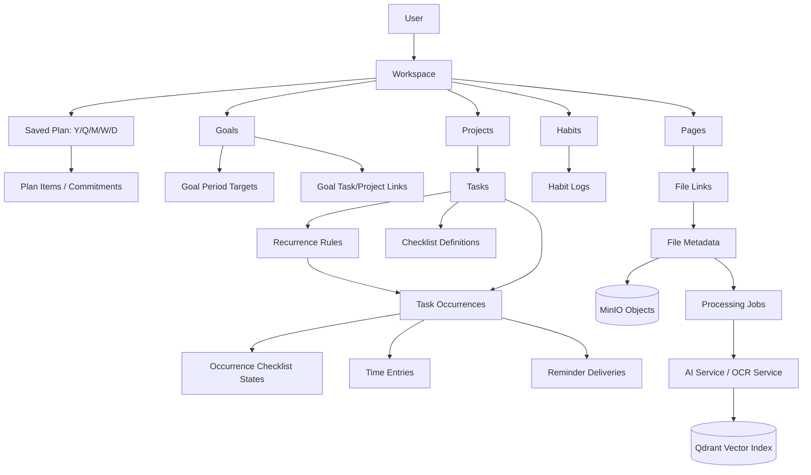
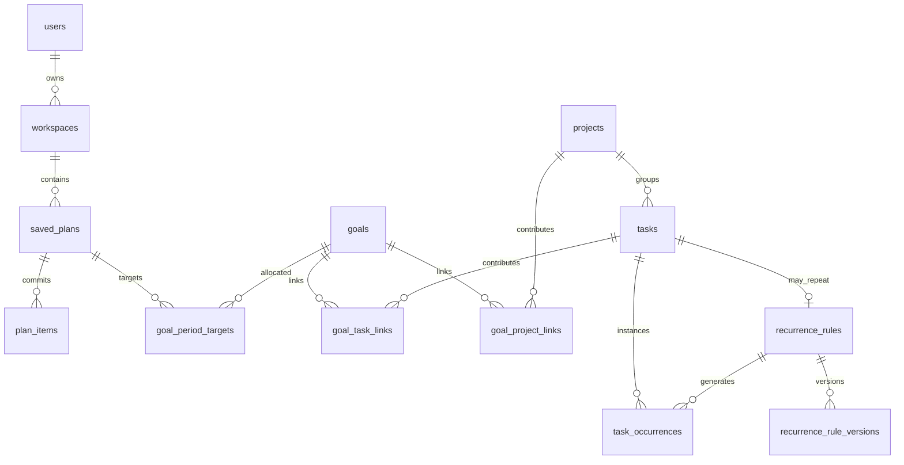
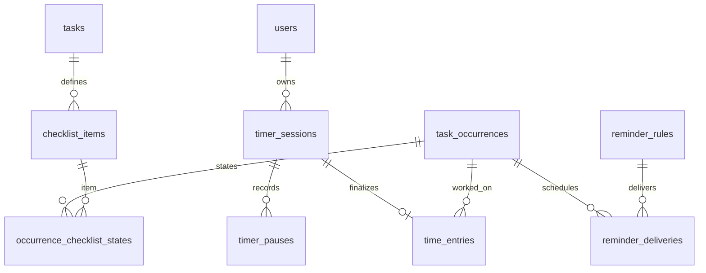
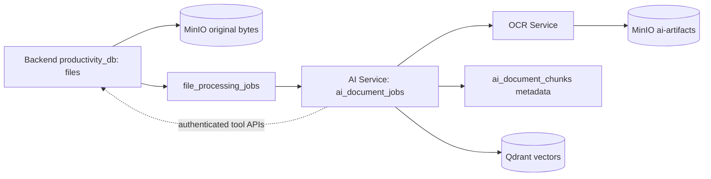

# PERSONAL PRODUCTIVITY & TIME MANAGEMENT APP
# Database Logical & Physical Design Specification — v1.0

> **Status:** Proposed / Design Review Required — dùng làm bản nền để chốt ERD và triển khai Alembic theo từng phase, **chưa phải migrations đã chạy**.  
> **Ngày:** 17/11/2026  
> **Nguồn nghiệp vụ:** Functional Requirements & Backend Feature Inventory v2.0 (Year → Quarter → Month → Week → Day, Tasks, Goals, Projects, Analytics, Notes, Files, AI/OCR).  
> **Công nghệ:** MySQL 8.4 LTS / InnoDB / Python 3.14 / FastAPI / SQLAlchemy 2.x / Alembic / asyncmy / DataGrip.  
> **Triển khai:** Ubuntu Docker Compose, MinIO self-host, Qdrant self-host, Ollama, AI Service Hybrid độc lập và OCR Service độc lập.

---

## 0. Executive decision & scope

Đây là **schema candidate đủ rộng cho roadmap**; không triển khai tất cả trong một migration. Mục tiêu là thiết kế mỗi loại dữ liệu có một nguồn sự thật, bảo vệ lịch sử đã thực hiện và có thể tăng dần chức năng mà không phải thiết kế lại lõi. Bản này dựa trên tài liệu chức năng hiện có; các phần chưa chốt được đưa thành **ADR cần duyệt**, không coi là yêu cầu đã thống nhất.

**Mô hình lưu trữ:**

- `productivity_db` (Backend owner): dữ liệu kế hoạch, task, occurrence, time entry, goal, project, reviews, file metadata, reminders và nghiệp vụ.
- `ai_metadata_db` (AI Service owner): conversations, AI runs, tool calls, action proposals mirror, OCR/RAG metadata. Không có FK trực tiếp sang `productivity_db`.
- **MinIO**: original bytes (PDF, ảnh, DOCX), OCR artifacts, exports.
- **Qdrant**: embeddings và vector payload, chỉ là search index có thể rebuild.
- **Ollama**: runtime model, không thay thế database.

**Quy tắc truy cập:** Next.js/iPhone → Backend API; Backend ↔ MySQL nghiệp vụ; Backend ↔ AI Service qua authenticated internal APIs; AI Service chỉ được đọc/cập nhật dữ liệu nghiệp vụ qua Backend tool APIs được phép. OCR Service chỉ nhận object scoped access/requests.

**Quy ước độ ưu tiên:** `P0` lõi tối thiểu, `P1` mở rộng có kế hoạch, `P2` tính năng nâng cao; **không đồng nghĩa tất cả P0 được triển khai cùng ngày**.

---

## 1. Quy ước vật lý MySQL (áp dụng mọi bảng)

| Chủ đề | Quyết định mặc định | Lý do |
|---|---|---|
| MySQL | `8.4 LTS`, InnoDB | Transaction và FK |
| IDs | `BINARY(16)` UUIDv7 tạo ở Python `uuid.uuid7()` | Nhỏ, tương đối theo thời gian; convert chuẩn bytes |
| UUID convert | Lưu `uuid.UUID.bytes` không swap; SQL `UUID_TO_BIN(x,0)` / `BIN_TO_UUID(x,0)` | UUIDv7 vốn có locality, tránh swap dành cho UUIDv1 |
| Audit timestamps | `DATETIME(6)` UTC, truyền ISO 8601 có offset tại API | MySQL DATETIME không chứa timezone |
| Calendar dates | `DATE` theo timezone frozen/user, dùng `[start,end)` cho range | Tránh lỗi kỳ giao tháng/năm |
| Intervals | `TIME(0)` cho local daily time, `INT` cho minutes/seconds | Đúng đơn vị, không dùng FLOAT thời lượng |
| Quantity/score | `DECIMAL(18,4)` hoặc `DECIMAL(12,3)` | Chính xác hơn FLOAT |
| Text | `utf8mb4`, collation `utf8mb4_0900_ai_ci` mặc định | Unicode; identity/keys unique cần case-sensitive/canonical |
| JSON | Chỉ cho cấu hình có schema hoặc document payload | Không thay thế FK/typed columns |
| Boolean | `BOOLEAN` (= `TINYINT(1)`) | Dùng CHECK 0/1 nếu cần bảo đảm strict |
| Enums | `VARCHAR(N)` + Pydantic Enum + CHECK khi domain ổn định | Dễ migration hơn MySQL ENUM |
| Common fields | `id BINARY(16) PK`, `created_at DATETIME(6)`, `updated_at DATETIME(6)` trừ bảng immutable/event có ghi chú | Truy vết và optimistic consistency |
| Deletion | `archived_at`/`deleted_at` theo từng bảng, không cascade lịch sử | Bảo toàn thống kê và audit |
| FK | Explicit foreign keys, policy RESTRICT mặc định | Không xóa dây chuyền bất ngờ |
| Index | Chọn từ actual query patterns, compound indexes lọc owner+time | Không tạo index vô hạn |
| Ownership | `workspace_id` trên root entity; child kế thừa qua parent | Chuẩn bị multi-user, kiểm tra cross-workspace |

**Chú ý rất quan trọng:** MySQL `UNIQUE` cho phép nhiều `NULL`, vì vậy không thể dùng unique đa cột có nullable để bảo đảm "mỗi record đúng 1" hoặc "một active row". Với trường này phải dùng generated discriminator key, separate typed link tables, hoặc transaction/locking ở service. MySQL không có partial unique index phổ thông như PostgreSQL.

`CHECK` MySQL 8.4 được enforce, nhưng không cho tham chiếu sang bảng khác và có giới hạn khi cùng cột dùng FK referential actions. Không sử dụng `ON DELETE CASCADE` tùy tiện đối với các bảng cần audit/historical integrity.

**Fields mặc định mỗi bảng:** Khi phần chi tiết dưới đây không liệt kê `id`, `created_at`, `updated_at`, mặc định mỗi bảng có `id BINARY(16) PRIMARY KEY`, `created_at DATETIME(6) NOT NULL`, `updated_at DATETIME(6) NOT NULL`. Với các bảng immutable/event, `updated_at` có thể bỏ trong migration sau khi review. **Bảng join** vẫn dùng `id` để dễ audit/ORM, đồng thời có `UNIQUE` khóa liên kết.

**Quy tắc đặt tên:** lower_snake_case cho bảng/cột; `pk_*`, `fk_*`, `uq_*`, `ix_*`, `ck_*` là naming convention trong SQLAlchemy/Alembic. FK columns không được đánh index lặp nếu đã có compound index với prefix đúng.

---

## 2. Tổng thể relationships và domain boundaries



**Mấu chốt:**

1. **Workspace thời gian** là view theo date range + saved plan, không phải sao chép task thành yearly/monthly/weekly/daily tables.
2. `tasks` là định nghĩa; `task_occurrences` là lần xuất hiện/trạng thái; `time_entries` là sự thật đã làm.
3. `plan_items` đại diện cam kết/priority trong một kỳ, không thay cho schedule trên occurrence.
4. `goals` có target và liên kết bằng typed links; actual từ evidence có provenance, chống double-counting.
5. Dashboard/Chart chỉ lưu **spec**, không lưu biểu đồ HTML/JS do model sinh hoặc số liệu sai nguồn.
6. File gốc ở MinIO; vector index ở Qdrant; AI metadata database chỉ sở hữu AI metadata.

---

## 3. Inventory tổng quan — **81 bảng đề xuất**

- `productivity_db`: **71 bảng** theo 13 nhóm.
- `ai_metadata_db`: **10 bảng** theo 1 nhóm AI.
- Theo phase (hai DB gộp): **P0 27**, **P1 39**, **P2 15**.
- Các bảng P1/P2 là **candidate planned capabilities**, không phải bắt buộc phải tạo trước khi có use case.

| Nhóm | Tổng bảng | P0 | P1 | P2 |
|---|---:|---:|---:|---:|
| 01 · Identity, Security & Workspace | 6 | 4 | 1 | 1 |
| 02 · Planning Workspaces & Reviews | 6 | 2 | 4 | 0 |
| 03 · Goals, Targets & Evidence | 6 | 5 | 1 | 0 |
| 04 · Projects, Categories & Tags | 6 | 2 | 4 | 0 |
| 05 · Tasks, Occurrences & Recurrence | 9 | 6 | 2 | 1 |
| 06 · Calendar, Capacity & Time Tracking | 5 | 2 | 2 | 1 |
| 07 · Habits & Routines | 3 | 0 | 3 | 0 |
| 08 · Reminders & Notifications | 4 | 2 | 2 | 0 |
| 09 · Notes, Files & Document Lifecycle | 8 | 0 | 5 | 3 |
| 10 · Saved Views, Dashboards & Analytics | 4 | 0 | 3 | 1 |
| 11 · Templates, Automations & Jobs | 4 | 1 | 1 | 2 |
| 12 · Audit, Import/Export & Reliability | 8 | 3 | 3 | 2 |
| 13 · Notion-like Custom Properties (Optional) | 2 | 0 | 0 | 2 |
| A · AI Conversations, Agents & Metadata (ai_metadata_db) | 10 | 0 | 8 | 2 |

### 3.1. Danh mục bảng theo phase và owner

| # | Database | Table | Phase | Trách nhiệm ngắn |
|---:|---|---|---|---|
| 01 | `productivity_db` | `users` | P0 | Tài khoản định danh; hỗ trợ một người trước nhưng có thể mở rộng. |
| 02 | `productivity_db` | `user_settings` | P0 | Cài đặt cá nhân và quy tắc quy đổi lịch/ngày giờ. |
| 03 | `productivity_db` | `auth_sessions` | P0 | Phiên đăng nhập/refresh token rotation. |
| 04 | `productivity_db` | `user_devices` | P1 | Thiết bị web/iPhone gắn tài khoản để quản lý phiên và thông báo. |
| 05 | `productivity_db` | `workspaces` | P0 | Logical personal workspace; sẵn sàng mở rộng nhiều workspace. |
| 06 | `productivity_db` | `workspace_members` | P2 | Membership/RBAC nếu mở rộng làm việc nhóm. |
| 07 | `productivity_db` | `saved_plans` | P0 | Bản kế hoạch đã lưu cho YEAR/QUARTER/MONTH/WEEK/DAY; view động không bắt buộc có row. |
| 08 | `productivity_db` | `plan_items` | P0 | Cam kết/ưu tiên liên kết resource vào saved plan; không nhân bản task. |
| 09 | `productivity_db` | `plan_time_budgets` | P1 | Ngân sách giờ theo kỳ và nhóm năng suất; không phải giờ thực tế. |
| 10 | `productivity_db` | `period_reviews` | P1 | Tổng kết kỳ, câu trả lời reflection và snapshot metadata. |
| 11 | `productivity_db` | `review_action_items` | P1 | Việc cải thiện sau review; có thể chuyển thành task thực. |
| 12 | `productivity_db` | `plan_rollover_events` | P1 | Lưu quyết định chuyển việc giữa hai kỳ. |
| 13 | `productivity_db` | `goals` | P0 | Mục tiêu định lượng/định tính độc lập với task. |
| 14 | `productivity_db` | `goal_period_targets` | P0 | Phân bổ target cho năm/quý/tháng/tuần; không nhân bản actual. |
| 15 | `productivity_db` | `goal_task_links` | P1 | Quan hệ nhiều-nhiều giữa goal và task. |
| 16 | `productivity_db` | `goal_project_links` | P0 | Quan hệ nhiều-nhiều goal ↔ project. |
| 17 | `productivity_db` | `goal_measurements` | P0 | Bằng chứng đo lường nhập tay/import; tự động phải truy vấn facts nguồn. |
| 18 | `productivity_db` | `goal_milestones` | P0 | Cột mốc của goal. |
| 19 | `productivity_db` | `projects` | P0 | Dự án tập hợp tasks, milestones, time tracking. |
| 20 | `productivity_db` | `project_sections` | P1 | Các nhóm/section trong dự án, hỗ trợ Board/List view. |
| 21 | `productivity_db` | `project_milestones` | P1 | Cột mốc của project độc lập với goal milestone. |
| 22 | `productivity_db` | `categories` | P0 | Nhóm cấp workspace: Work, Study, Health, Personal. |
| 23 | `productivity_db` | `tags` | P1 | Nhãn tự do dùng đa chức năng. |
| 24 | `productivity_db` | `task_tags` | P1 | Bảng join task ↔ tag. |
| 25 | `productivity_db` | `tasks` | P0 | Định nghĩa task gốc; không chứa trạng thái hoàn thành của từng lần. |
| 26 | `productivity_db` | `recurrence_rules` | P0 | Định nghĩa chuỗi lặp và policy sinh occurrences. |
| 27 | `productivity_db` | `recurrence_rule_versions` | P0 | Snapshot bất biến cho mỗi lần sửa recurrence rule. |
| 28 | `productivity_db` | `task_occurrences` | P0 | Một lần thực hiện cụ thể; trạng thái và lịch sử độc lập với task definition. |
| 29 | `productivity_db` | `recurrence_exceptions` | P1 | Ngoại lệ SKIP/OVERRIDE của chuỗi lặp trước hoặc sau khi materialize. |
| 30 | `productivity_db` | `checklist_items` | P0 | Checklist định nghĩa trên task; không chứa tick state. |
| 31 | `productivity_db` | `occurrence_checklist_states` | P0 | Trạng thái tick checklist của từng occurrence. |
| 32 | `productivity_db` | `task_dependencies` | P1 | Quan hệ A BLOCKS B có hướng; không phải hierarchy. |
| 33 | `productivity_db` | `task_relations` | P2 | Liên kết task có liên quan nhưng không chặn tiến độ. |
| 34 | `productivity_db` | `calendar_events` | P2 | Sự kiện cá nhân không thuộc task, ví dụ lịch hẹn. |
| 35 | `productivity_db` | `availability_rules` | P1 | Khung giờ khả dụng theo weekday làm input cho AI planner. |
| 36 | `productivity_db` | `time_entries` | P0 | Sự thật thời gian đã làm; nguồn TIMER hoặc MANUAL. |
| 37 | `productivity_db` | `timer_sessions` | P0 | Trạng thái timer active/paused/stopped; khôi phục trên nhiều thiết bị. |
| 38 | `productivity_db` | `timer_pauses` | P1 | Khoảng pause phục vụ điều tra/đồng bộ tính time thật. |
| 39 | `productivity_db` | `habits` | P1 | Thói quen có nhịp độ, target và nguồn check-in riêng. |
| 40 | `productivity_db` | `habit_schedules` | P1 | Lịch áp dụng thói quen; độc lập recurrence task. |
| 41 | `productivity_db` | `habit_logs` | P1 | Check-in habit theo ngày, đo lượng/định lượng. |
| 42 | `productivity_db` | `reminder_rules` | P0 | Quy tắc nhắc trước/sau deadline hoặc absolute time. |
| 43 | `productivity_db` | `reminder_deliveries` | P0 | Mỗi lần cần giao reminder; dedup và retry. |
| 44 | `productivity_db` | `push_subscriptions` | P1 | Web Push endpoint/token theo thiết bị, lưu credential mã hóa. |
| 45 | `productivity_db` | `in_app_notifications` | P1 | Thông báo in-app đã render/đọc. |
| 46 | `productivity_db` | `pages` | P1 | Trang nội dung kiểu Notion ở mức document; chưa bắt buộc block editor. |
| 47 | `productivity_db` | `page_revisions` | P1 | Snapshot bản sửa page, hỗ trợ lịch sử/khôi phục. |
| 48 | `productivity_db` | `page_links` | P2 | Link page ↔ page phục vụ backlink, knowledge graph đơn giản. |
| 49 | `productivity_db` | `files` | P1 | Metadata của blob MinIO; backend giữ ownership và ACL. |
| 50 | `productivity_db` | `file_versions` | P2 | Phiên bản object khi thay file gốc. |
| 51 | `productivity_db` | `file_links` | P1 | Gắn file với task/project/goal/page; nhiều-nhiều. |
| 52 | `productivity_db` | `file_processing_jobs` | P1 | Trạng thái xử lý file/backend giao qua AI/OCR. |
| 53 | `productivity_db` | `page_blocks` | P2 | Lựa chọn thay thế content_json nếu cần full Notion-style block API. |
| 54 | `productivity_db` | `saved_views` | P1 | Cấu hình view kiểu Notion cho cùng nguồn dữ liệu. |
| 55 | `productivity_db` | `dashboards` | P1 | Dashboard cấu hình tùy chọn của người dùng. |
| 56 | `productivity_db` | `dashboard_widgets` | P1 | Từng widget biểu đồ/KPI; renderer tái tính dữ liệu. |
| 57 | `productivity_db` | `analytics_snapshots` | P2 | Cache/snapshot cho báo cáo lớn hoặc kỳ review đã đóng. |
| 58 | `productivity_db` | `templates` | P1 | Mẫu task/project/page/plan có version schema. |
| 59 | `productivity_db` | `automation_rules` | P2 | Quy tắc automation khi nguồn event/time thay đổi. |
| 60 | `productivity_db` | `automation_runs` | P2 | Lịch sử thực hiện automation, retry và audit. |
| 61 | `productivity_db` | `background_jobs` | P0 | Job queue DB ban đầu cho recurrence/reconciliation/reminder orchestration. |
| 62 | `productivity_db` | `activity_events` | P0 | Nhật ký sự kiện nghiệp vụ để xem history và analytics audit. |
| 63 | `productivity_db` | `security_audit_logs` | P0 | Audit sự kiện đăng nhập, thay đổi quyền và chặn truy cập. |
| 64 | `productivity_db` | `import_jobs` | P1 | Tập nhập CSV/JSON/Notion với dry-run/preview. |
| 65 | `productivity_db` | `export_jobs` | P1 | Yêu cầu xuất dữ liệu và báo cáo, output file trong MinIO. |
| 66 | `productivity_db` | `external_connections` | P2 | Metadata kết nối calendar/provider bên ngoài. |
| 67 | `productivity_db` | `sync_cursors` | P2 | Cursor phục hồi sync incremental. |
| 68 | `productivity_db` | `idempotency_keys` | P0 | Chống double-submit từ web/mobile và retry AI actions. |
| 69 | `productivity_db` | `outbox_events` | P1 | Transactional outbox cho các event cần worker/AI ingestion. |
| 70 | `productivity_db` | `custom_field_definitions` | P2 | Định nghĩa custom field typed theo resource scope. |
| 71 | `productivity_db` | `custom_field_values` | P2 | Giá trị custom property theo task/project. |
| 72 | `ai_metadata_db` | `ai_conversations` | P1 | Hội thoại AI một người, lưu context summary và retention. |
| 73 | `ai_metadata_db` | `ai_messages` | P1 | Thông điệp trong hội thoại, vai trò, references và token usage. |
| 74 | `ai_metadata_db` | `ai_runs` | P1 | Một lượt AI orchestration, state, tracing và cost. |
| 75 | `ai_metadata_db` | `ai_tool_calls` | P1 | Nhật ký tool calling tới Backend Internal API. |
| 76 | `ai_metadata_db` | `ai_action_proposals` | P1 | Bản nháp hành động AI, user confirm ở backend. |
| 77 | `ai_metadata_db` | `ai_document_jobs` | P1 | Worker jobs đọc ảnh/PDF/OCR/chunk/embed với state riêng AI. |
| 78 | `ai_metadata_db` | `ai_document_chunks` | P1 | Metadata chunk để trace retrieval sang file/source. |
| 79 | `ai_metadata_db` | `ai_vector_indexes` | P1 | Registry model embedding, Qdrant collection, rebuild/alias. |
| 80 | `ai_metadata_db` | `ai_memories` | P2 | Long-term preferences/observations có provenance và quyền xóa. |
| 81 | `ai_metadata_db` | `ai_eval_runs` | P2 | Đánh giá mô hình/prompt theo dataset kiểm thử. |

---

## 4. Chi tiết từng bảng — Data Dictionary

> `NN`=NOT NULL; `NULL`=nullable; `DEF`=default; `FK`=Foreign Key; `EXT`=external reference (không FK cross-service). Mỗi row mô tả **cột đặc thù**; cột chuẩn (`id`, `created_at`, `updated_at`) được quy ước trong Mục 1. Index strings là **kế hoạch thiết kế**, migration phải naming cụ thể và không tạo index trùng.

### 01. `users` — P0

**Domain:** 01 · Identity, Security & Workspace  
**Chức năng:** Tài khoản định danh; hỗ trợ một người trước nhưng có thể mở rộng.

| Cột | MySQL type | Null / Key | Mô tả và ý nghĩa |
|---|---|---|---|
| `id` | `BINARY(16)` | PK, NN | UUIDv7, sinh ở application (trừ ADR khác) |
| `email` | `VARCHAR(254)` | NN | Email nguyên bản dùng hiển thị; xác thực bằng email_normalized. |
| `email_normalized` | `VARCHAR(254)` | NN | Email canonical (casefold ở application), dùng UNIQUE. |
| `password_hash` | `VARCHAR(255)` | NN | Argon2id hash; không lưu plaintext/password encryption key. |
| `display_name` | `VARCHAR(120)` | NN | Tên hiển thị. |
| `status` | `VARCHAR(20)` | NN, DEF ACTIVE | ACTIVE, DISABLED, PENDING_DELETION. |
| `email_verified_at` | `DATETIME(6)` | NULL | Thời điểm xác thực email UTC. |
| `last_login_at` | `DATETIME(6)` | NULL | Lần đăng nhập cuối UTC. |
| `created_at` | `DATETIME(6)` | NN | UTC created timestamp |
| `updated_at` | `DATETIME(6)` | NN | UTC last mutation; có thể bỏ với immutable log |

**Keys / indexes:** UQ(email_normalized); IDX(status).  
**Business rules / constraints:** Không trả password_hash trong API; DB không cấp quyền AI đọc bảng này.  

### 02. `user_settings` — P0

**Domain:** 01 · Identity, Security & Workspace  
**Chức năng:** Cài đặt cá nhân và quy tắc quy đổi lịch/ngày giờ.

| Cột | MySQL type | Null / Key | Mô tả và ý nghĩa |
|---|---|---|---|
| `id` | `BINARY(16)` | PK, NN | UUIDv7, sinh ở application (trừ ADR khác) |
| `user_id` | `BINARY(16)` | FK users, NN | Chủ sở hữu; một hàng mỗi user. |
| `timezone` | `VARCHAR(64)` | NN, DEF Asia/Ho_Chi_Minh | IANA timezone. |
| `week_starts_on` | `TINYINT UNSIGNED` | NN, DEF 1 | 1=Monday … 7=Sunday. |
| `locale` | `VARCHAR(16)` | NN, DEF vi-VN | Locale. |
| `date_format` | `VARCHAR(32)` | NN | Định dạng hiển thị. |
| `theme` | `VARCHAR(16)` | NN, DEF SYSTEM | LIGHT, DARK, SYSTEM. |
| `color_theme` | `VARCHAR(32)` | NN, DEF SOFT_BLUE | Tùy chọn bảng màu. |
| `preferences_json` | `JSON` | NULL | Tùy chọn UI ít truy vấn, có schema/version. |
| `created_at` | `DATETIME(6)` | NN | UTC created timestamp |
| `updated_at` | `DATETIME(6)` | NN | UTC last mutation; có thể bỏ với immutable log |

**Keys / indexes:** UQ(user_id).  
**Business rules / constraints:** Cài đặt tuần/múi giờ không tự hồi tố sửa kỳ kế hoạch đã lưu.  

### 03. `auth_sessions` — P0

**Domain:** 01 · Identity, Security & Workspace  
**Chức năng:** Phiên đăng nhập/refresh token rotation.

| Cột | MySQL type | Null / Key | Mô tả và ý nghĩa |
|---|---|---|---|
| `id` | `BINARY(16)` | PK, NN | UUIDv7, sinh ở application (trừ ADR khác) |
| `user_id` | `BINARY(16)` | FK users, NN | Tài khoản sở hữu. |
| `device_id` | `BINARY(16)` | FK user_devices, NULL | Thiết bị đăng nhập. |
| `refresh_token_hash` | `BINARY(32)` | NN | SHA-256 token ngẫu nhiên hoặc hash phù hợp, không lưu token gốc. |
| `family_id` | `BINARY(16)` | NN | Refresh family để revoke khi phát hiện reuse. |
| `issued_at` | `DATETIME(6)` | NN | Thời điểm cấp UTC. |
| `expires_at` | `DATETIME(6)` | NN | Thời điểm hết hạn. |
| `revoked_at` | `DATETIME(6)` | NULL | Thời điểm thu hồi. |
| `last_used_at` | `DATETIME(6)` | NULL | Lần dùng cuối. |
| `ip_fingerprint` | `VARBINARY(32)` | NULL | Fingerprint bảo vệ dữ liệu riêng tư; không bắt buộc. |
| `created_at` | `DATETIME(6)` | NN | UTC created timestamp |
| `updated_at` | `DATETIME(6)` | NN | UTC last mutation; có thể bỏ với immutable log |

**Keys / indexes:** UQ(refresh_token_hash); IDX(user_id,expires_at); IDX(family_id,revoked_at).  
**Business rules / constraints:** Atomic refresh rotation; revoke cả family khi token reuse.  

### 04. `user_devices` — P1

**Domain:** 01 · Identity, Security & Workspace  
**Chức năng:** Thiết bị web/iPhone gắn tài khoản để quản lý phiên và thông báo.

| Cột | MySQL type | Null / Key | Mô tả và ý nghĩa |
|---|---|---|---|
| `id` | `BINARY(16)` | PK, NN | UUIDv7, sinh ở application (trừ ADR khác) |
| `user_id` | `BINARY(16)` | FK users, NN | Owner. |
| `installation_id_hash` | `BINARY(32)` | NN | ID thiết bị/app đã băm; không chứa identifier hệ điều hành nhạy cảm. |
| `platform` | `VARCHAR(16)` | NN | WEB, IOS, ANDROID. |
| `device_label` | `VARCHAR(100)` | NULL | Tên gợi nhớ thiết bị. |
| `last_seen_at` | `DATETIME(6)` | NULL | Last active UTC. |
| `revoked_at` | `DATETIME(6)` | NULL | Thiết bị ngừng tin cậy. |
| `created_at` | `DATETIME(6)` | NN | UTC created timestamp |
| `updated_at` | `DATETIME(6)` | NN | UTC last mutation; có thể bỏ với immutable log |

**Keys / indexes:** UQ(user_id,installation_id_hash); IDX(user_id,last_seen_at).  
**Business rules / constraints:** Không phụ thuộc push token cho định danh thiết bị.  

### 05. `workspaces` — P0

**Domain:** 01 · Identity, Security & Workspace  
**Chức năng:** Logical personal workspace; sẵn sàng mở rộng nhiều workspace.

| Cột | MySQL type | Null / Key | Mô tả và ý nghĩa |
|---|---|---|---|
| `id` | `BINARY(16)` | PK, NN | UUIDv7, sinh ở application (trừ ADR khác) |
| `owner_user_id` | `BINARY(16)` | FK users, NN | Người tạo/owner. |
| `name` | `VARCHAR(160)` | NN | Tên workspace. |
| `slug` | `VARCHAR(120)` | NN | Định danh URL trong tài khoản. |
| `type` | `VARCHAR(20)` | NN, DEF PERSONAL | PERSONAL, TEAM (future). |
| `archived_at` | `DATETIME(6)` | NULL | Archive mềm. |
| `created_at` | `DATETIME(6)` | NN | UTC created timestamp |
| `updated_at` | `DATETIME(6)` | NN | UTC last mutation; có thể bỏ với immutable log |

**Keys / indexes:** UQ(owner_user_id,slug); IDX(owner_user_id,archived_at).  
**Business rules / constraints:** Bản MVP 1 workspace; không tạo workspace mới cho mỗi ngày/tuần/tháng.  

### 06. `workspace_members` — P2

**Domain:** 01 · Identity, Security & Workspace  
**Chức năng:** Membership/RBAC nếu mở rộng làm việc nhóm.

| Cột | MySQL type | Null / Key | Mô tả và ý nghĩa |
|---|---|---|---|
| `id` | `BINARY(16)` | PK, NN | UUIDv7, sinh ở application (trừ ADR khác) |
| `workspace_id` | `BINARY(16)` | FK workspaces, NN | Workspace. |
| `user_id` | `BINARY(16)` | FK users, NN | Member. |
| `role` | `VARCHAR(20)` | NN | OWNER, EDITOR, VIEWER. |
| `joined_at` | `DATETIME(6)` | NN | Thời điểm tham gia. |
| `removed_at` | `DATETIME(6)` | NULL | Thu hồi quyền. |
| `created_at` | `DATETIME(6)` | NN | UTC created timestamp |
| `updated_at` | `DATETIME(6)` | NN | UTC last mutation; có thể bỏ với immutable log |

**Keys / indexes:** UQ(workspace_id,user_id); IDX(user_id,removed_at).  
**Business rules / constraints:** Chưa cần kích hoạt multi-user; khi có phải rà soát mọi access policy.  

### 07. `saved_plans` — P0

**Domain:** 02 · Planning Workspaces & Reviews  
**Chức năng:** Bản kế hoạch đã lưu cho YEAR/QUARTER/MONTH/WEEK/DAY; view động không bắt buộc có row.

| Cột | MySQL type | Null / Key | Mô tả và ý nghĩa |
|---|---|---|---|
| `id` | `BINARY(16)` | PK, NN | UUIDv7, sinh ở application (trừ ADR khác) |
| `workspace_id` | `BINARY(16)` | FK workspaces, NN | Workspace sở hữu. |
| `created_by` | `BINARY(16)` | FK users, NN | Người tạo. |
| `period_type` | `VARCHAR(12)` | NN | YEAR, QUARTER, MONTH, WEEK, DAY. |
| `start_date` | `DATE` | NN | Ngày bắt đầu bao gồm, theo timezone lưu tại bản kế hoạch. |
| `end_date_exclusive` | `DATE` | NN | Ngày kết thúc loại trừ. |
| `timezone` | `VARCHAR(64)` | NN | IANA timezone đã chốt thời điểm tạo. |
| `week_starts_on` | `TINYINT UNSIGNED` | NULL | Chốt quy tắc tuần nếu period_type WEEK. |
| `title` | `VARCHAR(200)` | NN | Tên kế hoạch. |
| `focus` | `TEXT` | NULL | Định hướng, trọng tâm kỳ. |
| `notes_json` | `JSON` | NULL | Ghi chú có định dạng + version. |
| `status` | `VARCHAR(16)` | NN, DEF DRAFT | DRAFT, ACTIVE, CLOSED, ARCHIVED. |
| `version` | `INT UNSIGNED` | NN, DEF 1 | Optimistic locking khi sửa plan từ nhiều thiết bị. |
| `closed_at` | `DATETIME(6)` | NULL | Ngày đóng kỳ. |
| `created_at` | `DATETIME(6)` | NN | UTC created timestamp |
| `updated_at` | `DATETIME(6)` | NN | UTC last mutation; có thể bỏ với immutable log |

**Keys / indexes:** UQ(workspace_id,period_type,start_date,end_date_exclusive); IDX(workspace_id,start_date,end_date_exclusive,status).  
**Business rules / constraints:** CHECK start_date < end_date; week crossing month không gắn FK vào month. Overlap cùng type cần service kiểm tra.  

### 08. `plan_items` — P0

**Domain:** 02 · Planning Workspaces & Reviews  
**Chức năng:** Cam kết/ưu tiên liên kết resource vào saved plan; không nhân bản task.

| Cột | MySQL type | Null / Key | Mô tả và ý nghĩa |
|---|---|---|---|
| `id` | `BINARY(16)` | PK, NN | UUIDv7, sinh ở application (trừ ADR khác) |
| `plan_id` | `BINARY(16)` | FK saved_plans, NN | Bản kế hoạch. |
| `task_id` | `BINARY(16)` | FK tasks, NULL | Task definition được ưu tiên. |
| `occurrence_id` | `BINARY(16)` | FK task_occurrences, NULL | Lần thực hiện cụ thể. |
| `project_id` | `BINARY(16)` | FK projects, NULL | Project được theo dõi. |
| `goal_id` | `BINARY(16)` | FK goals, NULL | Goal được ưu tiên. |
| `target_key` | `VARCHAR(64)` | NN | Khóa canonical type:uuid để chống ghim trùng cùng plan. |
| `priority_rank` | `INT UNSIGNED` | NN, DEF 0 | Thứ tự trong kỳ; không thay priority global. |
| `commitment` | `VARCHAR(16)` | NN, DEF PLANNED | PLANNED, COMMITTED, OPTIONAL. |
| `notes` | `TEXT` | NULL | Bối cảnh cho mục kỳ. |
| `added_at` | `DATETIME(6)` | NN | Mốc thêm vào plan. |
| `created_at` | `DATETIME(6)` | NN | UTC created timestamp |
| `updated_at` | `DATETIME(6)` | NN | UTC last mutation; có thể bỏ với immutable log |

**Keys / indexes:** UQ(plan_id,target_key); IDX(plan_id,priority_rank); IDX(task_id); IDX(occurrence_id); IDX(goal_id).  
**Business rules / constraints:** CHECK chính xác 1 trong task_id/occurrence_id/project_id/goal_id khác NULL; không dùng ON DELETE CASCADE/SET NULL với cột tham gia CHECK.  

### 09. `plan_time_budgets` — P1

**Domain:** 02 · Planning Workspaces & Reviews  
**Chức năng:** Ngân sách giờ theo kỳ và nhóm năng suất; không phải giờ thực tế.

| Cột | MySQL type | Null / Key | Mô tả và ý nghĩa |
|---|---|---|---|
| `id` | `BINARY(16)` | PK, NN | UUIDv7, sinh ở application (trừ ADR khác) |
| `plan_id` | `BINARY(16)` | FK saved_plans, NN | Bản kế hoạch. |
| `category_id` | `BINARY(16)` | FK categories, NULL | Lọc theo category; NULL=toàn kỳ. |
| `project_id` | `BINARY(16)` | FK projects, NULL | Lọc theo project; NULL=toàn kỳ. |
| `planned_minutes` | `INT UNSIGNED` | NN | Tổng phút được dự trù. |
| `notes` | `VARCHAR(300)` | NULL | Ghi chú. |
| `created_at` | `DATETIME(6)` | NN | UTC created timestamp |
| `updated_at` | `DATETIME(6)` | NN | UTC last mutation; có thể bỏ với immutable log |

**Keys / indexes:** IDX(plan_id,category_id,project_id).  
**Business rules / constraints:** Không unique trên cặp nullable; dedup bằng canonical scope_key hoặc kiểm soát application.  

### 10. `period_reviews` — P1

**Domain:** 02 · Planning Workspaces & Reviews  
**Chức năng:** Tổng kết kỳ, câu trả lời reflection và snapshot metadata.

| Cột | MySQL type | Null / Key | Mô tả và ý nghĩa |
|---|---|---|---|
| `id` | `BINARY(16)` | PK, NN | UUIDv7, sinh ở application (trừ ADR khác) |
| `plan_id` | `BINARY(16)` | FK saved_plans, NN | Bản kế hoạch. |
| `reviewed_by` | `BINARY(16)` | FK users, NN | Người đánh giá. |
| `status` | `VARCHAR(16)` | NN | DRAFT, FINALIZED, REOPENED. |
| `answers_json` | `JSON` | NN | Các câu trả lời theo versioned questionnaire schema. |
| `metric_snapshot_json` | `JSON` | NULL | Số liệu lúc chốt + query metadata, không thay nguồn thật. |
| `metric_version` | `VARCHAR(32)` | NULL | Version công thức metric. |
| `finalized_at` | `DATETIME(6)` | NULL | Thời điểm chốt. |
| `created_at` | `DATETIME(6)` | NN | UTC created timestamp |
| `updated_at` | `DATETIME(6)` | NN | UTC last mutation; có thể bỏ với immutable log |

**Keys / indexes:** UQ(plan_id); IDX(status,finalized_at).  
**Business rules / constraints:** Finalized có snapshot cố định cho báo cáo lịch sử; live metrics vẫn có thể đổi khi sửa time entry.  

### 11. `review_action_items` — P1

**Domain:** 02 · Planning Workspaces & Reviews  
**Chức năng:** Việc cải thiện sau review; có thể chuyển thành task thực.

| Cột | MySQL type | Null / Key | Mô tả và ý nghĩa |
|---|---|---|---|
| `id` | `BINARY(16)` | PK, NN | UUIDv7, sinh ở application (trừ ADR khác) |
| `review_id` | `BINARY(16)` | FK period_reviews, NN | Review nguồn. |
| `title` | `VARCHAR(255)` | NN | Hành động cần thực hiện. |
| `linked_task_id` | `BINARY(16)` | FK tasks, NULL | Task được tạo/được gắn. |
| `status` | `VARCHAR(16)` | NN | OPEN, DONE, DISMISSED. |
| `sort_order` | `INT UNSIGNED` | NN, DEF 0 | Thứ tự. |
| `created_at` | `DATETIME(6)` | NN | UTC created timestamp |
| `updated_at` | `DATETIME(6)` | NN | UTC last mutation; có thể bỏ với immutable log |

**Keys / indexes:** IDX(review_id,sort_order); IDX(linked_task_id).  
**Business rules / constraints:** Không tạo task tự động khi AI viết reflection; phải confirm.  

### 12. `plan_rollover_events` — P1

**Domain:** 02 · Planning Workspaces & Reviews  
**Chức năng:** Lưu quyết định chuyển việc giữa hai kỳ.

| Cột | MySQL type | Null / Key | Mô tả và ý nghĩa |
|---|---|---|---|
| `id` | `BINARY(16)` | PK, NN | UUIDv7, sinh ở application (trừ ADR khác) |
| `source_plan_id` | `BINARY(16)` | FK saved_plans, NN | Kỳ nguồn. |
| `target_plan_id` | `BINARY(16)` | FK saved_plans, NN | Kỳ đích. |
| `occurrence_id` | `BINARY(16)` | FK task_occurrences, NULL | Lần thực hiện được dời. |
| `task_id` | `BINARY(16)` | FK tasks, NULL | Task chỉ được ưu tiên lại. |
| `mode` | `VARCHAR(24)` | NN | RESCHEDULE_OCCURRENCE hoặc PIN_TASK. |
| `old_date` | `DATE` | NULL | Ngày lịch cũ. |
| `new_date` | `DATE` | NULL | Ngày lịch mới. |
| `applied_by` | `BINARY(16)` | FK users, NN | Người xác nhận. |
| `applied_at` | `DATETIME(6)` | NN | Thời điểm áp dụng. |
| `created_at` | `DATETIME(6)` | NN | UTC created timestamp |
| `updated_at` | `DATETIME(6)` | NN | UTC last mutation; có thể bỏ với immutable log |

**Keys / indexes:** IDX(source_plan_id,target_plan_id); IDX(occurrence_id).  
**Business rules / constraints:** CHECK đúng một trong occurrence_id/task_id; ghi audit và idempotency; không tự sao chép hoặc xóa occurrence DONE.  

### 13. `goals` — P0

**Domain:** 03 · Goals, Targets & Evidence  
**Chức năng:** Mục tiêu định lượng/định tính độc lập với task.

| Cột | MySQL type | Null / Key | Mô tả và ý nghĩa |
|---|---|---|---|
| `id` | `BINARY(16)` | PK, NN | UUIDv7, sinh ở application (trừ ADR khác) |
| `workspace_id` | `BINARY(16)` | FK workspaces, NN | Workspace. |
| `owner_user_id` | `BINARY(16)` | FK users, NN | Owner. |
| `parent_goal_id` | `BINARY(16)` | FK goals, NULL | Phân cấp goal; guard cycle. |
| `category_id` | `BINARY(16)` | FK categories, NULL | Nhóm mục tiêu. |
| `title` | `VARCHAR(255)` | NN | Tên mục tiêu. |
| `description` | `TEXT` | NULL | Mô tả. |
| `goal_type` | `VARCHAR(24)` | NN | QUANTITATIVE, COUNT, HABIT, TASK, MILESTONE, QUALITATIVE. |
| `measurement_mode` | `VARCHAR(24)` | NN | AUTO_TIME, AUTO_HABIT, AUTO_TASK, MANUAL, MIXED. |
| `unit` | `VARCHAR(40)` | NN | hours, times, books, pages, score... |
| `target_value` | `DECIMAL(18,4)` | NULL | Mục tiêu nếu định lượng. |
| `start_date` | `DATE` | NULL | Ngày bắt đầu. |
| `due_date` | `DATE` | NULL | Ngày đích. |
| `status` | `VARCHAR(20)` | NN | NOT_STARTED, ACTIVE, ON_HOLD, ACHIEVED, CANCELLED. |
| `version` | `INT UNSIGNED` | NN, DEF 1 | Optimistic lock khi cập nhật mục tiêu. |
| `archived_at` | `DATETIME(6)` | NULL | Archive. |
| `created_at` | `DATETIME(6)` | NN | UTC created timestamp |
| `updated_at` | `DATETIME(6)` | NN | UTC last mutation; có thể bỏ với immutable log |

**Keys / indexes:** IDX(workspace_id,status,due_date); IDX(parent_goal_id); IDX(category_id).  
**Business rules / constraints:** Auto actual tính từ evidence nguồn; không lưu current_value denormalized làm nguồn thật. Goal qualitative có target_value NULL.  

### 14. `goal_period_targets` — P0

**Domain:** 03 · Goals, Targets & Evidence  
**Chức năng:** Phân bổ target cho năm/quý/tháng/tuần; không nhân bản actual.

| Cột | MySQL type | Null / Key | Mô tả và ý nghĩa |
|---|---|---|---|
| `id` | `BINARY(16)` | PK, NN | UUIDv7, sinh ở application (trừ ADR khác) |
| `goal_id` | `BINARY(16)` | FK goals, NN | Goal. |
| `plan_id` | `BINARY(16)` | FK saved_plans, NN | Kỳ kế hoạch. |
| `target_value` | `DECIMAL(18,4)` | NN | Chỉ tiêu trong kỳ. |
| `unit` | `VARCHAR(40)` | NN | Cùng đơn vị goal hoặc mapping được validate. |
| `notes` | `VARCHAR(300)` | NULL | Ghi chú. |
| `created_at` | `DATETIME(6)` | NN | UTC created timestamp |
| `updated_at` | `DATETIME(6)` | NN | UTC last mutation; có thể bỏ với immutable log |

**Keys / indexes:** UQ(goal_id,plan_id); IDX(plan_id).  
**Business rules / constraints:** Tổng target kỳ có thể khác target tổng khi đang draft; cảnh báo chứ không xóa dữ liệu.  

### 15. `goal_task_links` — P1

**Domain:** 03 · Goals, Targets & Evidence  
**Chức năng:** Quan hệ nhiều-nhiều giữa goal và task.

| Cột | MySQL type | Null / Key | Mô tả và ý nghĩa |
|---|---|---|---|
| `id` | `BINARY(16)` | PK, NN | UUIDv7, sinh ở application (trừ ADR khác) |
| `goal_id` | `BINARY(16)` | FK goals, NN | Goal. |
| `task_id` | `BINARY(16)` | FK tasks, NN | Task đóng góp. |
| `contribution_kind` | `VARCHAR(24)` | NN | COUNT_COMPLETIONS, TRACK_TIME, EVIDENCE_ONLY. |
| `weight` | `DECIMAL(8,4)` | NN, DEF 1 | Trọng số khi công thức cần. |
| `created_at` | `DATETIME(6)` | NN | UTC created timestamp |
| `updated_at` | `DATETIME(6)` | NN | UTC last mutation; có thể bỏ với immutable log |

**Keys / indexes:** UQ(goal_id,task_id); IDX(task_id).  
**Business rules / constraints:** Cùng một time entry chỉ được tính một lần cho một goal dù có nhiều link giao nhau.  

### 16. `goal_project_links` — P0

**Domain:** 03 · Goals, Targets & Evidence  
**Chức năng:** Quan hệ nhiều-nhiều goal ↔ project.

| Cột | MySQL type | Null / Key | Mô tả và ý nghĩa |
|---|---|---|---|
| `id` | `BINARY(16)` | PK, NN | UUIDv7, sinh ở application (trừ ADR khác) |
| `goal_id` | `BINARY(16)` | FK goals, NN | Goal. |
| `project_id` | `BINARY(16)` | FK projects, NN | Project đóng góp. |
| `contribution_kind` | `VARCHAR(24)` | NN | TRACK_TIME, TASK_COUNT, EVIDENCE_ONLY. |
| `weight` | `DECIMAL(8,4)` | NN, DEF 1 | Trọng số optional. |
| `created_at` | `DATETIME(6)` | NN | UTC created timestamp |
| `updated_at` | `DATETIME(6)` | NN | UTC last mutation; có thể bỏ với immutable log |

**Keys / indexes:** UQ(goal_id,project_id); IDX(project_id).  
**Business rules / constraints:** Không dùng FK goal_id đơn trực tiếp trên projects vì một project có thể phục vụ nhiều goals.  

### 17. `goal_measurements` — P0

**Domain:** 03 · Goals, Targets & Evidence  
**Chức năng:** Bằng chứng đo lường nhập tay/import; tự động phải truy vấn facts nguồn.

| Cột | MySQL type | Null / Key | Mô tả và ý nghĩa |
|---|---|---|---|
| `id` | `BINARY(16)` | PK, NN | UUIDv7, sinh ở application (trừ ADR khác) |
| `goal_id` | `BINARY(16)` | FK goals, NN | Goal. |
| `measured_on` | `DATE` | NN | Ngày ghi nhận theo local timezone. |
| `value` | `DECIMAL(18,4)` | NN | Giá trị lần đo (delta/absolute theo measurement_kind). |
| `measurement_kind` | `VARCHAR(16)` | NN | DELTA, ABSOLUTE. |
| `source` | `VARCHAR(16)` | NN | MANUAL, IMPORT, VERIFIED_EXTERNAL. |
| `unit` | `VARCHAR(40)` | NN | Đơn vị. |
| `note` | `TEXT` | NULL | Minh chứng/giải thích. |
| `recorded_by` | `BINARY(16)` | FK users, NN | Người ghi. |
| `voided_at` | `DATETIME(6)` | NULL | Hủy bản ghi có audit, không xóa lịch sử. |
| `created_at` | `DATETIME(6)` | NN | UTC created timestamp |
| `updated_at` | `DATETIME(6)` | NN | UTC last mutation; có thể bỏ với immutable log |

**Keys / indexes:** IDX(goal_id,measured_on); IDX(recorded_by).  
**Business rules / constraints:** Tránh tự động ghi lại số giờ đã có ở time_entries; auto progress được tính on-demand.  

### 18. `goal_milestones` — P0

**Domain:** 03 · Goals, Targets & Evidence  
**Chức năng:** Cột mốc của goal.

| Cột | MySQL type | Null / Key | Mô tả và ý nghĩa |
|---|---|---|---|
| `id` | `BINARY(16)` | PK, NN | UUIDv7, sinh ở application (trừ ADR khác) |
| `goal_id` | `BINARY(16)` | FK goals, NN | Goal. |
| `title` | `VARCHAR(255)` | NN | Tên cột mốc. |
| `target_date` | `DATE` | NULL | Ngày dự kiến. |
| `status` | `VARCHAR(16)` | NN | NOT_STARTED, IN_PROGRESS, DONE, CANCELLED. |
| `completed_at` | `DATETIME(6)` | NULL | Thời điểm hoàn thành. |
| `sort_order` | `INT UNSIGNED` | NN, DEF 0 | Vị trí. |
| `created_at` | `DATETIME(6)` | NN | UTC created timestamp |
| `updated_at` | `DATETIME(6)` | NN | UTC last mutation; có thể bỏ với immutable log |

**Keys / indexes:** IDX(goal_id,sort_order); IDX(goal_id,target_date).  
**Business rules / constraints:** Đánh dấu milestone DONE không làm DONE các task liên quan.  

### 19. `projects` — P0

**Domain:** 04 · Projects, Categories & Tags  
**Chức năng:** Dự án tập hợp tasks, milestones, time tracking.

| Cột | MySQL type | Null / Key | Mô tả và ý nghĩa |
|---|---|---|---|
| `id` | `BINARY(16)` | PK, NN | UUIDv7, sinh ở application (trừ ADR khác) |
| `workspace_id` | `BINARY(16)` | FK workspaces, NN | Workspace. |
| `owner_user_id` | `BINARY(16)` | FK users, NN | Owner. |
| `category_id` | `BINARY(16)` | FK categories, NULL | Nhóm dự án. |
| `name` | `VARCHAR(255)` | NN | Tên dự án. |
| `description` | `TEXT` | NULL | Mô tả. |
| `start_date` | `DATE` | NULL | Ngày bắt đầu. |
| `target_date` | `DATE` | NULL | Deadline. |
| `status` | `VARCHAR(20)` | NN | PLANNED, ACTIVE, ON_HOLD, COMPLETED, CANCELLED. |
| `version` | `INT UNSIGNED` | NN, DEF 1 | Optimistic lock cho cập nhật dự án. |
| `sort_order` | `INT UNSIGNED` | NN, DEF 0 | Thứ tự. |
| `archived_at` | `DATETIME(6)` | NULL | Archive. |
| `created_at` | `DATETIME(6)` | NN | UTC created timestamp |
| `updated_at` | `DATETIME(6)` | NN | UTC last mutation; có thể bỏ với immutable log |

**Keys / indexes:** IDX(workspace_id,status,target_date); IDX(category_id).  
**Business rules / constraints:** Project completion phải tính metric có chính sách; không lưu progress_percent cố định.  

### 20. `project_sections` — P1

**Domain:** 04 · Projects, Categories & Tags  
**Chức năng:** Các nhóm/section trong dự án, hỗ trợ Board/List view.

| Cột | MySQL type | Null / Key | Mô tả và ý nghĩa |
|---|---|---|---|
| `id` | `BINARY(16)` | PK, NN | UUIDv7, sinh ở application (trừ ADR khác) |
| `project_id` | `BINARY(16)` | FK projects, NN | Project. |
| `name` | `VARCHAR(120)` | NN | Tên section. |
| `sort_order` | `INT UNSIGNED` | NN, DEF 0 | Thứ tự. |
| `color` | `CHAR(7)` | NULL | Màu tùy chọn HEX. |
| `archived_at` | `DATETIME(6)` | NULL | Archive. |
| `created_at` | `DATETIME(6)` | NN | UTC created timestamp |
| `updated_at` | `DATETIME(6)` | NN | UTC last mutation; có thể bỏ với immutable log |

**Keys / indexes:** UQ(project_id,name); IDX(project_id,sort_order).  
**Business rules / constraints:** Tên section unique theo collation đã chọn, cân nhắc đổi tên.  

### 21. `project_milestones` — P1

**Domain:** 04 · Projects, Categories & Tags  
**Chức năng:** Cột mốc của project độc lập với goal milestone.

| Cột | MySQL type | Null / Key | Mô tả và ý nghĩa |
|---|---|---|---|
| `id` | `BINARY(16)` | PK, NN | UUIDv7, sinh ở application (trừ ADR khác) |
| `project_id` | `BINARY(16)` | FK projects, NN | Project. |
| `title` | `VARCHAR(255)` | NN | Tên milestone. |
| `target_date` | `DATE` | NULL | Deadline. |
| `status` | `VARCHAR(16)` | NN | OPEN, DONE, CANCELLED. |
| `completed_at` | `DATETIME(6)` | NULL | Hoàn thành. |
| `sort_order` | `INT UNSIGNED` | NN, DEF 0 | Thứ tự. |
| `created_at` | `DATETIME(6)` | NN | UTC created timestamp |
| `updated_at` | `DATETIME(6)` | NN | UTC last mutation; có thể bỏ với immutable log |

**Keys / indexes:** IDX(project_id,target_date,status).  
**Business rules / constraints:** Không tự gộp với goal_milestones vì semantics khác nhau, có thể tái sử dụng UI.  

### 22. `categories` — P0

**Domain:** 04 · Projects, Categories & Tags  
**Chức năng:** Nhóm cấp workspace: Work, Study, Health, Personal.

| Cột | MySQL type | Null / Key | Mô tả và ý nghĩa |
|---|---|---|---|
| `id` | `BINARY(16)` | PK, NN | UUIDv7, sinh ở application (trừ ADR khác) |
| `workspace_id` | `BINARY(16)` | FK workspaces, NN | Workspace. |
| `name` | `VARCHAR(120)` | NN | Tên category. |
| `color_hex` | `CHAR(7)` | NN | Màu HEX (Soft Blue/pastel accents). |
| `sort_order` | `INT UNSIGNED` | NN, DEF 0 | Thứ tự. |
| `archived_at` | `DATETIME(6)` | NULL | Archive. |
| `created_at` | `DATETIME(6)` | NN | UTC created timestamp |
| `updated_at` | `DATETIME(6)` | NN | UTC last mutation; có thể bỏ với immutable log |

**Keys / indexes:** IDX(workspace_id,sort_order); UQ(workspace_id,name).  
**Business rules / constraints:** Soft-delete và reuse tên: unique name cần chính sách rename/archive hoặc generated active key; không dựa vào NULL unique.  

### 23. `tags` — P1

**Domain:** 04 · Projects, Categories & Tags  
**Chức năng:** Nhãn tự do dùng đa chức năng.

| Cột | MySQL type | Null / Key | Mô tả và ý nghĩa |
|---|---|---|---|
| `id` | `BINARY(16)` | PK, NN | UUIDv7, sinh ở application (trừ ADR khác) |
| `workspace_id` | `BINARY(16)` | FK workspaces, NN | Workspace. |
| `name` | `VARCHAR(100)` | NN | Tên tag. |
| `color_hex` | `CHAR(7)` | NULL | Màu optional. |
| `archived_at` | `DATETIME(6)` | NULL | Archive. |
| `created_at` | `DATETIME(6)` | NN | UTC created timestamp |
| `updated_at` | `DATETIME(6)` | NN | UTC last mutation; có thể bỏ với immutable log |

**Keys / indexes:** UQ(workspace_id,name).  
**Business rules / constraints:** Không thay thế category bởi tags; tags nhiều-nhiều.  

### 24. `task_tags` — P1

**Domain:** 04 · Projects, Categories & Tags  
**Chức năng:** Bảng join task ↔ tag.

| Cột | MySQL type | Null / Key | Mô tả và ý nghĩa |
|---|---|---|---|
| `id` | `BINARY(16)` | PK, NN | UUIDv7, sinh ở application (trừ ADR khác) |
| `task_id` | `BINARY(16)` | FK tasks, NN | Task. |
| `tag_id` | `BINARY(16)` | FK tags, NN | Tag. |
| `created_at` | `DATETIME(6)` | NN | UTC created timestamp |
| `updated_at` | `DATETIME(6)` | NN | UTC last mutation; có thể bỏ với immutable log |

**Keys / indexes:** UQ(task_id,tag_id); IDX(tag_id,task_id).  
**Business rules / constraints:** Không cho tag từ workspace khác; kiểm tra ở service hoặc composite FK.  

### 25. `tasks` — P0

**Domain:** 05 · Tasks, Occurrences & Recurrence  
**Chức năng:** Định nghĩa task gốc; không chứa trạng thái hoàn thành của từng lần.

| Cột | MySQL type | Null / Key | Mô tả và ý nghĩa |
|---|---|---|---|
| `id` | `BINARY(16)` | PK, NN | UUIDv7, sinh ở application (trừ ADR khác) |
| `workspace_id` | `BINARY(16)` | FK workspaces, NN | Workspace. |
| `created_by` | `BINARY(16)` | FK users, NN | Owner/actor tạo. |
| `project_id` | `BINARY(16)` | FK projects, NULL | Project liên kết. |
| `project_section_id` | `BINARY(16)` | FK project_sections, NULL | Section trong project nếu sử dụng. |
| `category_id` | `BINARY(16)` | FK categories, NULL | Phân loại. |
| `parent_task_id` | `BINARY(16)` | FK tasks, NULL | Task cha; chặn cycle ở service. |
| `title` | `VARCHAR(255)` | NN | Tên công việc. |
| `description_json` | `JSON` | NULL | Rich description schema version (lightweight). |
| `priority` | `VARCHAR(12)` | NN, DEF MEDIUM | LOW, MEDIUM, HIGH, URGENT. |
| `estimated_minutes` | `INT UNSIGNED` | NULL | Thời lượng mặc định dự kiến. |
| `default_due_date` | `DATE` | NULL | Deadline mặc định của task không lặp; với recurring dùng occurrence due. |
| `sort_order` | `DECIMAL(20,8)` | NN, DEF 0 | Key thứ tự sortable; normalize khi cần. |
| `version` | `INT UNSIGNED` | NN, DEF 1 | Optimistic lock khi sửa task ở hai client. |
| `archived_at` | `DATETIME(6)` | NULL | Archive, không xóa history. |
| `deleted_at` | `DATETIME(6)` | NULL | Soft-delete sau khi qua policy. |
| `created_at` | `DATETIME(6)` | NN | UTC created timestamp |
| `updated_at` | `DATETIME(6)` | NN | UTC last mutation; có thể bỏ với immutable log |

**Keys / indexes:** IDX(workspace_id,archived_at,created_at); IDX(project_id,sort_order); IDX(parent_task_id); IDX(category_id,priority).  
**Business rules / constraints:** Task chưa xếp lịch có thể chưa có occurrence (Inbox); không đặt is_done hoặc completed_at trên tasks.  

### 26. `recurrence_rules` — P0

**Domain:** 05 · Tasks, Occurrences & Recurrence  
**Chức năng:** Định nghĩa chuỗi lặp và policy sinh occurrences.

| Cột | MySQL type | Null / Key | Mô tả và ý nghĩa |
|---|---|---|---|
| `id` | `BINARY(16)` | PK, NN | UUIDv7, sinh ở application (trừ ADR khác) |
| `task_id` | `BINARY(16)` | FK tasks, NN | Task recurring. |
| `frequency` | `VARCHAR(12)` | NN | DAILY, WEEKLY, MONTHLY, YEARLY. |
| `interval_count` | `SMALLINT UNSIGNED` | NN, DEF 1 | Mỗi N chu kỳ. |
| `weekdays_json` | `JSON` | NULL | Các weekday 1..7 nếu weekly. |
| `month_day` | `TINYINT UNSIGNED` | NULL | Ngày tháng 1–31 cho monthly. |
| `month_of_year` | `TINYINT UNSIGNED` | NULL | Tháng 1–12 cho yearly. |
| `local_start_time` | `TIME(0)` | NULL | Giờ bắt đầu theo timezone. |
| `planned_duration_minutes` | `INT UNSIGNED` | NULL | Thời lượng mặc định. |
| `start_date` | `DATE` | NN | Ngày bắt đầu local. |
| `until_date` | `DATE` | NULL | Ngày kết thúc local. |
| `max_occurrences` | `INT UNSIGNED` | NULL | Giới hạn số lần (nếu có). |
| `month_overflow_policy` | `VARCHAR(24)` | NN, DEF SKIP | SKIP hoặc CLAMP_TO_LAST_DAY. |
| `timezone` | `VARCHAR(64)` | NN | Timezone riêng của rule. |
| `status` | `VARCHAR(16)` | NN | ACTIVE, PAUSED, ENDED. |
| `current_version` | `INT UNSIGNED` | NN, DEF 1 | Phiên bản của rule. |
| `created_at` | `DATETIME(6)` | NN | UTC created timestamp |
| `updated_at` | `DATETIME(6)` | NN | UTC last mutation; có thể bỏ với immutable log |

**Keys / indexes:** UQ(task_id); IDX(status,start_date).  
**Business rules / constraints:** Rule thay đổi phải tạo version record; không rewrite đã hoàn thành.  

### 27. `recurrence_rule_versions` — P0

**Domain:** 05 · Tasks, Occurrences & Recurrence  
**Chức năng:** Snapshot bất biến cho mỗi lần sửa recurrence rule.

| Cột | MySQL type | Null / Key | Mô tả và ý nghĩa |
|---|---|---|---|
| `id` | `BINARY(16)` | PK, NN | UUIDv7, sinh ở application (trừ ADR khác) |
| `rule_id` | `BINARY(16)` | FK recurrence_rules, NN | Rule gốc. |
| `version_number` | `INT UNSIGNED` | NN | Phiên bản tăng dần. |
| `effective_from` | `DATE` | NN | Ngày áp dụng từ local date. |
| `rule_snapshot_json` | `JSON` | NN | Snapshot đầy đủ quy tắc đã validate. |
| `changed_by` | `BINARY(16)` | FK users, NN | Người thay đổi. |
| `reason` | `VARCHAR(300)` | NULL | Lý do. |
| `created_at` | `DATETIME(6)` | NN | UTC created timestamp |
| `updated_at` | `DATETIME(6)` | NN | UTC last mutation; có thể bỏ với immutable log |

**Keys / indexes:** UQ(rule_id,version_number); IDX(rule_id,effective_from).  
**Business rules / constraints:** Phiên bản dùng audit và tái lập lịch theo đúng policy.  

### 28. `task_occurrences` — P0

**Domain:** 05 · Tasks, Occurrences & Recurrence  
**Chức năng:** Một lần thực hiện cụ thể; trạng thái và lịch sử độc lập với task definition.

| Cột | MySQL type | Null / Key | Mô tả và ý nghĩa |
|---|---|---|---|
| `id` | `BINARY(16)` | PK, NN | UUIDv7, sinh ở application (trừ ADR khác) |
| `task_id` | `BINARY(16)` | FK tasks, NN | Task gốc. |
| `recurrence_rule_id` | `BINARY(16)` | FK recurrence_rules, NULL | Rule đã sinh, NULL cho one-off. |
| `rule_version_id` | `BINARY(16)` | FK recurrence_rule_versions, NULL | Phiên bản rule tạo ra instance. |
| `occurrence_key` | `VARCHAR(128)` | NN | Key bất biến: one-off hoặc original recurrence slot. |
| `original_local_date` | `DATE` | NULL | Ngày kỳ vọng ban đầu; không đổi khi reschedule. |
| `scheduled_date` | `DATE` | NULL | Ngày theo timezone người dùng; NULL khi unscheduled draft. |
| `scheduled_start_at` | `DATETIME(6)` | NULL | UTC start dự kiến. |
| `scheduled_end_at` | `DATETIME(6)` | NULL | UTC end dự kiến. |
| `due_at` | `DATETIME(6)` | NULL | UTC deadline có giờ. |
| `due_date` | `DATE` | NULL | Deadline all-day theo local date. |
| `status` | `VARCHAR(20)` | NN, DEF NOT_STARTED | NOT_STARTED, IN_PROGRESS, DONE, SKIPPED, CANCELLED. |
| `completed_at` | `DATETIME(6)` | NULL | Thời điểm done UTC. |
| `completion_note` | `TEXT` | NULL | Ghi chú hoàn thành. |
| `overridden_at` | `DATETIME(6)` | NULL | Dời/sửa riêng instance. |
| `version` | `INT UNSIGNED` | NN, DEF 1 | Optimistic lock state/schedule changes. |
| `created_at` | `DATETIME(6)` | NN | UTC created timestamp |
| `updated_at` | `DATETIME(6)` | NN | UTC last mutation; có thể bỏ với immutable log |

**Keys / indexes:** UQ(task_id,occurrence_key); IDX(task_id,scheduled_date); IDX(status,scheduled_date); IDX(due_at).  
**Business rules / constraints:** One-off key=one-off; recurring key ổn định theo slot gốc, không đổi khi dời. CHECK end>start; status transitions ở service.  

### 29. `recurrence_exceptions` — P1

**Domain:** 05 · Tasks, Occurrences & Recurrence  
**Chức năng:** Ngoại lệ SKIP/OVERRIDE của chuỗi lặp trước hoặc sau khi materialize.

| Cột | MySQL type | Null / Key | Mô tả và ý nghĩa |
|---|---|---|---|
| `id` | `BINARY(16)` | PK, NN | UUIDv7, sinh ở application (trừ ADR khác) |
| `rule_id` | `BINARY(16)` | FK recurrence_rules, NN | Rule liên quan. |
| `occurrence_key` | `VARCHAR(128)` | NN | Slot gốc cần áp exception. |
| `exception_type` | `VARCHAR(20)` | NN | SKIP, MOVE, OVERRIDE_TIME. |
| `replacement_date` | `DATE` | NULL | Ngày thay thế. |
| `replacement_start_at` | `DATETIME(6)` | NULL | UTC start mới. |
| `replacement_end_at` | `DATETIME(6)` | NULL | UTC end mới. |
| `reason` | `VARCHAR(300)` | NULL | Lý do. |
| `created_at` | `DATETIME(6)` | NN | UTC created timestamp |
| `updated_at` | `DATETIME(6)` | NN | UTC last mutation; có thể bỏ với immutable log |

**Keys / indexes:** UQ(rule_id,occurrence_key); IDX(rule_id,exception_type).  
**Business rules / constraints:** Khi occurrence đã tồn tại, chỉnh record và giữ immutable original slot; không tạo thêm bản sao.  

### 30. `checklist_items` — P0

**Domain:** 05 · Tasks, Occurrences & Recurrence  
**Chức năng:** Checklist định nghĩa trên task; không chứa tick state.

| Cột | MySQL type | Null / Key | Mô tả và ý nghĩa |
|---|---|---|---|
| `id` | `BINARY(16)` | PK, NN | UUIDv7, sinh ở application (trừ ADR khác) |
| `task_id` | `BINARY(16)` | FK tasks, NN | Task. |
| `title` | `VARCHAR(300)` | NN | Nội dung bước. |
| `sort_order` | `INT UNSIGNED` | NN, DEF 0 | Vị trí. |
| `active_from` | `DATETIME(6)` | NN | Ngày thêm vào template. |
| `retired_at` | `DATETIME(6)` | NULL | Ngừng áp dụng cho occurrence mới. |
| `required` | `BOOLEAN` | NN, DEF 0 | Bước bắt buộc nếu checklist policy bật. |
| `created_at` | `DATETIME(6)` | NN | UTC created timestamp |
| `updated_at` | `DATETIME(6)` | NN | UTC last mutation; có thể bỏ với immutable log |

**Keys / indexes:** IDX(task_id,sort_order); IDX(task_id,retired_at).  
**Business rules / constraints:** Retire thay vì hard delete để giữ trạng thái checklist đã tick trong lịch sử.  

### 31. `occurrence_checklist_states` — P0

**Domain:** 05 · Tasks, Occurrences & Recurrence  
**Chức năng:** Trạng thái tick checklist của từng occurrence.

| Cột | MySQL type | Null / Key | Mô tả và ý nghĩa |
|---|---|---|---|
| `id` | `BINARY(16)` | PK, NN | UUIDv7, sinh ở application (trừ ADR khác) |
| `occurrence_id` | `BINARY(16)` | FK task_occurrences, NN | Occurrence. |
| `checklist_item_id` | `BINARY(16)` | FK checklist_items, NN | Mẫu bước. |
| `is_checked` | `BOOLEAN` | NN, DEF 0 | Trạng thái thực hiện riêng từng lần. |
| `checked_at` | `DATETIME(6)` | NULL | Thời điểm check. |
| `checked_by` | `BINARY(16)` | FK users, NULL | Người thực hiện. |
| `created_at` | `DATETIME(6)` | NN | UTC created timestamp |
| `updated_at` | `DATETIME(6)` | NN | UTC last mutation; có thể bỏ với immutable log |

**Keys / indexes:** UQ(occurrence_id,checklist_item_id); IDX(checklist_item_id).  
**Business rules / constraints:** Enforce checklist_item.task_id == occurrence.task_id trong service hoặc trigger/constraints bổ sung; occurrence mới không inherit tick.  

### 32. `task_dependencies` — P1

**Domain:** 05 · Tasks, Occurrences & Recurrence  
**Chức năng:** Quan hệ A BLOCKS B có hướng; không phải hierarchy.

| Cột | MySQL type | Null / Key | Mô tả và ý nghĩa |
|---|---|---|---|
| `id` | `BINARY(16)` | PK, NN | UUIDv7, sinh ở application (trừ ADR khác) |
| `blocking_task_id` | `BINARY(16)` | FK tasks, NN | Task phải làm trước. |
| `blocked_task_id` | `BINARY(16)` | FK tasks, NN | Task bị chặn. |
| `created_by` | `BINARY(16)` | FK users, NN | Actor. |
| `created_at` | `DATETIME(6)` | NN | UTC created timestamp |
| `updated_at` | `DATETIME(6)` | NN | UTC last mutation; có thể bỏ với immutable log |

**Keys / indexes:** UQ(blocking_task_id,blocked_task_id); IDX(blocked_task_id).  
**Business rules / constraints:** Chặn self-reference và chu trình bằng graph traversal trong service.  

### 33. `task_relations` — P2

**Domain:** 05 · Tasks, Occurrences & Recurrence  
**Chức năng:** Liên kết task có liên quan nhưng không chặn tiến độ.

| Cột | MySQL type | Null / Key | Mô tả và ý nghĩa |
|---|---|---|---|
| `id` | `BINARY(16)` | PK, NN | UUIDv7, sinh ở application (trừ ADR khác) |
| `left_task_id` | `BINARY(16)` | FK tasks, NN | Task đầu (canonical order). |
| `right_task_id` | `BINARY(16)` | FK tasks, NN | Task cuối. |
| `relation_type` | `VARCHAR(24)` | NN | RELATED_TO, DUPLICATES, REFERENCES. |
| `created_at` | `DATETIME(6)` | NN | UTC created timestamp |
| `updated_at` | `DATETIME(6)` | NN | UTC last mutation; có thể bỏ với immutable log |

**Keys / indexes:** UQ(left_task_id,right_task_id,relation_type); IDX(right_task_id).  
**Business rules / constraints:** Canonical ordering để không tạo A–B và B–A trùng trong quan hệ đối xứng.  

### 34. `calendar_events` — P2

**Domain:** 06 · Calendar, Capacity & Time Tracking  
**Chức năng:** Sự kiện cá nhân không thuộc task, ví dụ lịch hẹn.

| Cột | MySQL type | Null / Key | Mô tả và ý nghĩa |
|---|---|---|---|
| `id` | `BINARY(16)` | PK, NN | UUIDv7, sinh ở application (trừ ADR khác) |
| `workspace_id` | `BINARY(16)` | FK workspaces, NN | Workspace. |
| `title` | `VARCHAR(255)` | NN | Tên sự kiện. |
| `description` | `TEXT` | NULL | Nội dung. |
| `starts_at` | `DATETIME(6)` | NULL | UTC start, NULL nếu all-day. |
| `ends_at` | `DATETIME(6)` | NULL | UTC end. |
| `local_start_date` | `DATE` | NN | Ngày bắt đầu local. |
| `local_end_date_exclusive` | `DATE` | NN | Ngày kết thúc exclusive. |
| `timezone` | `VARCHAR(64)` | NN | IANA timezone. |
| `all_day` | `BOOLEAN` | NN, DEF 0 | All-day flag. |
| `created_at` | `DATETIME(6)` | NN | UTC created timestamp |
| `updated_at` | `DATETIME(6)` | NN | UTC last mutation; có thể bỏ với immutable log |

**Keys / indexes:** IDX(workspace_id,local_start_date,local_end_date_exclusive).  
**Business rules / constraints:** Không nhân bản task occurrences thành calendar_events; union ở read layer.  

### 35. `availability_rules` — P1

**Domain:** 06 · Calendar, Capacity & Time Tracking  
**Chức năng:** Khung giờ khả dụng theo weekday làm input cho AI planner.

| Cột | MySQL type | Null / Key | Mô tả và ý nghĩa |
|---|---|---|---|
| `id` | `BINARY(16)` | PK, NN | UUIDv7, sinh ở application (trừ ADR khác) |
| `workspace_id` | `BINARY(16)` | FK workspaces, NN | Workspace. |
| `weekday` | `TINYINT UNSIGNED` | NN | 1=Mon..7=Sun. |
| `start_local_time` | `TIME(0)` | NN | Giờ bắt đầu local. |
| `end_local_time` | `TIME(0)` | NN | Giờ kết thúc local. |
| `timezone` | `VARCHAR(64)` | NN | Timezone áp dụng. |
| `valid_from` | `DATE` | NULL | Ngày bắt đầu hiệu lực. |
| `valid_until` | `DATE` | NULL | Ngày kết thúc hiệu lực. |
| `created_at` | `DATETIME(6)` | NN | UTC created timestamp |
| `updated_at` | `DATETIME(6)` | NN | UTC last mutation; có thể bỏ với immutable log |

**Keys / indexes:** IDX(workspace_id,weekday,valid_from).  
**Business rules / constraints:** Overnight availability split thành hai khoảng/ngày; chống overlap theo service.  

### 36. `time_entries` — P0

**Domain:** 06 · Calendar, Capacity & Time Tracking  
**Chức năng:** Sự thật thời gian đã làm; nguồn TIMER hoặc MANUAL.

| Cột | MySQL type | Null / Key | Mô tả và ý nghĩa |
|---|---|---|---|
| `id` | `BINARY(16)` | PK, NN | UUIDv7, sinh ở application (trừ ADR khác) |
| `workspace_id` | `BINARY(16)` | FK workspaces, NN | Workspace. |
| `user_id` | `BINARY(16)` | FK users, NN | Người thực hiện. |
| `occurrence_id` | `BINARY(16)` | FK task_occurrences, NULL | Có thể ghi độc lập. |
| `project_id` | `BINARY(16)` | FK projects, NULL | Cho hoạt động không gắn task; nếu gắn task cần quy tắc attribution. |
| `started_at` | `DATETIME(6)` | NN | UTC bắt đầu hoạt động. |
| `ended_at` | `DATETIME(6)` | NN | UTC kết thúc hoạt động. |
| `duration_seconds` | `INT UNSIGNED` | NN | Số giây hoạt động sau khi trừ pause. |
| `source` | `VARCHAR(16)` | NN | TIMER, MANUAL, IMPORT. |
| `timer_session_id` | `BINARY(16)` | FK timer_sessions, NULL | Phiên timer tạo ra entry. |
| `notes` | `TEXT` | NULL | Ghi chú thực hiện. |
| `voided_at` | `DATETIME(6)` | NULL | Hủy/correct có audit. |
| `created_at` | `DATETIME(6)` | NN | UTC created timestamp |
| `updated_at` | `DATETIME(6)` | NN | UTC last mutation; có thể bỏ với immutable log |

**Keys / indexes:** IDX(user_id,started_at); IDX(occurrence_id,started_at); IDX(project_id,started_at); UQ(timer_session_id).  
**Business rules / constraints:** CHECK ended_at > started_at; duration >=0; overlap và split ngày local xử lý ở service/report.  

### 37. `timer_sessions` — P0

**Domain:** 06 · Calendar, Capacity & Time Tracking  
**Chức năng:** Trạng thái timer active/paused/stopped; khôi phục trên nhiều thiết bị.

| Cột | MySQL type | Null / Key | Mô tả và ý nghĩa |
|---|---|---|---|
| `id` | `BINARY(16)` | PK, NN | UUIDv7, sinh ở application (trừ ADR khác) |
| `workspace_id` | `BINARY(16)` | FK workspaces, NN | Workspace. |
| `user_id` | `BINARY(16)` | FK users, NN | Người bấm timer. |
| `occurrence_id` | `BINARY(16)` | FK task_occurrences, NULL | Task đang làm, NULL cho independent activity. |
| `status` | `VARCHAR(16)` | NN | RUNNING, PAUSED, STOPPED, ABANDONED. |
| `started_at` | `DATETIME(6)` | NN | Start UTC từ server. |
| `last_resumed_at` | `DATETIME(6)` | NULL | Lần resume. |
| `stopped_at` | `DATETIME(6)` | NULL | Kết thúc. |
| `accumulated_seconds` | `INT UNSIGNED` | NN, DEF 0 | Tổng giây trước segment đang chạy. |
| `last_heartbeat_at` | `DATETIME(6)` | NULL | Dấu hiệu còn hoạt động. |
| `version` | `INT UNSIGNED` | NN, DEF 1 | Optimistic locking; chống double stop. |
| `created_at` | `DATETIME(6)` | NN | UTC created timestamp |
| `updated_at` | `DATETIME(6)` | NN | UTC last mutation; có thể bỏ với immutable log |

**Keys / indexes:** IDX(user_id,status); IDX(occurrence_id,started_at).  
**Business rules / constraints:** MySQL thiếu partial unique: enforce 1 active timer qua guard row/lock hoặc generated active_user_key+unique; không chỉ query rồi insert.  

### 38. `timer_pauses` — P1

**Domain:** 06 · Calendar, Capacity & Time Tracking  
**Chức năng:** Khoảng pause phục vụ điều tra/đồng bộ tính time thật.

| Cột | MySQL type | Null / Key | Mô tả và ý nghĩa |
|---|---|---|---|
| `id` | `BINARY(16)` | PK, NN | UUIDv7, sinh ở application (trừ ADR khác) |
| `timer_session_id` | `BINARY(16)` | FK timer_sessions, NN | Timer. |
| `paused_at` | `DATETIME(6)` | NN | Bắt đầu pause UTC. |
| `resumed_at` | `DATETIME(6)` | NULL | Kết thúc pause, NULL nếu đang pause. |
| `created_at` | `DATETIME(6)` | NN | UTC created timestamp |
| `updated_at` | `DATETIME(6)` | NN | UTC last mutation; có thể bỏ với immutable log |

**Keys / indexes:** IDX(timer_session_id,paused_at).  
**Business rules / constraints:** Pause ranges không chồng nhau; khi stop timer đang PAUSED chốt interval theo policy.  

### 39. `habits` — P1

**Domain:** 07 · Habits & Routines  
**Chức năng:** Thói quen có nhịp độ, target và nguồn check-in riêng.

| Cột | MySQL type | Null / Key | Mô tả và ý nghĩa |
|---|---|---|---|
| `id` | `BINARY(16)` | PK, NN | UUIDv7, sinh ở application (trừ ADR khác) |
| `workspace_id` | `BINARY(16)` | FK workspaces, NN | Workspace. |
| `category_id` | `BINARY(16)` | FK categories, NULL | Nhóm thói quen. |
| `title` | `VARCHAR(255)` | NN | Tên thói quen. |
| `description` | `TEXT` | NULL | Mô tả. |
| `tracking_type` | `VARCHAR(16)` | NN | BOOLEAN, QUANTITY, DURATION. |
| `unit` | `VARCHAR(40)` | NULL | times, km, liters, minutes. |
| `target_value` | `DECIMAL(12,3)` | NULL | Mục tiêu mỗi kỳ. |
| `status` | `VARCHAR(16)` | NN | ACTIVE, PAUSED, ARCHIVED. |
| `archived_at` | `DATETIME(6)` | NULL | Archive. |
| `created_at` | `DATETIME(6)` | NN | UTC created timestamp |
| `updated_at` | `DATETIME(6)` | NN | UTC last mutation; có thể bỏ với immutable log |

**Keys / indexes:** IDX(workspace_id,status); IDX(category_id).  
**Business rules / constraints:** Không buộc mọi habit tạo task; calendar có thể union habits theo yêu cầu.  

### 40. `habit_schedules` — P1

**Domain:** 07 · Habits & Routines  
**Chức năng:** Lịch áp dụng thói quen; độc lập recurrence task.

| Cột | MySQL type | Null / Key | Mô tả và ý nghĩa |
|---|---|---|---|
| `id` | `BINARY(16)` | PK, NN | UUIDv7, sinh ở application (trừ ADR khác) |
| `habit_id` | `BINARY(16)` | FK habits, NN | Habit. |
| `frequency` | `VARCHAR(12)` | NN | DAILY, WEEKLY, CUSTOM. |
| `weekdays_json` | `JSON` | NULL | Weekdays. |
| `interval_count` | `SMALLINT UNSIGNED` | NN, DEF 1 | Mỗi N chu kỳ. |
| `start_date` | `DATE` | NN | Ngày bắt đầu. |
| `end_date` | `DATE` | NULL | Ngày kết thúc. |
| `timezone` | `VARCHAR(64)` | NN | IANA zone. |
| `created_at` | `DATETIME(6)` | NN | UTC created timestamp |
| `updated_at` | `DATETIME(6)` | NN | UTC last mutation; có thể bỏ với immutable log |

**Keys / indexes:** IDX(habit_id,start_date).  
**Business rules / constraints:** History ghi theo schedule snapshot/version nếu sửa lớn; giữ logs cũ.  

### 41. `habit_logs` — P1

**Domain:** 07 · Habits & Routines  
**Chức năng:** Check-in habit theo ngày, đo lượng/định lượng.

| Cột | MySQL type | Null / Key | Mô tả và ý nghĩa |
|---|---|---|---|
| `id` | `BINARY(16)` | PK, NN | UUIDv7, sinh ở application (trừ ADR khác) |
| `habit_id` | `BINARY(16)` | FK habits, NN | Habit. |
| `local_date` | `DATE` | NN | Ngày check-in local. |
| `value` | `DECIMAL(12,3)` | NN | Kết quả: 1, km, lít, phút... |
| `source` | `VARCHAR(16)` | NN | MANUAL, TIMER, IMPORT. |
| `notes` | `VARCHAR(500)` | NULL | Ghi chú. |
| `recorded_at` | `DATETIME(6)` | NN | Thời điểm UTC. |
| `voided_at` | `DATETIME(6)` | NULL | Hủy check-in theo policy. |
| `created_at` | `DATETIME(6)` | NN | UTC created timestamp |
| `updated_at` | `DATETIME(6)` | NN | UTC last mutation; có thể bỏ với immutable log |

**Keys / indexes:** UQ(habit_id,local_date); IDX(habit_id,recorded_at).  
**Business rules / constraints:** MVP một aggregate log/ngày; nếu cần nhiều lần/ngày, tách habit_entries chi tiết và aggregate, không giả định nhiều row với same key.  

### 42. `reminder_rules` — P0

**Domain:** 08 · Reminders & Notifications  
**Chức năng:** Quy tắc nhắc trước/sau deadline hoặc absolute time.

| Cột | MySQL type | Null / Key | Mô tả và ý nghĩa |
|---|---|---|---|
| `id` | `BINARY(16)` | PK, NN | UUIDv7, sinh ở application (trừ ADR khác) |
| `workspace_id` | `BINARY(16)` | FK workspaces, NN | Workspace. |
| `task_id` | `BINARY(16)` | FK tasks, NULL | Task nguồn. |
| `occurrence_id` | `BINARY(16)` | FK task_occurrences, NULL | Một occurrence cụ thể. |
| `goal_id` | `BINARY(16)` | FK goals, NULL | Goal milestone/deadline. |
| `reminder_type` | `VARCHAR(20)` | NN | ABSOLUTE, BEFORE_START, BEFORE_DUE, OVERDUE. |
| `absolute_at` | `DATETIME(6)` | NULL | UTC nếu ABSOLUTE. |
| `offset_minutes` | `INT` | NULL | Âm/ dương theo policy. |
| `channel` | `VARCHAR(16)` | NN | WEB_PUSH, IOS_LOCAL, IN_APP (server không giả local delivered). |
| `is_enabled` | `BOOLEAN` | NN, DEF 1 | Bật/tắt. |
| `created_at` | `DATETIME(6)` | NN | UTC created timestamp |
| `updated_at` | `DATETIME(6)` | NN | UTC last mutation; có thể bỏ với immutable log |

**Keys / indexes:** IDX(workspace_id,is_enabled); IDX(task_id); IDX(occurrence_id).  
**Business rules / constraints:** CHECK đúng một nguồn task_id/occurrence_id/goal_id; next fire time tính khi tạo delivery; không ghi một row cho mỗi tương lai vô hạn.  

### 43. `reminder_deliveries` — P0

**Domain:** 08 · Reminders & Notifications  
**Chức năng:** Mỗi lần cần giao reminder; dedup và retry.

| Cột | MySQL type | Null / Key | Mô tả và ý nghĩa |
|---|---|---|---|
| `id` | `BINARY(16)` | PK, NN | UUIDv7, sinh ở application (trừ ADR khác) |
| `rule_id` | `BINARY(16)` | FK reminder_rules, NN | Rule gốc. |
| `occurrence_id` | `BINARY(16)` | FK task_occurrences, NULL | Occurrence nếu được gắn. |
| `dedup_key` | `VARCHAR(180)` | NN | Key theo rule+occurrence+scheduled_at+channel. |
| `scheduled_at` | `DATETIME(6)` | NN | Thời điểm gửi UTC. |
| `status` | `VARCHAR(16)` | NN | PENDING, CLAIMED, SENT, FAILED, CANCELLED. |
| `attempt_count` | `SMALLINT UNSIGNED` | NN, DEF 0 | Số lần thử. |
| `next_attempt_at` | `DATETIME(6)` | NULL | Lịch retry. |
| `sent_at` | `DATETIME(6)` | NULL | Mốc gửi cho push provider. |
| `last_error_code` | `VARCHAR(60)` | NULL | Mã lỗi redacted. |
| `lease_until` | `DATETIME(6)` | NULL | Cho worker claim, retry after crash. |
| `created_at` | `DATETIME(6)` | NN | UTC created timestamp |
| `updated_at` | `DATETIME(6)` | NN | UTC last mutation; có thể bỏ với immutable log |

**Keys / indexes:** UQ(dedup_key); IDX(status,scheduled_at,next_attempt_at); IDX(rule_id,occurrence_id).  
**Business rules / constraints:** SENT chỉ khẳng định đã chuyển cho provider, không chắc điện thoại đã hiển thị; idempotent worker.  

### 44. `push_subscriptions` — P1

**Domain:** 08 · Reminders & Notifications  
**Chức năng:** Web Push endpoint/token theo thiết bị, lưu credential mã hóa.

| Cột | MySQL type | Null / Key | Mô tả và ý nghĩa |
|---|---|---|---|
| `id` | `BINARY(16)` | PK, NN | UUIDv7, sinh ở application (trừ ADR khác) |
| `user_id` | `BINARY(16)` | FK users, NN | Owner. |
| `device_id` | `BINARY(16)` | FK user_devices, NULL | Thiết bị. |
| `endpoint_hash` | `BINARY(32)` | NN | Hash dùng UNIQUE/dedup. |
| `endpoint_encrypted` | `TEXT` | NN | URL đã mã hóa at rest nếu cần. |
| `auth_key_encrypted` | `TEXT` | NULL | Web push auth secret encrypted. |
| `p256dh_encrypted` | `TEXT` | NULL | Public key material có thể mã hóa cùng payload. |
| `expires_at` | `DATETIME(6)` | NULL | Hết hạn nếu provider có. |
| `revoked_at` | `DATETIME(6)` | NULL | Ngừng nhận. |
| `created_at` | `DATETIME(6)` | NN | UTC created timestamp |
| `updated_at` | `DATETIME(6)` | NN | UTC last mutation; có thể bỏ với immutable log |

**Keys / indexes:** UQ(endpoint_hash); IDX(user_id,revoked_at).  
**Business rules / constraints:** Không log endpoint/auth; local notifications iOS không dùng push subscription theo kiểu Web Push.  

### 45. `in_app_notifications` — P1

**Domain:** 08 · Reminders & Notifications  
**Chức năng:** Thông báo in-app đã render/đọc.

| Cột | MySQL type | Null / Key | Mô tả và ý nghĩa |
|---|---|---|---|
| `id` | `BINARY(16)` | PK, NN | UUIDv7, sinh ở application (trừ ADR khác) |
| `user_id` | `BINARY(16)` | FK users, NN | Người nhận. |
| `type` | `VARCHAR(30)` | NN | REMINDER, OVERDUE, SYSTEM, REVIEW. |
| `source_delivery_id` | `BINARY(16)` | FK reminder_deliveries, NULL | Link delivery. |
| `title` | `VARCHAR(255)` | NN | Tiêu đề. |
| `body` | `TEXT` | NULL | Nội dung. |
| `payload_json` | `JSON` | NULL | Navigation target đã kiểm tra. |
| `read_at` | `DATETIME(6)` | NULL | Đã đọc. |
| `created_at` | `DATETIME(6)` | NN | UTC created timestamp |
| `updated_at` | `DATETIME(6)` | NN | UTC last mutation; có thể bỏ với immutable log |

**Keys / indexes:** IDX(user_id,read_at,created_at).  
**Business rules / constraints:** Đọc/unread không thay đổi trạng thái gửi push.  

### 46. `pages` — P1

**Domain:** 09 · Notes, Files & Document Lifecycle  
**Chức năng:** Trang nội dung kiểu Notion ở mức document; chưa bắt buộc block editor.

| Cột | MySQL type | Null / Key | Mô tả và ý nghĩa |
|---|---|---|---|
| `id` | `BINARY(16)` | PK, NN | UUIDv7, sinh ở application (trừ ADR khác) |
| `workspace_id` | `BINARY(16)` | FK workspaces, NN | Workspace. |
| `parent_page_id` | `BINARY(16)` | FK pages, NULL | Cấu trúc page tree. |
| `linked_project_id` | `BINARY(16)` | FK projects, NULL | Liên kết project. |
| `linked_task_id` | `BINARY(16)` | FK tasks, NULL | Liên kết task. |
| `title` | `VARCHAR(255)` | NN | Tiêu đề. |
| `content_json` | `JSON` | NN | Tiptap/ProseMirror schema có version. |
| `plain_text` | `MEDIUMTEXT` | NULL | Read-model text để search, rebuildable. |
| `content_version` | `INT UNSIGNED` | NN, DEF 1 | Optimistic concurrency. |
| `archived_at` | `DATETIME(6)` | NULL | Archive. |
| `created_at` | `DATETIME(6)` | NN | UTC created timestamp |
| `updated_at` | `DATETIME(6)` | NN | UTC last mutation; có thể bỏ với immutable log |

**Keys / indexes:** IDX(workspace_id,parent_page_id); IDX(linked_project_id); FULLTEXT(title,plain_text) optional.  
**Business rules / constraints:** Không cần đồng thời pages.content_json và page_blocks full relational trong MVP; chọn 1 nguồn sự thật.  

### 47. `page_revisions` — P1

**Domain:** 09 · Notes, Files & Document Lifecycle  
**Chức năng:** Snapshot bản sửa page, hỗ trợ lịch sử/khôi phục.

| Cột | MySQL type | Null / Key | Mô tả và ý nghĩa |
|---|---|---|---|
| `id` | `BINARY(16)` | PK, NN | UUIDv7, sinh ở application (trừ ADR khác) |
| `page_id` | `BINARY(16)` | FK pages, NN | Page. |
| `revision_number` | `INT UNSIGNED` | NN | Version liên tục. |
| `content_json` | `JSON` | NN | Snapshot đã validate. |
| `modified_by` | `BINARY(16)` | FK users, NN | Actor. |
| `change_note` | `VARCHAR(300)` | NULL | Ghi chú thay đổi. |
| `created_at` | `DATETIME(6)` | NN | UTC created timestamp |
| `updated_at` | `DATETIME(6)` | NN | UTC last mutation; có thể bỏ với immutable log |

**Keys / indexes:** UQ(page_id,revision_number).  
**Business rules / constraints:** Retention có kiểm soát; không tạo full snapshot mỗi lần gõ ký tự.  

### 48. `page_links` — P2

**Domain:** 09 · Notes, Files & Document Lifecycle  
**Chức năng:** Link page ↔ page phục vụ backlink, knowledge graph đơn giản.

| Cột | MySQL type | Null / Key | Mô tả và ý nghĩa |
|---|---|---|---|
| `id` | `BINARY(16)` | PK, NN | UUIDv7, sinh ở application (trừ ADR khác) |
| `source_page_id` | `BINARY(16)` | FK pages, NN | Page nguồn. |
| `target_page_id` | `BINARY(16)` | FK pages, NN | Page đích. |
| `link_type` | `VARCHAR(16)` | NN | REFERENCE, RELATED. |
| `created_at` | `DATETIME(6)` | NN | UTC created timestamp |
| `updated_at` | `DATETIME(6)` | NN | UTC last mutation; có thể bỏ với immutable log |

**Keys / indexes:** UQ(source_page_id,target_page_id,link_type); IDX(target_page_id).  
**Business rules / constraints:** Không thay Qdrant; search nội dung dài qua AI document pipeline khi cần.  

### 49. `files` — P1

**Domain:** 09 · Notes, Files & Document Lifecycle  
**Chức năng:** Metadata của blob MinIO; backend giữ ownership và ACL.

| Cột | MySQL type | Null / Key | Mô tả và ý nghĩa |
|---|---|---|---|
| `id` | `BINARY(16)` | PK, NN | UUIDv7, sinh ở application (trừ ADR khác) |
| `workspace_id` | `BINARY(16)` | FK workspaces, NN | Workspace. |
| `uploaded_by` | `BINARY(16)` | FK users, NN | Người upload. |
| `original_filename` | `VARCHAR(255)` | NN | Tên file hiển thị đã sanitize. |
| `mime_type` | `VARCHAR(120)` | NN | Sniffed MIME, không chỉ tin browser. |
| `size_bytes` | `BIGINT UNSIGNED` | NN | Kích thước. |
| `sha256` | `BINARY(32)` | NULL | Checksum nội dung. |
| `storage_bucket` | `VARCHAR(80)` | NN | Bucket private. |
| `object_key` | `VARCHAR(600)` | NN | Key MinIO opaque, không là URL. |
| `current_version` | `INT UNSIGNED` | NN, DEF 1 | Phiên bản đang active. |
| `status` | `VARCHAR(20)` | NN | PENDING_UPLOAD, READY, QUARANTINED, DELETED. |
| `deleted_at` | `DATETIME(6)` | NULL | Soft delete trước cleanup. |
| `created_at` | `DATETIME(6)` | NN | UTC created timestamp |
| `updated_at` | `DATETIME(6)` | NN | UTC last mutation; có thể bỏ với immutable log |

**Keys / indexes:** UQ(storage_bucket,object_key); IDX(workspace_id,status,created_at); IDX(sha256).  
**Business rules / constraints:** Không lưu bytes ảnh/PDF trong MySQL; upload stream, checksum, MIME allowlist, quota, owner checks.  

### 50. `file_versions` — P2

**Domain:** 09 · Notes, Files & Document Lifecycle  
**Chức năng:** Phiên bản object khi thay file gốc.

| Cột | MySQL type | Null / Key | Mô tả và ý nghĩa |
|---|---|---|---|
| `id` | `BINARY(16)` | PK, NN | UUIDv7, sinh ở application (trừ ADR khác) |
| `file_id` | `BINARY(16)` | FK files, NN | Logical file. |
| `version_number` | `INT UNSIGNED` | NN | Thứ tự. |
| `storage_bucket` | `VARCHAR(80)` | NN | Bucket. |
| `object_key` | `VARCHAR(600)` | NN | Object version key. |
| `sha256` | `BINARY(32)` | NN | Checksum. |
| `size_bytes` | `BIGINT UNSIGNED` | NN | Dung lượng. |
| `created_by` | `BINARY(16)` | FK users, NN | Actor. |
| `created_at` | `DATETIME(6)` | NN | UTC created timestamp |
| `updated_at` | `DATETIME(6)` | NN | UTC last mutation; có thể bỏ với immutable log |

**Keys / indexes:** UQ(file_id,version_number); UQ(storage_bucket,object_key).  
**Business rules / constraints:** Không ghi đè object cũ nếu cần lịch sử; một file có thể có nhiều version.  

### 51. `file_links` — P1

**Domain:** 09 · Notes, Files & Document Lifecycle  
**Chức năng:** Gắn file với task/project/goal/page; nhiều-nhiều.

| Cột | MySQL type | Null / Key | Mô tả và ý nghĩa |
|---|---|---|---|
| `id` | `BINARY(16)` | PK, NN | UUIDv7, sinh ở application (trừ ADR khác) |
| `file_id` | `BINARY(16)` | FK files, NN | File. |
| `task_id` | `BINARY(16)` | FK tasks, NULL | Task liên kết. |
| `project_id` | `BINARY(16)` | FK projects, NULL | Project liên kết. |
| `goal_id` | `BINARY(16)` | FK goals, NULL | Goal liên kết. |
| `page_id` | `BINARY(16)` | FK pages, NULL | Page liên kết. |
| `sort_order` | `INT UNSIGNED` | NN, DEF 0 | Thứ tự attachments. |
| `target_key` | `VARCHAR(64)` | NN | Canonical type:uuid của entity được gắn, chống duplicate. |
| `created_at` | `DATETIME(6)` | NN | UTC created timestamp |
| `updated_at` | `DATETIME(6)` | NN | UTC last mutation; có thể bỏ với immutable log |

**Keys / indexes:** UQ(file_id,target_key); IDX(task_id); IDX(project_id); IDX(goal_id); IDX(page_id).  
**Business rules / constraints:** Exactly one target non-NULL; source file delete phải kiểm tra shared links và AI indexing; tránh ON DELETE referential actions trên checked FK columns.  

### 52. `file_processing_jobs` — P1

**Domain:** 09 · Notes, Files & Document Lifecycle  
**Chức năng:** Trạng thái xử lý file/backend giao qua AI/OCR.

| Cột | MySQL type | Null / Key | Mô tả và ý nghĩa |
|---|---|---|---|
| `id` | `BINARY(16)` | PK, NN | UUIDv7, sinh ở application (trừ ADR khác) |
| `file_id` | `BINARY(16)` | FK files, NN | File nguồn. |
| `file_version` | `INT UNSIGNED` | NN | Version cần xử lý. |
| `pipeline` | `VARCHAR(20)` | NN | OCR, INGEST, THUMBNAIL, EMBEDDING. |
| `status` | `VARCHAR(18)` | NN | QUEUED, RUNNING, DONE, FAILED, CANCELLED. |
| `request_key` | `VARCHAR(180)` | NN | Khóa idempotency. |
| `attempt_count` | `SMALLINT UNSIGNED` | NN, DEF 0 | Thử lại. |
| `artifact_object_key` | `VARCHAR(600)` | NULL | Output trong MinIO/ai-artifacts. |
| `last_error_code` | `VARCHAR(60)` | NULL | Mã lỗi. |
| `next_attempt_at` | `DATETIME(6)` | NULL | Retry. |
| `created_at` | `DATETIME(6)` | NN | UTC created timestamp |
| `updated_at` | `DATETIME(6)` | NN | UTC last mutation; có thể bỏ với immutable log |

**Keys / indexes:** UQ(request_key); IDX(status,next_attempt_at); IDX(file_id,file_version).  
**Business rules / constraints:** Backend owner job; AI/OCR không được UPDATE trực tiếp productivity_db.  

### 53. `page_blocks` — P2

**Domain:** 09 · Notes, Files & Document Lifecycle  
**Chức năng:** Lựa chọn thay thế content_json nếu cần full Notion-style block API.

| Cột | MySQL type | Null / Key | Mô tả và ý nghĩa |
|---|---|---|---|
| `id` | `BINARY(16)` | PK, NN | UUIDv7, sinh ở application (trừ ADR khác) |
| `page_id` | `BINARY(16)` | FK pages, NN | Trang. |
| `parent_block_id` | `BINARY(16)` | FK page_blocks, NULL | Block nesting. |
| `block_type` | `VARCHAR(32)` | NN | PARAGRAPH, HEADING, LIST, CODE, IMAGE, TABLE... |
| `content_json` | `JSON` | NN | Block payload versioned. |
| `sort_order` | `DECIMAL(20,8)` | NN | Order. |
| `archived_at` | `DATETIME(6)` | NULL | Archive. |
| `created_at` | `DATETIME(6)` | NN | UTC created timestamp |
| `updated_at` | `DATETIME(6)` | NN | UTC last mutation; có thể bỏ với immutable log |

**Keys / indexes:** IDX(page_id,parent_block_id,sort_order).  
**Business rules / constraints:** Phương án thay thế; khi bật page_blocks làm canonical source phải chuyển pages.content_json sang cache/summary, không duy trì 2 truth.  

### 54. `saved_views` — P1

**Domain:** 10 · Saved Views, Dashboards & Analytics  
**Chức năng:** Cấu hình view kiểu Notion cho cùng nguồn dữ liệu.

| Cột | MySQL type | Null / Key | Mô tả và ý nghĩa |
|---|---|---|---|
| `id` | `BINARY(16)` | PK, NN | UUIDv7, sinh ở application (trừ ADR khác) |
| `workspace_id` | `BINARY(16)` | FK workspaces, NN | Workspace. |
| `owner_user_id` | `BINARY(16)` | FK users, NN | Người tạo. |
| `resource_type` | `VARCHAR(20)` | NN | TASK, PROJECT, PAGE, GOAL. |
| `name` | `VARCHAR(160)` | NN | Tên view. |
| `view_type` | `VARCHAR(20)` | NN | TABLE, LIST, BOARD, CALENDAR, TIMELINE, GALLERY, CHART. |
| `filter_spec_json` | `JSON` | NN | Typed filter DSL allowlist. |
| `sort_spec_json` | `JSON` | NN | Typed sort DSL. |
| `group_spec_json` | `JSON` | NULL | Group definition. |
| `columns_spec_json` | `JSON` | NULL | Visible columns/order. |
| `is_default` | `BOOLEAN` | NN, DEF 0 | View mặc định theo scope khi cần. |
| `created_at` | `DATETIME(6)` | NN | UTC created timestamp |
| `updated_at` | `DATETIME(6)` | NN | UTC last mutation; có thể bỏ với immutable log |

**Keys / indexes:** IDX(workspace_id,resource_type); IDX(owner_user_id).  
**Business rules / constraints:** Không sinh SQL từ filter tùy ý; validate DSL và bind parameters.  

### 55. `dashboards` — P1

**Domain:** 10 · Saved Views, Dashboards & Analytics  
**Chức năng:** Dashboard cấu hình tùy chọn của người dùng.

| Cột | MySQL type | Null / Key | Mô tả và ý nghĩa |
|---|---|---|---|
| `id` | `BINARY(16)` | PK, NN | UUIDv7, sinh ở application (trừ ADR khác) |
| `workspace_id` | `BINARY(16)` | FK workspaces, NN | Workspace. |
| `owner_user_id` | `BINARY(16)` | FK users, NN | Owner. |
| `name` | `VARCHAR(180)` | NN | Tên dashboard. |
| `description` | `VARCHAR(400)` | NULL | Mô tả. |
| `is_default` | `BOOLEAN` | NN, DEF 0 | Default dashboard. |
| `layout_version` | `INT UNSIGNED` | NN, DEF 1 | Version schema layout. |
| `archived_at` | `DATETIME(6)` | NULL | Archive. |
| `created_at` | `DATETIME(6)` | NN | UTC created timestamp |
| `updated_at` | `DATETIME(6)` | NN | UTC last mutation; có thể bỏ với immutable log |

**Keys / indexes:** IDX(workspace_id,archived_at).  
**Business rules / constraints:** Không lưu chart rendered bytes hay metric values như truth.  

### 56. `dashboard_widgets` — P1

**Domain:** 10 · Saved Views, Dashboards & Analytics  
**Chức năng:** Từng widget biểu đồ/KPI; renderer tái tính dữ liệu.

| Cột | MySQL type | Null / Key | Mô tả và ý nghĩa |
|---|---|---|---|
| `id` | `BINARY(16)` | PK, NN | UUIDv7, sinh ở application (trừ ADR khác) |
| `dashboard_id` | `BINARY(16)` | FK dashboards, NN | Dashboard. |
| `widget_type` | `VARCHAR(24)` | NN | KPI, BAR, LINE, AREA, DONUT, HEATMAP, TIMELINE. |
| `title` | `VARCHAR(200)` | NN | Tên widget. |
| `metric_key` | `VARCHAR(64)` | NN | Key metric đã được backend hỗ trợ. |
| `query_spec_json` | `JSON` | NN | Period, granularity, typed filters. |
| `visual_spec_json` | `JSON` | NN | Style/layout settings an toàn. |
| `position_x` | `SMALLINT UNSIGNED` | NN | Cột bắt đầu. |
| `position_y` | `SMALLINT UNSIGNED` | NN | Hàng bắt đầu. |
| `width_units` | `TINYINT UNSIGNED` | NN | Số cột. |
| `height_units` | `TINYINT UNSIGNED` | NN | Số hàng. |
| `created_at` | `DATETIME(6)` | NN | UTC created timestamp |
| `updated_at` | `DATETIME(6)` | NN | UTC last mutation; có thể bỏ với immutable log |

**Keys / indexes:** IDX(dashboard_id,position_y,position_x).  
**Business rules / constraints:** ChartSpec từ AI chỉ là cấu hình; backend kiểm tra metric, scope, fields.  

### 57. `analytics_snapshots` — P2

**Domain:** 10 · Saved Views, Dashboards & Analytics  
**Chức năng:** Cache/snapshot cho báo cáo lớn hoặc kỳ review đã đóng.

| Cột | MySQL type | Null / Key | Mô tả và ý nghĩa |
|---|---|---|---|
| `id` | `BINARY(16)` | PK, NN | UUIDv7, sinh ở application (trừ ADR khác) |
| `workspace_id` | `BINARY(16)` | FK workspaces, NN | Scope. |
| `metric_key` | `VARCHAR(64)` | NN | Metric định nghĩa trong code. |
| `window_start_at` | `DATETIME(6)` | NN | UTC window start. |
| `window_end_at` | `DATETIME(6)` | NN | UTC exclusive end. |
| `filters_hash` | `BINARY(32)` | NN | Hash canonical filters. |
| `metric_version` | `VARCHAR(32)` | NN | Version formula. |
| `value_json` | `JSON` | NN | Kết quả aggregate cache. |
| `computed_at` | `DATETIME(6)` | NN | UTC calculate. |
| `expires_at` | `DATETIME(6)` | NULL | Hạn cache. |
| `created_at` | `DATETIME(6)` | NN | UTC created timestamp |
| `updated_at` | `DATETIME(6)` | NN | UTC last mutation; có thể bỏ với immutable log |

**Keys / indexes:** UQ(workspace_id,metric_key,window_start_at,window_end_at,filters_hash,metric_version).  
**Business rules / constraints:** Không triển khai trước khi có bottleneck; invalidation khi time entry sửa.  

### 58. `templates` — P1

**Domain:** 11 · Templates, Automations & Jobs  
**Chức năng:** Mẫu task/project/page/plan có version schema.

| Cột | MySQL type | Null / Key | Mô tả và ý nghĩa |
|---|---|---|---|
| `id` | `BINARY(16)` | PK, NN | UUIDv7, sinh ở application (trừ ADR khác) |
| `workspace_id` | `BINARY(16)` | FK workspaces, NN | Workspace. |
| `created_by` | `BINARY(16)` | FK users, NN | Actor. |
| `template_type` | `VARCHAR(24)` | NN | TASK, PROJECT, PAGE, PLAN, CHECKLIST. |
| `name` | `VARCHAR(180)` | NN | Tên mẫu. |
| `body_json` | `JSON` | NN | Template dữ liệu đã validate. |
| `schema_version` | `INT UNSIGNED` | NN, DEF 1 | Version serialization. |
| `archived_at` | `DATETIME(6)` | NULL | Archive. |
| `created_at` | `DATETIME(6)` | NN | UTC created timestamp |
| `updated_at` | `DATETIME(6)` | NN | UTC last mutation; có thể bỏ với immutable log |

**Keys / indexes:** IDX(workspace_id,template_type,archived_at).  
**Business rules / constraints:** Không copy time_entries/completion history khi instantiate template.  

### 59. `automation_rules` — P2

**Domain:** 11 · Templates, Automations & Jobs  
**Chức năng:** Quy tắc automation khi nguồn event/time thay đổi.

| Cột | MySQL type | Null / Key | Mô tả và ý nghĩa |
|---|---|---|---|
| `id` | `BINARY(16)` | PK, NN | UUIDv7, sinh ở application (trừ ADR khác) |
| `workspace_id` | `BINARY(16)` | FK workspaces, NN | Workspace. |
| `name` | `VARCHAR(180)` | NN | Tên rule. |
| `trigger_type` | `VARCHAR(32)` | NN | SCHEDULED, TASK_COMPLETED, DEADLINE_NEAR... |
| `conditions_json` | `JSON` | NN | Typed allowlisted rules. |
| `actions_json` | `JSON` | NN | Danh sách action qua service. |
| `is_enabled` | `BOOLEAN` | NN, DEF 0 | Tắt mặc định khi chưa test. |
| `created_by` | `BINARY(16)` | FK users, NN | Actor. |
| `created_at` | `DATETIME(6)` | NN | UTC created timestamp |
| `updated_at` | `DATETIME(6)` | NN | UTC last mutation; có thể bỏ với immutable log |

**Keys / indexes:** IDX(workspace_id,is_enabled,trigger_type).  
**Business rules / constraints:** Không eval arbitrary Python/JS trong automation payload.  

### 60. `automation_runs` — P2

**Domain:** 11 · Templates, Automations & Jobs  
**Chức năng:** Lịch sử thực hiện automation, retry và audit.

| Cột | MySQL type | Null / Key | Mô tả và ý nghĩa |
|---|---|---|---|
| `id` | `BINARY(16)` | PK, NN | UUIDv7, sinh ở application (trừ ADR khác) |
| `rule_id` | `BINARY(16)` | FK automation_rules, NN | Rule. |
| `trigger_event_id` | `BINARY(16)` | FK activity_events, NULL | Event nguồn. |
| `status` | `VARCHAR(18)` | NN | QUEUED, RUNNING, DONE, FAILED. |
| `started_at` | `DATETIME(6)` | NULL | Start. |
| `finished_at` | `DATETIME(6)` | NULL | End. |
| `error_code` | `VARCHAR(64)` | NULL | Lỗi redacted. |
| `dedup_key` | `VARCHAR(180)` | NN | Ngăn chạy trùng. |
| `created_at` | `DATETIME(6)` | NN | UTC created timestamp |
| `updated_at` | `DATETIME(6)` | NN | UTC last mutation; có thể bỏ với immutable log |

**Keys / indexes:** UQ(dedup_key); IDX(rule_id,created_at).  
**Business rules / constraints:** Không dùng automation runs thay audit logs business.  

### 61. `background_jobs` — P0

**Domain:** 11 · Templates, Automations & Jobs  
**Chức năng:** Job queue DB ban đầu cho recurrence/reconciliation/reminder orchestration.

| Cột | MySQL type | Null / Key | Mô tả và ý nghĩa |
|---|---|---|---|
| `id` | `BINARY(16)` | PK, NN | UUIDv7, sinh ở application (trừ ADR khác) |
| `job_type` | `VARCHAR(40)` | NN | RECURRENCE_GENERATE, CLEANUP, EXPORT... |
| `payload_json` | `JSON` | NN | Tham số typed/schema versioned. |
| `status` | `VARCHAR(16)` | NN | QUEUED, CLAIMED, DONE, FAILED, CANCELLED. |
| `priority` | `SMALLINT` | NN, DEF 0 | Ưu tiên. |
| `dedup_key` | `VARCHAR(180)` | NN | Idempotency key. |
| `available_at` | `DATETIME(6)` | NN | Thời điểm được chạy. |
| `lease_until` | `DATETIME(6)` | NULL | Worker claim lease. |
| `attempt_count` | `SMALLINT UNSIGNED` | NN, DEF 0 | Attempts. |
| `last_error_code` | `VARCHAR(60)` | NULL | Lỗi. |
| `created_at` | `DATETIME(6)` | NN | UTC created timestamp |
| `updated_at` | `DATETIME(6)` | NN | UTC last mutation; có thể bỏ với immutable log |

**Keys / indexes:** UQ(dedup_key); IDX(status,available_at,priority).  
**Business rules / constraints:** Claim bằng SELECT ... FOR UPDATE SKIP LOCKED khi hợp lệ; xử lý retry và poison jobs.  

### 62. `activity_events` — P0

**Domain:** 12 · Audit, Import/Export & Reliability  
**Chức năng:** Nhật ký sự kiện nghiệp vụ để xem history và analytics audit.

| Cột | MySQL type | Null / Key | Mô tả và ý nghĩa |
|---|---|---|---|
| `id` | `BINARY(16)` | PK, NN | UUIDv7, sinh ở application (trừ ADR khác) |
| `workspace_id` | `BINARY(16)` | FK workspaces, NN | Scope. |
| `actor_user_id` | `BINARY(16)` | FK users, NULL | Actor nếu user action; NULL cho system. |
| `entity_type` | `VARCHAR(32)` | NN | TASK, OCCURRENCE, PLAN, GOAL, TIME_ENTRY... |
| `entity_id` | `BINARY(16)` | NN | ID bản ghi; không FK đa hình. |
| `event_type` | `VARCHAR(48)` | NN | CREATED, UPDATED, COMPLETED, REOPENED, RESCHEDULED... |
| `old_values_json` | `JSON` | NULL | Fields cũ đã redact. |
| `new_values_json` | `JSON` | NULL | Fields mới đã redact. |
| `source` | `VARCHAR(20)` | NN | USER, SYSTEM, IMPORT, AI_APPROVED. |
| `request_id` | `VARCHAR(80)` | NULL | Correlation ID. |
| `occurred_at` | `DATETIME(6)` | NN | Thời điểm UTC. |
| `created_at` | `DATETIME(6)` | NN | UTC created timestamp |
| `updated_at` | `DATETIME(6)` | NN | UTC last mutation; có thể bỏ với immutable log |

**Keys / indexes:** IDX(workspace_id,entity_type,entity_id,occurred_at); IDX(actor_user_id,occurred_at).  
**Business rules / constraints:** Không log password/token; activity log không phải event store thay domain tables.  

### 63. `security_audit_logs` — P0

**Domain:** 12 · Audit, Import/Export & Reliability  
**Chức năng:** Audit sự kiện đăng nhập, thay đổi quyền và chặn truy cập.

| Cột | MySQL type | Null / Key | Mô tả và ý nghĩa |
|---|---|---|---|
| `id` | `BINARY(16)` | PK, NN | UUIDv7, sinh ở application (trừ ADR khác) |
| `user_id` | `BINARY(16)` | FK users, NULL | User liên quan nếu biết. |
| `event_type` | `VARCHAR(48)` | NN | LOGIN_SUCCESS, LOGIN_FAIL, TOKEN_REUSE, POLICY_DENIED... |
| `severity` | `VARCHAR(12)` | NN | INFO, WARN, ERROR. |
| `request_id` | `VARCHAR(80)` | NULL | Trace correlation. |
| `metadata_json` | `JSON` | NULL | Metadata đã lọc PII. |
| `occurred_at` | `DATETIME(6)` | NN | UTC event timestamp. |
| `created_at` | `DATETIME(6)` | NN | UTC created timestamp |
| `updated_at` | `DATETIME(6)` | NN | UTC last mutation; có thể bỏ với immutable log |

**Keys / indexes:** IDX(user_id,occurred_at); IDX(event_type,occurred_at).  
**Business rules / constraints:** Giới hạn retention, bảo vệ quyền xem logs, tránh lưu secrets.  

### 64. `import_jobs` — P1

**Domain:** 12 · Audit, Import/Export & Reliability  
**Chức năng:** Tập nhập CSV/JSON/Notion với dry-run/preview.

| Cột | MySQL type | Null / Key | Mô tả và ý nghĩa |
|---|---|---|---|
| `id` | `BINARY(16)` | PK, NN | UUIDv7, sinh ở application (trừ ADR khác) |
| `workspace_id` | `BINARY(16)` | FK workspaces, NN | Scope. |
| `created_by` | `BINARY(16)` | FK users, NN | Actor. |
| `source_type` | `VARCHAR(24)` | NN | CSV, JSON, NOTION_EXPORT. |
| `source_file_id` | `BINARY(16)` | FK files, NULL | Archive input trong MinIO. |
| `status` | `VARCHAR(20)` | NN | UPLOADED, VALIDATING, PREVIEW, APPLYING, DONE, FAILED. |
| `options_json` | `JSON` | NN | Mapping dữ liệu, timezone, dedup. |
| `summary_json` | `JSON` | NULL | Số import/thất bại/cảnh báo. |
| `started_at` | `DATETIME(6)` | NULL | Bắt đầu. |
| `finished_at` | `DATETIME(6)` | NULL | Kết thúc. |
| `created_at` | `DATETIME(6)` | NN | UTC created timestamp |
| `updated_at` | `DATETIME(6)` | NN | UTC last mutation; có thể bỏ với immutable log |

**Keys / indexes:** IDX(workspace_id,created_at); IDX(status).  
**Business rules / constraints:** Import phải giữ source provenance; không tự bịa history không có trong Notion export.  

### 65. `export_jobs` — P1

**Domain:** 12 · Audit, Import/Export & Reliability  
**Chức năng:** Yêu cầu xuất dữ liệu và báo cáo, output file trong MinIO.

| Cột | MySQL type | Null / Key | Mô tả và ý nghĩa |
|---|---|---|---|
| `id` | `BINARY(16)` | PK, NN | UUIDv7, sinh ở application (trừ ADR khác) |
| `workspace_id` | `BINARY(16)` | FK workspaces, NN | Scope. |
| `created_by` | `BINARY(16)` | FK users, NN | Actor. |
| `export_type` | `VARCHAR(24)` | NN | TASKS, TIME_ENTRIES, FULL_ARCHIVE, REPORT. |
| `filters_json` | `JSON` | NULL | Bộ lọc validated. |
| `status` | `VARCHAR(16)` | NN | QUEUED, RUNNING, DONE, FAILED. |
| `output_file_id` | `BINARY(16)` | FK files, NULL | File xuất trong MinIO. |
| `expires_at` | `DATETIME(6)` | NULL | Retention của link export. |
| `created_at` | `DATETIME(6)` | NN | UTC created timestamp |
| `updated_at` | `DATETIME(6)` | NN | UTC last mutation; có thể bỏ với immutable log |

**Keys / indexes:** IDX(workspace_id,status,created_at).  
**Business rules / constraints:** Backup DB/MinIO là job infra ngoài ứng dụng; export không phải backup toàn hệ thống.  

### 66. `external_connections` — P2

**Domain:** 12 · Audit, Import/Export & Reliability  
**Chức năng:** Metadata kết nối calendar/provider bên ngoài.

| Cột | MySQL type | Null / Key | Mô tả và ý nghĩa |
|---|---|---|---|
| `id` | `BINARY(16)` | PK, NN | UUIDv7, sinh ở application (trừ ADR khác) |
| `workspace_id` | `BINARY(16)` | FK workspaces, NN | Scope. |
| `user_id` | `BINARY(16)` | FK users, NN | Owner. |
| `provider` | `VARCHAR(32)` | NN | GOOGLE_CALENDAR, APPLE_CALDAV, ... |
| `external_account_id` | `VARCHAR(255)` | NN | ID nhà cung cấp (hash nếu cần). |
| `credentials_ref` | `VARCHAR(255)` | NN | Ref tới secret encryption store; không plaintext JSON. |
| `status` | `VARCHAR(16)` | NN | ACTIVE, ERROR, REVOKED. |
| `last_sync_at` | `DATETIME(6)` | NULL | UTC last sync. |
| `created_at` | `DATETIME(6)` | NN | UTC created timestamp |
| `updated_at` | `DATETIME(6)` | NN | UTC last mutation; có thể bỏ với immutable log |

**Keys / indexes:** UQ(user_id,provider,external_account_id); IDX(workspace_id,status).  
**Business rules / constraints:** Không lưu refresh OAuth token trực tiếp trong JSON plaintext.  

### 67. `sync_cursors` — P2

**Domain:** 12 · Audit, Import/Export & Reliability  
**Chức năng:** Cursor phục hồi sync incremental.

| Cột | MySQL type | Null / Key | Mô tả và ý nghĩa |
|---|---|---|---|
| `id` | `BINARY(16)` | PK, NN | UUIDv7, sinh ở application (trừ ADR khác) |
| `connection_id` | `BINARY(16)` | FK external_connections, NN | Provider connection. |
| `resource_type` | `VARCHAR(40)` | NN | CALENDAR_EVENTS, TASKS... |
| `cursor_encrypted` | `TEXT` | NULL | Sync token/cursor opaque. |
| `last_success_at` | `DATETIME(6)` | NULL | UTC last sync. |
| `created_at` | `DATETIME(6)` | NN | UTC created timestamp |
| `updated_at` | `DATETIME(6)` | NN | UTC last mutation; có thể bỏ với immutable log |

**Keys / indexes:** UQ(connection_id,resource_type).  
**Business rules / constraints:** Cursor vô hiệu phải full resync có dedup.  

### 68. `idempotency_keys` — P0

**Domain:** 12 · Audit, Import/Export & Reliability  
**Chức năng:** Chống double-submit từ web/mobile và retry AI actions.

| Cột | MySQL type | Null / Key | Mô tả và ý nghĩa |
|---|---|---|---|
| `id` | `BINARY(16)` | PK, NN | UUIDv7, sinh ở application (trừ ADR khác) |
| `workspace_id` | `BINARY(16)` | FK workspaces, NN | Scope. |
| `operation` | `VARCHAR(80)` | NN | Tên operation/method + route. |
| `client_key` | `VARCHAR(180)` | NN | Key do client cấp, có giới hạn ký tự. |
| `request_hash` | `BINARY(32)` | NN | Hash canonical payload. |
| `response_status` | `SMALLINT UNSIGNED` | NULL | HTTP status đã commit. |
| `response_json` | `JSON` | NULL | Response summary được phép lưu. |
| `status` | `VARCHAR(16)` | NN | IN_PROGRESS, SUCCEEDED, FAILED. |
| `expires_at` | `DATETIME(6)` | NN | TTL. |
| `created_at` | `DATETIME(6)` | NN | UTC created timestamp |
| `updated_at` | `DATETIME(6)` | NN | UTC last mutation; có thể bỏ với immutable log |

**Keys / indexes:** UQ(workspace_id,operation,client_key); IDX(expires_at).  
**Business rules / constraints:** Same key với khác payload => 409; transaction/cas chống hai request cùng lúc.  

### 69. `outbox_events` — P1

**Domain:** 12 · Audit, Import/Export & Reliability  
**Chức năng:** Transactional outbox cho các event cần worker/AI ingestion.

| Cột | MySQL type | Null / Key | Mô tả và ý nghĩa |
|---|---|---|---|
| `id` | `BINARY(16)` | PK, NN | UUIDv7, sinh ở application (trừ ADR khác) |
| `aggregate_type` | `VARCHAR(40)` | NN | FILE, TASK, OCCURRENCE, GOAL... |
| `aggregate_id` | `BINARY(16)` | NN | ID domain record. |
| `event_type` | `VARCHAR(64)` | NN | FILE_READY, TASK_UPDATED, REMINDER_DUE... |
| `payload_json` | `JSON` | NN | Payload tối thiểu, có version. |
| `event_id` | `BINARY(16)` | NN | Unique message id. |
| `published_at` | `DATETIME(6)` | NULL | Đã phát cho worker. |
| `attempt_count` | `SMALLINT UNSIGNED` | NN, DEF 0 | Thử lại. |
| `created_at` | `DATETIME(6)` | NN | UTC created timestamp |
| `updated_at` | `DATETIME(6)` | NN | UTC last mutation; có thể bỏ với immutable log |

**Keys / indexes:** UQ(event_id); IDX(published_at,created_at).  
**Business rules / constraints:** Ghi outbox cùng transaction với thay đổi state; at-least-once consumer phải idempotent.  

### 70. `custom_field_definitions` — P2

**Domain:** 13 · Notion-like Custom Properties (Optional)  
**Chức năng:** Định nghĩa custom field typed theo resource scope.

| Cột | MySQL type | Null / Key | Mô tả và ý nghĩa |
|---|---|---|---|
| `id` | `BINARY(16)` | PK, NN | UUIDv7, sinh ở application (trừ ADR khác) |
| `workspace_id` | `BINARY(16)` | FK workspaces, NN | Scope. |
| `resource_type` | `VARCHAR(20)` | NN | TASK hoặc PROJECT giai đoạn đầu. |
| `field_key` | `VARCHAR(80)` | NN | Stable API key. |
| `label` | `VARCHAR(120)` | NN | Tên hiển thị. |
| `field_type` | `VARCHAR(20)` | NN | TEXT, NUMBER, DATE, SELECT, MULTI_SELECT, BOOLEAN. |
| `options_json` | `JSON` | NULL | Options/validation schema. |
| `required` | `BOOLEAN` | NN, DEF 0 | Bắt buộc. |
| `archived_at` | `DATETIME(6)` | NULL | Ngừng sử dụng. |
| `created_at` | `DATETIME(6)` | NN | UTC created timestamp |
| `updated_at` | `DATETIME(6)` | NN | UTC last mutation; có thể bỏ với immutable log |

**Keys / indexes:** UQ(workspace_id,resource_type,field_key).  
**Business rules / constraints:** Chỉ bật khi thực sự cần property không thuộc domain; không để custom field thay các cột nghiệp vụ quan trọng.  

### 71. `custom_field_values` — P2

**Domain:** 13 · Notion-like Custom Properties (Optional)  
**Chức năng:** Giá trị custom property theo task/project.

| Cột | MySQL type | Null / Key | Mô tả và ý nghĩa |
|---|---|---|---|
| `id` | `BINARY(16)` | PK, NN | UUIDv7, sinh ở application (trừ ADR khác) |
| `field_definition_id` | `BINARY(16)` | FK custom_field_definitions, NN | Field definition. |
| `task_id` | `BINARY(16)` | FK tasks, NULL | Task owner. |
| `project_id` | `BINARY(16)` | FK projects, NULL | Project owner. |
| `value_json` | `JSON` | NN | Value typed, validate schema. |
| `target_key` | `VARCHAR(64)` | NN | Canonical type:uuid theo resource. |
| `created_at` | `DATETIME(6)` | NN | UTC created timestamp |
| `updated_at` | `DATETIME(6)` | NN | UTC last mutation; có thể bỏ với immutable log |

**Keys / indexes:** UQ(field_definition_id,target_key); IDX(field_definition_id,task_id); IDX(field_definition_id,project_id).  
**Business rules / constraints:** Exactly one target; UQ(field_definition_id,target_key) và service validate key khớp FK typed columns; MySQL UNIQUE nullable không giải quyết.  

### 72. `ai_conversations` — P1

**Domain:** A · AI Conversations, Agents & Metadata (ai_metadata_db)  
**Chức năng:** Hội thoại AI một người, lưu context summary và retention.

| Cột | MySQL type | Null / Key | Mô tả và ý nghĩa |
|---|---|---|---|
| `id` | `BINARY(16)` | PK, NN | UUIDv7, sinh ở application (trừ ADR khác) |
| `owner_user_id` | `BINARY(16)` | NN, EXT identity | User ID từ backend trusted context, không FK xuyên schema/service. |
| `workspace_id` | `BINARY(16)` | NN, EXT identity | Workspace ID validated từ backend. |
| `title` | `VARCHAR(200)` | NULL | Tên conversation. |
| `status` | `VARCHAR(16)` | NN | ACTIVE, ARCHIVED, DELETED. |
| `summary_text` | `TEXT` | NULL | Tóm tắt context có giới hạn. |
| `last_message_at` | `DATETIME(6)` | NULL | Mốc cập nhật. |
| `deleted_at` | `DATETIME(6)` | NULL | Purge marker. |
| `created_at` | `DATETIME(6)` | NN | UTC created timestamp |
| `updated_at` | `DATETIME(6)` | NN | UTC last mutation; có thể bỏ với immutable log |

**Keys / indexes:** IDX(owner_user_id,last_message_at); IDX(workspace_id,status).  
**Business rules / constraints:** AI-owned metadata, không cấp SELECT productivity_db; cần purge/export policy.  

### 73. `ai_messages` — P1

**Domain:** A · AI Conversations, Agents & Metadata (ai_metadata_db)  
**Chức năng:** Thông điệp trong hội thoại, vai trò, references và token usage.

| Cột | MySQL type | Null / Key | Mô tả và ý nghĩa |
|---|---|---|---|
| `id` | `BINARY(16)` | PK, NN | UUIDv7, sinh ở application (trừ ADR khác) |
| `conversation_id` | `BINARY(16)` | FK ai_conversations, NN | Thread. |
| `role` | `VARCHAR(16)` | NN | USER, ASSISTANT, TOOL, SYSTEM. |
| `content_json` | `JSON` | NN | Text + structured parts đã sanitize. |
| `model_id` | `VARCHAR(100)` | NULL | Model xử lý nếu assistant. |
| `usage_json` | `JSON` | NULL | Token/cost statistics. |
| `sequence_no` | `INT UNSIGNED` | NN | Thứ tự trong thread. |
| `created_at` | `DATETIME(6)` | NN | UTC created timestamp |
| `updated_at` | `DATETIME(6)` | NN | UTC last mutation; có thể bỏ với immutable log |

**Keys / indexes:** UQ(conversation_id,sequence_no).  
**Business rules / constraints:** Không lưu secrets/PII ngoài cần thiết; hạn lưu/purge.  

### 74. `ai_runs` — P1

**Domain:** A · AI Conversations, Agents & Metadata (ai_metadata_db)  
**Chức năng:** Một lượt AI orchestration, state, tracing và cost.

| Cột | MySQL type | Null / Key | Mô tả và ý nghĩa |
|---|---|---|---|
| `id` | `BINARY(16)` | PK, NN | UUIDv7, sinh ở application (trừ ADR khác) |
| `conversation_id` | `BINARY(16)` | FK ai_conversations, NULL | Thread optional. |
| `request_id` | `VARCHAR(80)` | NN | Correlation ID backend → AI. |
| `agent_name` | `VARCHAR(60)` | NN | task_intelligence/planning/analytics/visualization. |
| `provider` | `VARCHAR(30)` | NN | OLLAMA, CLOUD, RULE_ONLY. |
| `model_id` | `VARCHAR(100)` | NULL | Tên model. |
| `status` | `VARCHAR(20)` | NN | RUNNING, SUCCEEDED, FAILED, CANCELLED. |
| `tokens_in` | `INT UNSIGNED` | NN, DEF 0 | Input tokens. |
| `tokens_out` | `INT UNSIGNED` | NN, DEF 0 | Output tokens. |
| `latency_ms` | `INT UNSIGNED` | NULL | Thời gian xử lý. |
| `error_code` | `VARCHAR(60)` | NULL | Lỗi sanitized. |
| `created_at` | `DATETIME(6)` | NN | UTC created timestamp |
| `updated_at` | `DATETIME(6)` | NN | UTC last mutation; có thể bỏ với immutable log |

**Keys / indexes:** UQ(request_id); IDX(agent_name,status,created_at).  
**Business rules / constraints:** Không lưu raw prompt chứa credentials; trace spans có redaction.  

### 75. `ai_tool_calls` — P1

**Domain:** A · AI Conversations, Agents & Metadata (ai_metadata_db)  
**Chức năng:** Nhật ký tool calling tới Backend Internal API.

| Cột | MySQL type | Null / Key | Mô tả và ý nghĩa |
|---|---|---|---|
| `id` | `BINARY(16)` | PK, NN | UUIDv7, sinh ở application (trừ ADR khác) |
| `run_id` | `BINARY(16)` | FK ai_runs, NN | Run chứa tool call. |
| `tool_name` | `VARCHAR(80)` | NN | Tên tool allowlisted. |
| `input_hash` | `BINARY(32)` | NN | Hash tham số. |
| `input_redacted_json` | `JSON` | NULL | Parameters đã lọc. |
| `status` | `VARCHAR(16)` | NN | PENDING, OK, DENIED, ERROR. |
| `latency_ms` | `INT UNSIGNED` | NULL | Thời gian. |
| `error_code` | `VARCHAR(60)` | NULL | Mã lỗi. |
| `created_at` | `DATETIME(6)` | NN | UTC created timestamp |
| `updated_at` | `DATETIME(6)` | NN | UTC last mutation; có thể bỏ với immutable log |

**Keys / indexes:** IDX(run_id,created_at); IDX(tool_name,status).  
**Business rules / constraints:** Tool gọi Backend bằng S2S identity + end-user signed context; không cho SQL tự do.  

### 76. `ai_action_proposals` — P1

**Domain:** A · AI Conversations, Agents & Metadata (ai_metadata_db)  
**Chức năng:** Bản nháp hành động AI, user confirm ở backend.

| Cột | MySQL type | Null / Key | Mô tả và ý nghĩa |
|---|---|---|---|
| `id` | `BINARY(16)` | PK, NN | UUIDv7, sinh ở application (trừ ADR khác) |
| `owner_user_id` | `BINARY(16)` | NN, EXT identity | User validated từ backend. |
| `workspace_id` | `BINARY(16)` | NN, EXT identity | Workspace. |
| `run_id` | `BINARY(16)` | FK ai_runs, NN | Nguồn AI đề xuất. |
| `action_type` | `VARCHAR(60)` | NN | CREATE_TASK, REPLAN, UPDATE_REMINDER... |
| `payload_json` | `JSON` | NN | Typed proposal payload. |
| `status` | `VARCHAR(20)` | NN | DRAFT, PROPOSED, CONFIRMED, REJECTED, EXPIRED, EXECUTED. |
| `expires_at` | `DATETIME(6)` | NN | TTL proposal. |
| `backend_execution_ref` | `VARCHAR(100)` | NULL | ID operation/result do backend trả. |
| `created_at` | `DATETIME(6)` | NN | UTC created timestamp |
| `updated_at` | `DATETIME(6)` | NN | UTC last mutation; có thể bỏ với immutable log |

**Keys / indexes:** IDX(owner_user_id,status,expires_at); IDX(run_id).  
**Business rules / constraints:** CONFIRMED ở AI chỉ là trạng thái mirror; quyền phê duyệt và thực thi cuối ở Backend, có idempotency.  

### 77. `ai_document_jobs` — P1

**Domain:** A · AI Conversations, Agents & Metadata (ai_metadata_db)  
**Chức năng:** Worker jobs đọc ảnh/PDF/OCR/chunk/embed với state riêng AI.

| Cột | MySQL type | Null / Key | Mô tả và ý nghĩa |
|---|---|---|---|
| `id` | `BINARY(16)` | PK, NN | UUIDv7, sinh ở application (trừ ADR khác) |
| `backend_job_id` | `BINARY(16)` | NN, EXT reference | Ref file_processing_jobs qua internal contract. |
| `file_id` | `BINARY(16)` | NN, EXT reference | Ref file metadata từ Backend. |
| `file_version` | `INT UNSIGNED` | NN | Version. |
| `pipeline` | `VARCHAR(24)` | NN | OCR, DOCUMENT_INGEST, REINDEX. |
| `status` | `VARCHAR(18)` | NN | QUEUED, PROCESSING, INDEXED, FAILED, CANCELLED. |
| `processing_stage` | `VARCHAR(24)` | NULL | FETCH, OCR, CHUNK, EMBED, INDEX. |
| `artifact_key` | `VARCHAR(600)` | NULL | MinIO ai-artifacts key. |
| `attempt_count` | `SMALLINT UNSIGNED` | NN, DEF 0 | Attempts. |
| `last_error` | `VARCHAR(80)` | NULL | Error code. |
| `created_at` | `DATETIME(6)` | NN | UTC created timestamp |
| `updated_at` | `DATETIME(6)` | NN | UTC last mutation; có thể bỏ với immutable log |

**Keys / indexes:** UQ(backend_job_id); IDX(file_id,file_version,status).  
**Business rules / constraints:** Backend là canonical job request; AI-owned row chỉ để tracking internal execution.  

### 78. `ai_document_chunks` — P1

**Domain:** A · AI Conversations, Agents & Metadata (ai_metadata_db)  
**Chức năng:** Metadata chunk để trace retrieval sang file/source.

| Cột | MySQL type | Null / Key | Mô tả và ý nghĩa |
|---|---|---|---|
| `id` | `BINARY(16)` | PK, NN | UUIDv7, sinh ở application (trừ ADR khác) |
| `file_id` | `BINARY(16)` | NN, EXT reference | File business ID. |
| `file_version` | `INT UNSIGNED` | NN | Version. |
| `chunk_key` | `VARCHAR(160)` | NN | Stable key. |
| `page_from` | `INT UNSIGNED` | NULL | Trang đầu. |
| `page_to` | `INT UNSIGNED` | NULL | Trang cuối. |
| `text_sha256` | `BINARY(32)` | NN | Hash text chunk. |
| `text_artifact_key` | `VARCHAR(600)` | NULL | Nội dung đầy đủ trong MinIO ai-artifacts. |
| `qdrant_point_id` | `BINARY(16)` | NN | Vector point ID. |
| `index_generation` | `VARCHAR(60)` | NN | Embedding collection/version. |
| `created_at` | `DATETIME(6)` | NN | UTC created timestamp |
| `updated_at` | `DATETIME(6)` | NN | UTC last mutation; có thể bỏ với immutable log |

**Keys / indexes:** UQ(file_id,file_version,chunk_key,index_generation); UQ(qdrant_point_id,index_generation).  
**Business rules / constraints:** Không thay file gốc; chunk metadata có thể rebuild khi reindex.  

### 79. `ai_vector_indexes` — P1

**Domain:** A · AI Conversations, Agents & Metadata (ai_metadata_db)  
**Chức năng:** Registry model embedding, Qdrant collection, rebuild/alias.

| Cột | MySQL type | Null / Key | Mô tả và ý nghĩa |
|---|---|---|---|
| `id` | `BINARY(16)` | PK, NN | UUIDv7, sinh ở application (trừ ADR khác) |
| `index_name` | `VARCHAR(100)` | NN | Logical index/alias. |
| `collection_name` | `VARCHAR(120)` | NN | Qdrant collection. |
| `embedding_model` | `VARCHAR(120)` | NN | Model + version/hash. |
| `vector_size` | `INT UNSIGNED` | NN | Embedding dimension. |
| `distance_metric` | `VARCHAR(16)` | NN | COSINE, DOT, EUCLID. |
| `status` | `VARCHAR(16)` | NN | BUILDING, ACTIVE, RETIRED. |
| `activated_at` | `DATETIME(6)` | NULL | UTC activation. |
| `created_at` | `DATETIME(6)` | NN | UTC created timestamp |
| `updated_at` | `DATETIME(6)` | NN | UTC last mutation; có thể bỏ với immutable log |

**Keys / indexes:** UQ(collection_name); IDX(index_name,status).  
**Business rules / constraints:** Không ghi vector bytes vào MySQL; đổi dimension phải build collection mới.  

### 80. `ai_memories` — P2

**Domain:** A · AI Conversations, Agents & Metadata (ai_metadata_db)  
**Chức năng:** Long-term preferences/observations có provenance và quyền xóa.

| Cột | MySQL type | Null / Key | Mô tả và ý nghĩa |
|---|---|---|---|
| `id` | `BINARY(16)` | PK, NN | UUIDv7, sinh ở application (trừ ADR khác) |
| `owner_user_id` | `BINARY(16)` | NN, EXT identity | User. |
| `workspace_id` | `BINARY(16)` | NN, EXT identity | Workspace. |
| `memory_type` | `VARCHAR(30)` | NN | PREFERENCE, PLAN_CONTEXT, HABIT_INSIGHT. |
| `summary_text` | `TEXT` | NN | Tóm tắt nội dung cho AI. |
| `source_ref` | `VARCHAR(120)` | NULL | Ref nguồn; không chứa raw secret. |
| `consent_status` | `VARCHAR(16)` | NN | OPT_IN, APPROVED, REVOKED. |
| `qdrant_point_id` | `BINARY(16)` | NULL | Vector nếu đã index. |
| `expires_at` | `DATETIME(6)` | NULL | TTL. |
| `deleted_at` | `DATETIME(6)` | NULL | Xóa mềm trước purge vector. |
| `created_at` | `DATETIME(6)` | NN | UTC created timestamp |
| `updated_at` | `DATETIME(6)` | NN | UTC last mutation; có thể bỏ với immutable log |

**Keys / indexes:** IDX(owner_user_id,consent_status); IDX(expires_at).  
**Business rules / constraints:** Chỉ lưu nếu người dùng cho phép; phải đồng bộ xóa Qdrant.  

### 81. `ai_eval_runs` — P2

**Domain:** A · AI Conversations, Agents & Metadata (ai_metadata_db)  
**Chức năng:** Đánh giá mô hình/prompt theo dataset kiểm thử.

| Cột | MySQL type | Null / Key | Mô tả và ý nghĩa |
|---|---|---|---|
| `id` | `BINARY(16)` | PK, NN | UUIDv7, sinh ở application (trừ ADR khác) |
| `suite_name` | `VARCHAR(100)` | NN | Test suite. |
| `model_id` | `VARCHAR(120)` | NN | Model under test. |
| `prompt_version` | `VARCHAR(50)` | NN | Prompt version. |
| `metrics_json` | `JSON` | NN | Schema validity, tool accuracy, hallucination... |
| `artifact_key` | `VARCHAR(600)` | NULL | Report trong MinIO ai-artifacts. |
| `run_at` | `DATETIME(6)` | NN | Thời điểm test. |
| `created_at` | `DATETIME(6)` | NN | UTC created timestamp |
| `updated_at` | `DATETIME(6)` | NN | UTC last mutation; có thể bỏ với immutable log |

**Keys / indexes:** IDX(suite_name,run_at).  
**Business rules / constraints:** Chỉ lưu metric/test summary đã redacted; không ghi dữ liệu cá nhân thật vào test suite công khai.  

---

## 5. ERD chi tiết cho các domain cốt lõi

### 5.1. Planning + Goals + Tasks



### 5.2. Time Tracking + Checklist + History



### 5.3. File / AI boundary



**Kiến trúc bảo mật:** ERD của `ai_metadata_db` không có foreign key tới `productivity_db`. `owner_user_id`/`workspace_id` trong AI DB là external identity do Backend xác thực, không phải identity tự suy từ LLM prompt. Xóa account/file cần orchestration và eventual cleanup có retry.

---

## 6. Các invariant quyết định thành bại của hệ thống

| Invariant | Database guard | Service/worker guard | Test bắt buộc |
|---|---|---|---|
| Không có occurrence sinh trùng | `UQ(tasks.id, occurrence_key)` | Stable canonical slot key; concurrency-safe upsert | Hai worker sinh cùng range |
| One-off không bị tạo hai lần | `occurrence_key = 'one-off'` | Tạo occurrence on first schedule/start/complete trong transaction | Concurrent first-start |
| Sửa rule không xóa history | FK + archive + version records | Chỉ reconcile tương lai an toàn | Rule update sau DONE |
| Checklist mỗi lần riêng | `UQ(occurrence_id,checklist_item_id)` | Không copy tick từ occurrence trước | Daily checklist reset |
| Timer không stop hai lần | Timer optimistic version + unique `time_entries.timer_session_id` | Atomic state transitions | Double stop |
| Một active timer/user | Guard row/generated active key | `SELECT ... FOR UPDATE` hoặc lock user row | Two-device start race |
| Không cộng trùng active time | Positive intervals; overlap validation app | Union intervals hoặc reject overlaps | Simultaneous timer+manual |
| Week giao tháng | DATE range, no month parent FK | `[start,end)` theo timezone frozen | Week 30/12 → 05/01 |
| Goal không double count evidence | Source IDs/typed links | Distinct time_entry ID per goal | Task+project same goal |
| Reminders không lặp gửi | Unique `dedup_key` | Leases + state machine + retry | Two workers / process crash |
| File consistency | File state & keys | MinIO + SQL staged/compensating jobs | Upload timeout / delete partial |
| Vector stale cleanup | AI index registry/status | Reindex version, purge old points | Update/deletion during OCR |
| AI no direct business write | Separate DB accounts | Backend internal API + confirmation | Prompt injection requesting DB write |
| Optimistic concurrency | `version` hoặc ETag/updated_at | Reject stale patch 409 | Two-device same task edit |
| Metrics reproducible | Canonical records & optional snapshots | Metric formula version, window, filters | Yearly/weekly boundary |

**Một số ràng buộc không có sẵn trong MySQL:** cross-row overlap, hierarchy cycle, lịch tuần overlapping, unique trên subset `status IN (...)`. Cần transaction/locking, generated column hoặc explicit guard, không được hứa có thể thực hiện bằng `CHECK` đơn giản.

---

## 7. SQL DDL minh họa cho lõi (MySQL 8.4)

> **Không copy/paste chạy toàn bộ**: Đây là những ví dụ triển khai có chủ đích, KHÔNG phải migrations đầy đủ. Thứ tự tạo bảng còn phụ thuộc FK taxonomy/projects/users; Alembic là nguồn chính thức của schema. Dưới đây chỉ trích các quan hệ cốt lõi, bỏ `updated_at` trong một số ví dụ cho dễ đọc.

### 7.1. Task definition + occurrence: trường hợp one-off unscheduled

```sql
CREATE TABLE tasks (
  id BINARY(16) NOT NULL,
  workspace_id BINARY(16) NOT NULL,
  title VARCHAR(255) NOT NULL,
  priority VARCHAR(12) NOT NULL DEFAULT 'MEDIUM',
  estimated_minutes INT UNSIGNED NULL,
  archived_at DATETIME(6) NULL,
  created_at DATETIME(6) NOT NULL,
  updated_at DATETIME(6) NOT NULL,
  CONSTRAINT pk_tasks PRIMARY KEY (id),
  CONSTRAINT ck_tasks_priority CHECK (priority IN ('LOW','MEDIUM','HIGH','URGENT')),
  INDEX ix_tasks_workspace_active (workspace_id, archived_at, created_at)
) ENGINE=InnoDB DEFAULT CHARSET=utf8mb4 COLLATE=utf8mb4_0900_ai_ci;

CREATE TABLE task_occurrences (
  id BINARY(16) NOT NULL,
  task_id BINARY(16) NOT NULL,
  occurrence_key VARCHAR(128) CHARACTER SET ascii COLLATE ascii_bin NOT NULL,
  scheduled_date DATE NULL,
  scheduled_start_at DATETIME(6) NULL,
  scheduled_end_at DATETIME(6) NULL,
  status VARCHAR(20) NOT NULL DEFAULT 'NOT_STARTED',
  completed_at DATETIME(6) NULL,
  created_at DATETIME(6) NOT NULL,
  updated_at DATETIME(6) NOT NULL,
  CONSTRAINT pk_task_occurrences PRIMARY KEY (id),
  CONSTRAINT fk_occ_task FOREIGN KEY (task_id) REFERENCES tasks(id),
  CONSTRAINT uq_task_occurrence_key UNIQUE (task_id, occurrence_key),
  CONSTRAINT ck_occ_status CHECK (status IN ('NOT_STARTED','IN_PROGRESS','DONE','SKIPPED','CANCELLED')),
  CONSTRAINT ck_occ_schedule CHECK (scheduled_end_at IS NULL OR scheduled_start_at IS NULL OR scheduled_end_at > scheduled_start_at),
  INDEX ix_occ_task_date (task_id, scheduled_date),
  INDEX ix_occ_status_date (status, scheduled_date)
) ENGINE=InnoDB DEFAULT CHARSET=utf8mb4;
```

**Important:** `tasks` khi chưa lên lịch **không bắt buộc** có row trong `task_occurrences`; khi bắt đầu lên lịch lần đầu, tạo `occurrence_key='one-off'` transactionally; recurring keys immutable dù dời ngày. DDL trên rút gọn, không đại diện full model ở Section 4.

### 7.2. Timer claim/stop phải atomically update

```sql
-- Trong transaction, khóa 'user row' hoặc một row guard riêng:
SELECT id FROM users WHERE id = :user_id FOR UPDATE;
-- Check active timer của user và INSERT/UPDATE timer_sessions.
-- Stop: UPDATE timer_sessions SET status='STOPPED', ... WHERE id=:id AND status IN ('RUNNING','PAUSED') AND version=:expected_version.
-- Sau đó INSERT time_entries với UQ(timer_session_id); COMMIT.
```

### 7.3. Reminder worker claim pattern

```sql
START TRANSACTION;
SELECT id
FROM reminder_deliveries
WHERE status = 'PENDING' AND scheduled_at <= UTC_TIMESTAMP(6)
ORDER BY scheduled_at
LIMIT 20
FOR UPDATE SKIP LOCKED;
-- Claim selected rows + lease in same transaction; COMMIT.
-- Gửi external push ngoài DB transaction, sau đó update SENT/FAILED có dedup/retry.
```

### 7.4. UUIDv7 Python 3.14 ↔ MySQL BINARY(16)

```python
import uuid

new_id = uuid.uuid7()
db_bytes = new_id.bytes              # 16-byte canonical ordering
api_id = str(uuid.UUID(bytes=db_bytes))
```

Trong MySQL chỉ dùng `UUID_TO_BIN(uuid_str, 0)` / `BIN_TO_UUID(binary_id, 0)` nếu thao tác SQL thủ công trong DataGrip. **Không bật swap flag 1** với UUIDv7. Bản production cần custom `TypeDecorator` + round-trip tests và xử lý dữ liệu legacy nếu có.

---

## 8. Indexing & query patterns trước khi tối ưu

| Use case | Truy vấn chính | Index định hướng |
|---|---|---|
| Today view | Occurrences theo khoảng local date, status | `(status,scheduled_date)` + ownership join hoặc thêm workspace_id có review |
| Task list project | Project tasks sắp thứ tự | `tasks(project_id,sort_order)` |
| Week/month calendar | Occurrences theo `[start,end)` | `scheduled_date`, composite filter |
| Goal period target | Goal + plan | `UQ(goal_id,plan_id)` |
| Time heatmap | User active time per day/time | `time_entries(user_id,started_at)` |
| Reminder due | Delivery due + retry | `(status,scheduled_at,next_attempt_at)` |
| File list | Workspace + status/date | `files(workspace_id,status,created_at)` |
| Job worker | Queue due and lease | `(status,available_at,priority)` |
| Search tasks | Text title/description | LIKE prefix index; FULLTEXT with Vietnamese tests before enabling |

**Index QA:** SQLAlchemy queries must be tested with `EXPLAIN ANALYZE`; avoid `SELECT *` for list/calendar; use keyset pagination where helpful; no N+1; composite index order driven by `WHERE` and `ORDER BY` actual patterns.

---

## 9. Transaction, isolation và module ownership

- **FastAPI Backend** owns `productivity_db` migrations; **AI Service** owns `ai_metadata_db` migrations, each with separate DB URL, Alembic version table, SQLAlchemy metadata and DB user. No cross-schema write grants.
- `Service` / Unit of Work owns transaction; Repository doesn't auto commit; Router receives typed request and never constructs raw SQL from arbitrary query params.
- **Cross-module**: Tasks owns recurring Task/Occurrence; Calendar reads + requests schedule mutations through Task service; Analytics reads canonical data; Goal reads facts via time/occurrence/habit services.
- Outbox may publish to file/AI worker after DB commit, with idempotency key; avoid distributed transaction between MySQL and MinIO/Qdrant.
- Use retry strategy for deadlocks/timeouts where operation is idempotent; do not blindly retry without key on payment/mutation logic (none currently).
- MySQL `REPEATABLE READ` default is acceptable initially, but **locking patterns for writers** must be explicit. Consider `READ COMMITTED` only after tests; don't mix inconsistent isolation across services.
- `ondelete` default restrict on business history; bulk hard delete requires documented retention and deletion orchestration.

---

## 10. Privacy, security, self-host operations

1. Docker network private for MySQL `3306`, Qdrant `6333`, MinIO S3/Console, Ollama `11434`, OCR, and AI Service; frontend only calls public Backend API.
2. SQL accounts: `backend_user` scoped to `productivity_db`, `ai_user` scoped to `ai_metadata_db`, migrations via separate elevated account, read-only DataGrip account where practical.
3. MinIO default bucket private; app gets limited object permissions; never grant root MinIO keys to AI/OCR or frontend.
4. AI tool calls use signed scoped user context + service identity + allowlists; no arbitrary SQL. Files through Backend internal object gateway or short-lived scoped access.
5. File upload validation: MIME sniff, file size, PDF page limits, archive bombs, OCR job timeouts, checksum, safe object keys.
6. Sensitive logs: hash/redact tokens, passwords, notification endpoints, prompt content; MySQL backups encrypted where possible.
7. Backup of `productivity_db`, `ai_metadata_db`, MinIO object bytes, Qdrant snapshots; backups must exist on **another drive/device** to survive server disk failure. Validate restores.
8. Use DataGrip for schema browsing and explain; any production schema change through Alembic, not interactive manual edit.
9. Monitor DB free disk, backup freshness, orphan metadata, stuck jobs, deadlocks, index drift, latency, OCR queue length and version mismatch in embeddings.
10. Ensure Ubuntu host sleep/restart policy; local server off => no remote push/AI/OCR. Mobile local notifications can still work for synced schedules subject to app/platform capabilities.

---

## 11. Migration rollout: tối ưu thời gian phát triển

Không tạo tất cả bảng ngay. Migrations theo dependency graph, có test và rollback/restore plan:

| Stage | Các bảng ưu tiên | Gate để qua stage |
|---|---|---|
| M0 — Foundation | users, user_settings, workspaces, user_devices, auth_sessions, categories, projects, project_sections | Auth, workspace/owner scope, DataGrip connect |
| M1 — Tasks | tasks, recurrence_rules, recurrence_rule_versions, task_occurrences, checklist_items, occurrence_checklist_states | Recurrence idempotency, state transitions, checklist resets |
| M2 — Planning/Goals | saved_plans, plan_items, goals, goal_period_targets, goal_project_links, goal_measurements, goal_milestones | Week crossing year, plan commitments, goal evidence |
| M3 — Time/Reminders | timer_sessions, time_entries, reminder_rules, reminder_deliveries, background_jobs, idempotency_keys | Two-device timer race, worker retry |
| M4 — User Experience | analytics read queries, views, dashboards, reviews, habits, notes, attachments | Metric definitions and UX APIs |
| M5 — AI & Documents | MinIO file metadata/processing, ai_metadata_db, Qdrant integration, OCR ingestion | RAG source citations, deletion/reindex, auth isolation |
| M6 — Advanced | Templates, automation, integrations, custom fields, goal time forecasting snapshot | Feature-dependent tests and migration review |

**Migration ordering:** Tất cả module migrations có thể dùng một `productivity_db` Alembic root để kiểm soát FK; AI Service có Alembic root riêng. Migration files không được tái sửa khi đã áp dụng lên môi trường khác. Review autogenerate; MySQL DDL thường không rollback atomically.

---

## 12. Test strategy / acceptance gates

### 12.1. Test matrix tối thiểu (functional + DB concurrency)

| ID | Test | Kết quả kỳ vọng |
|---|---|---|
| DB-001 | Tạo unscheduled task, mở Inbox | Không có fake occurrence; task xuất hiện Inbox |
| DB-002 | Schedule task 1 lần từ hai client | Chỉ 1 `one-off` occurrence |
| DB-003 | Sinh lịch DAILY 30 ngày hai worker | Không trùng `occurrence_key` |
| DB-004 | Dời occurrence recurring | Giữ original key, không regenerate bản cũ |
| DB-005 | Sửa rule sau khi DONE | History DONE không đổi |
| DB-006 | Checklist recurring 2 ngày | Trạng thái tick riêng từng ngày |
| DB-007 | Tuần bắt đầu Thứ Hai qua 31/12 | Cùng một tuần liên tục, không ép month_id |
| DB-008 | Goal linked cả task và project | Time entry chỉ cộng một lần |
| DB-009 | User đổi timezone và week starts_on | Plan đã lưu không đổi date bounds âm thầm |
| DB-010 | Timer start từ hai thiết bị | Chỉ một active timer theo policy |
| DB-011 | Double stop timer | Một time entry do timer sinh ra |
| DB-012 | Timer pause và stop | Duration trừ pause chính xác |
| DB-013 | Time entry qua nửa đêm | Metrics 2 ngày tính đúng local timezone |
| DB-014 | Overlapping manual entries | Reject/warn/union đúng policy đã chốt |
| DB-015 | Reminder worker 2 instance cùng claim | Không gửi cùng delivery hai lần không chủ đích |
| DB-016 | Upload file timeout giữa MySQL/MinIO | Retry hoặc cleanup consistent |
| DB-017 | Update PDF trong lúc indexing | Không dùng stale version làm active |
| DB-018 | Delete file có Qdrant vectors | Tombstone, async delete, no stale search |
| DB-019 | AI gọi tool bằng user_id tự sinh | Backend từ chối |
| DB-020 | Cross-workspace task link | Backend từ chối; composite FK nếu đã chốt |
| DB-021 | Migration từ schema trống | Alembic upgrade chạy sạch |
| DB-022 | Restore backup sang DB riêng | Có thể truy cập dữ liệu và file liên quan |
| DB-023 | Query Today/Calendar với 10k tasks | Index được sử dụng, không N+1 |
| DB-024 | DataGrip đổi schema prod thủ công | Database grants/review policy chặn |
| DB-025 | Goal retarget sau khi đã ACHIEVED | Evidence không mất; audit target change |
| DB-026 | Export rồi import Notion thiếu lịch sử | Không dựng fake time entries |
| DB-027 | MySQL check, FK, unique conflicts | Thất bại đúng constraint, được API map lỗi |
| DB-028 | Duplicate idempotency key khác payload | 409, không ghi business mutation |
| DB-029 | Cross-tenant AI chart request | Không đọc data workspace khác |
| DB-030 | DashboardSpec sai metric | Pydantic validate fail; no arbitrary SQL/JS |

### 12.2. Performance budget (initial target, not guarantee)

- Task list/detail: p95 < 250ms DB-side on local Docker (đo trong môi trường thống nhất, không tính network/browser).
- Today/Week calendar: p95 < 350ms DB-side with appropriate filters/indexes.
- Aggregate analytics 1 year: p95 < 1s on target personal dataset; add cache only when measurements justify.
- Migration clean bootstrap, restoration, and FK consistency verified in CI using MySQL container same branch as production; no SQLite shortcut for MySQL-specific behavior.

---

## 13. Open ADRs — bắt buộc duyệt trước production migrations

| ADR | Quyết định còn mở | Baseline trong bản design này | Tác động nếu đổi |
|---|---|---|---|
| DB-ADR-01 | Week identity | Freeze timezone + week_starts_on theo saved_plan | Query, rollover, review |
| DB-ADR-02 | Unscheduled one-off | Tasks definition tồn tại trước; one-off occurrence tạo khi schedule/start/complete | Inbox, status, progress |
| DB-ADR-03 | Recurrence horizon | Rolling 60 days + on-demand window | Worker, storage |
| DB-ADR-04 | Month-day 31 policy | SKIP mặc định | Monthly correctness |
| DB-ADR-05 | Overlap time entries | Warn/union metric, block simultaneous running timers | Time analytics |
| DB-ADR-06 | Goal attribution | Distinct time_entry/occurrence per goal via explicit source definition | Goal progress |
| DB-ADR-07 | Task/project progress | Named metrics, no implicit percent | Dashboard/API |
| DB-ADR-08 | Task tree depth | Guard cycles; max depth 5 in MVP | Subtasks UX |
| DB-ADR-09 | Review snapshot | Snapshot on finalize + formula version | History/report |
| DB-ADR-10 | Notes model | `pages.content_json` canonical first; blocks P2 alternative | Page editing/storage |
| DB-ADR-11 | Timer invariant | Lock user row to ensure 1 active timer per user | Concurrency |
| DB-ADR-12 | Retention | Archive first, hard-delete only purge workflow | Audit/legal privacy |
| DB-ADR-13 | Cross-workspace keys | Backend scope checks, composite FK for critical joins after review | Isolation/security |
| DB-ADR-14 | Custom fields | P2 JSON typed properties with validation | Notion-like tables |
| DB-ADR-15 | AI metadata | Separate schema `ai_metadata_db` when AI phase begins | Migration/service rights |

---

## 14. AI Coding Standards / PR checklist

- [ ] Chỉ sửa schema qua Alembic, có migration unit/integration tests.
- [ ] Mỗi bảng có owner module; không tạo bảng trùng trách nhiệm.
- [ ] Tất cả PK/FK/UNIQUE/INDEX/CHECK được khai báo có tên và CI kiểm tra MySQL 8.4.
- [ ] ORM models có correct type converters UUIDv7, datetime UTC, JSON version.
- [ ] Router mỏng; Services giữ transaction + domain invariants; Repositories chỉ query.
- [ ] Không dùng `session.commit()` tùy tiện trong repository/mapper; không lộ SQLAlchemy model ở API response.
- [ ] Không thêm `tasks.completed_at`, `daily_tasks`, `weekly_tasks`, `monthly_tasks`, `yearly_tasks`.
- [ ] Không tính Activity Heatmap từ scheduled tasks; chỉ time_entries/completion/habit logs đã ghi nhận.
- [ ] Không để AI/OCR dùng business DB credential hoặc MinIO root key.
- [ ] Trường đa hình (plan_items/file_links) dùng exactly-one check + FK có review MySQL 8.4 hoặc tách thành typed link tables.
- [ ] Có E2E tests concurrent writes, soft delete, restore, retry và timezone.
- [ ] Database backup/restore thực tế được kiểm thử, không chỉ có script backup.
- [ ] Có query plan/EXPLAIN với API ngày/tuần/tháng/năm quan trọng.

---

## 15. Source references và tài liệu nền

### Tài liệu nội bộ của dự án

- `personal_productivity_functional_spec_v2_notion.md` — Functional v2.0; 518 functional IDs; Year–Quarter–Month–Week–Day, Goals, Task, Reviews, Analytics, Files/OCR.
- `personal_productivity_database_architecture_notion.md` — MySQL 8.4/asyncmy/SQLAlchemy/Alembic/DataGrip, chính sách config/transactions.
- `v2.md` — AI & Data Infrastructure v2.0; Backend ↔ AI Service, OCR, MinIO/Qdrant/Ollama và AI metadata DB separation.

### External official references (retrieved November 2026)

- [MySQL 8.4 — CHECK Constraints](https://dev.mysql.com/doc/refman/8.4/en/create-table-check-constraints.html)
- [MySQL 8.4 — Foreign Key Constraints](https://dev.mysql.com/doc/refman/8.4/en/create-table-foreign-keys.html)
- [MySQL 8.4 — UUID_TO_BIN / BIN_TO_UUID](https://dev.mysql.com/doc/refman/8.4/en/miscellaneous-functions.html)
- [SQLAlchemy — MySQL/asyncmy dialect](https://docs.sqlalchemy.org/en/20/dialects/mysql.html)
- [Python 3.14 — uuid.uuid7()](https://docs.python.org/3.14/library/uuid.html)

---

## 16. Final recommendation

**Thiết kế tương lai đủ rộng nhưng triển khai theo nhu cầu thực.** Bắt đầu từ MySQL core P0 (task, occurrence, planning, goals, time, auth), sau đó thêm notes/views/dashboards, rồi files/OCR/AI metadata/Qdrant. Số bảng ở inventory không phải KPI chất lượng — chất lượng là mỗi invariant được bảo vệ bởi constraints/transactions/tests, không mất lịch sử và không double count.

**Chưa tuyên bố production-ready:** Các ADR còn mở, constraint examples, index list, FK/ownership matrix cần review với use cases và run migration/integration tests trước khi chốt ERD/migration thực tế.
