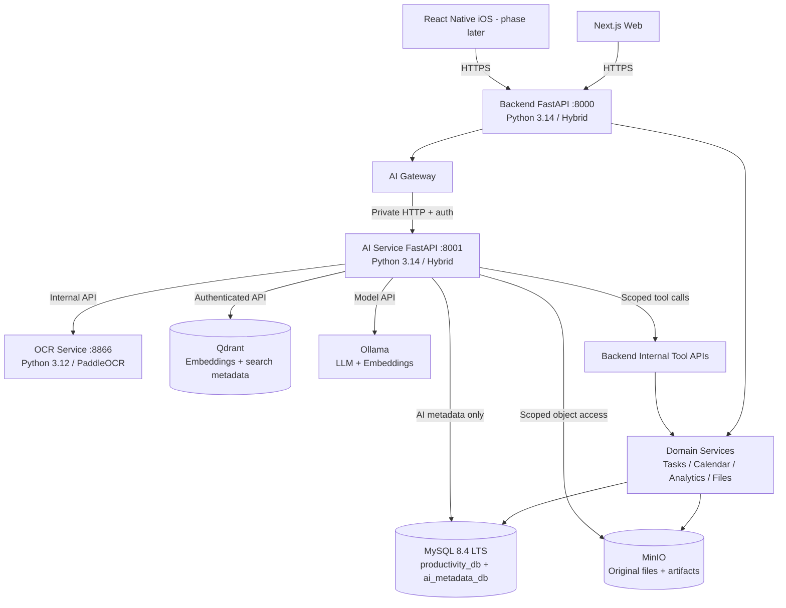
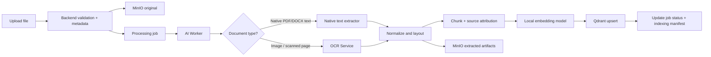

# Personal Productivity App — AI & Data Infrastructure Technical Specification v2.0

> **Tài liệu:** AI Service Hybrid Architecture, Local AI Infrastructure, Document Intelligence & Storage
> **Dự án:** Personal Productivity & Time Management App
> **Phiên bản:** 2.0.0 — Self-Hosted / Independent AI Service / Hybrid Architecture
> **Ngày cập nhật:** 17/11/2026
> **Trạng thái:** Kiến trúc mục tiêu — chưa đồng nghĩa đã triển khai hoặc kiểm thử production
> **Đối tượng:** Developer, reviewer, Codex / Claude Code / AI coding assistant
> **Thay thế:** Tài liệu AI Hybrid v2 trước đó ở các quyết định lưu trữ, Qdrant, OCR và triển khai cloud
> **Phạm vi:** Kiến trúc, frameworks, ranh giới service, giao thức, storage, OCR/RAG, jobs, security, testing, triển khai. **Chưa khóa ERD chi tiết**.

---

## 0. Executive summary — các quyết định đã chốt

1. **Frontend:** Next.js 16 + React 19 + TypeScript + Tailwind CSS 4 + shadcn/ui; iOS React Native/Expo là giai đoạn sau.
2. **Business Backend:** FastAPI + Python 3.14, **Hybrid Architecture (feature-first, layered-inside)**, sở hữu business rules và dữ liệu nghiệp vụ.
3. **AI Service:** FastAPI + Python **3.14**, Pydantic AI; **service độc lập** có `Dockerfile`, dependency lock, healthcheck, API và tests riêng; **bên trong cũng là Hybrid Architecture**.
4. **OCR Service:** **service/container độc lập**, đề xuất Python **3.12** để thuận lợi cho PaddlePaddle/PaddleOCR; không ép tất cả service dùng cùng Python runtime.
5. **MySQL 8.4 LTS / InnoDB:** dữ liệu nghiệp vụ, metadata, job state; có thể chia `productivity_db` và `ai_metadata_db` trong **cùng một instance MySQL** để tiết kiệm RAM.
6. **MinIO self-host:** lưu file gốc và artifact (ảnh, PDF, DOCX, OCR output, exports). **Không dùng AWS S3/R2 hay thuê cloud object storage**.
7. **Qdrant self-host:** embeddings và payload tìm kiếm ngữ nghĩa. **Không lưu file gốc hay làm nguồn sự thật nghiệp vụ**.
8. **Ollama self-host:** chạy local LLM / embedding model. Cloud provider là tùy chọn **tắt theo mặc định**; chưa phải dependency của MVP.
9. **Giao tiếp:** `Web/iOS → Backend → AI Service`; AI gọi lại **Backend Internal Tool APIs** khi cần dữ liệu nghiệp vụ; AI gọi OCR, Qdrant, Ollama và đọc object đã được cấp phép ở MinIO.
10. **AI không tự cập nhật nghiệp vụ:** các action chỉ là `proposal` → user review/confirm → Backend revalidate → transaction → audit.
11. **Infrastructure:** Docker Compose trên Ubuntu, persistent volumes, mạng riêng, backup, healthcheck, không public MySQL/Qdrant/MinIO admin/Ollama/OCR.
12. **Phạm vi mở rộng:** Document Understanding, OCR ảnh/PDF scan, RAG, semantic search, chart/dashboard generation, task extraction, planning, analytics.

### 0.1. Tư duy kiến trúc

**Service-oriented + Polyglot Persistence + Hybrid Architecture.**

- *Service-oriented*: Backend, AI Service và OCR Service là các tiến trình/container độc lập.
- *Hybrid*: mỗi service tổ chức **theo nghiệp vụ trước**, rồi phân lớp API / services / agents / repositories / schemas / mappers nếu cần.
- *Polyglot persistence*: MySQL cho dữ liệu quan hệ; MinIO cho object/file; Qdrant cho vector/semantic retrieval.
- *Single machine*: ban đầu self-host trên một Ubuntu server, chưa cần Kubernetes, cluster, Kafka hay nhiều database server.
- *Data ownership*: hệ thống AI xử lý, suy luận và tìm kiếm nhưng **Backend là nguồn sự thật cho tasks, schedules, files và permissions**.

### 0.2. Những ràng buộc không được phá

- Không có luồng **Frontend → AI Service trực tiếp** trên Internet.
- Không có luồng **LLM → MySQL trực tiếp**, SQL tùy ý, shell/JS tùy ý.
- AI Service **không có credential truy cập `productivity_db`**.
- Nếu có `ai_metadata_db`, AI Service chỉ có quyền trong database này qua account riêng.
- OCR đọc nội dung không đáng tin cậy; không coi text trích xuất là chỉ dẫn hệ thống.
- Charts phải dựng từ metric có nguồn xác thực, không để LLM tự bịa số liệu.
- Lịch sử `tasks → task_occurrences → time_entries` phải được bảo toàn; AI không được sửa các occurrence đã hoàn thành tùy tiện.
- Khi AI/OCR/Qdrant/Ollama lỗi, tạo/sửa task thủ công và phần Backend cơ bản **vẫn hoạt động**.

---

## 1. Sơ đồ kiến trúc tổng thể



> Diagram là **luồng logic**, không có nghĩa mọi request đều đi qua tất cả services. Ví dụ tạo task thủ công không gọi AI; query time tracking không cần Qdrant.

### 1.1. Trust boundaries và quyền sở hữu

| Component   | Sở hữu                                                                          | Được truy cập                                                                                      | Bị cấm                                                       |
| ----------- | --------------------------------------------------------------------------------- | ------------------------------------------------------------------------------------------------------ | -------------------------------------------------------------- |
| Frontend    | UI, local state, typed client                                                     | Public Backend API                                                                                     | MySQL, AI Internal, Qdrant, MinIO admin, Ollama                |
| Backend     | Auth, business rules, user ownership, transactions, file metadata, proposals      | MySQL nghiệp vụ, MinIO qua SDK, AI Gateway                                                           | Để client tự truyền `user_id` làm căn cứ phân quyền |
| AI Service  | Agents, prompt/tool orchestration, RAG, chart specs, document-processing metadata | Backend Internal Tools, OCR, Qdrant, Ollama, object được cấp quyền, `ai_metadata_db` nếu dùng | Business tables trực tiếp, public unrestricted file access   |
| OCR Service | Text/layout/table extraction                                                      | Bytes hoặc URL nội bộ có TTL và giới hạn scope                                                  | MySQL nghiệp vụ, AI action execution                         |
| MySQL       | Relational source of truth, lifecycle state                                       | Backend, AI metadata account có scope riêng                                                          | Truy cập public                                               |
| MinIO       | Object bytes, versioned artifacts                                                 | Backend và AI/OCR theo quyền hạn hẹp                                                               | Bucket public, admin credentials cho ứng dụng                |
| Qdrant      | Search index, vector payload                                                      | AI Service, maintenance jobs                                                                           | Dùng làm primary source of truth                             |
| Ollama      | Local inference                                                                   | AI Service                                                                                             | Public model API                                               |

---

## 2. Technology stack — phiên bản và framework

| Nhóm               | Công nghệ                                             | Quyết định / chính sách                               |
| ------------------- | ------------------------------------------------------- | ---------------------------------------------------------- |
| Backend runtime     | **Python 3.14**                                   | Pin `>=3.14,<3.15` và kiểm thử compatibility          |
| AI runtime          | **Python 3.14**                                   | Environment độc lập Backend                             |
| OCR runtime         | **Python 3.12**                                   | Dùng riêng do dependency native/PaddlePaddle             |
| HTTP API            | **FastAPI, Uvicorn**                              | Mỗi service FastAPI riêng                                |
| AI Orchestration    | **Pydantic AI**                                   | Typed tools, structured outputs, model abstraction         |
| Validation          | **Pydantic v2, pydantic-settings**                | Request/response strict validation                         |
| HTTP Client         | **HTTPX**                                         | Async internal service calls, timeouts                     |
| Relational DB       | **MySQL 8.4 LTS**                                 | InnoDB, utf8mb4, persistent volume                         |
| ORM / migration     | **SQLAlchemy 2.x, Alembic**                       | Backend; nếu AI metadata cần bảng thì migration riêng |
| MySQL async driver  | **asyncmy**                                       | Kiểm thử cùng Python 3.14 trước khi pin               |
| Object Storage      | **MinIO (self-host)**                             | S3-compatible; image/tag **pin bản đã xác minh** |
| MinIO Python client | **minio** hoặc **boto3**                   | Một abstraction cho storage, chọn 1 SDK thống nhất     |
| Vector Database     | **Qdrant**                                        | Persistent volume + snapshot                               |
| Vector Client       | **qdrant-client**                                 | Async API, payload filter                                  |
| Local inference     | **Ollama**                                        | LLM và embedding theo benchmark RAM/GPU                   |
| OCR / layout        | **PaddleOCR 3.x / PP-StructureV3**                | Optional layout pipeline sau basic OCR                     |
| Image preprocess    | **Pillow, OpenCV**                                | Resize, rotate, denoise có chọn lọc                     |
| PDF parsing         | **PyMuPDF**                                       | Extract text-first; render scanned pages khi cần          |
| Office parsing      | **python-docx**                                   | DOCX; XLSX parser tùy tính năng sau                     |
| Computation         | **SQL + Python**                                  | Pandas/NumPy chỉ cài khi bài toán thực sự cần       |
| Chart renderer      | **Recharts + shadcn Charts**                      | Frontend nhận validated ChartSpec                         |
| Package management  | **uv**                                            | Mỗi Python service có `pyproject.toml` / `uv.lock`   |
| Test / Evals        | **pytest, pytest-asyncio, HTTPX, Pydantic Evals** | Unit + integration + eval fixtures                         |
| Code quality        | **Ruff, Pyright**                                 | Lint, format, type checking                                |
| Infra               | **Docker Compose**                                | Ubuntu self-host, independent containers                   |
| DB IDE              | **JetBrains DataGrip**                            | Truy cập qua SSH tunnel hoặc host binding local          |

**Compatibility gate:** tài liệu chỉ chọn *nhánh công nghệ*. Phiên bản package cụ thể được chốt bằng lockfile và CI import/integration tests. Đặc biệt không mặc định PaddlePaddle hỗ trợ Python 3.14 chỉ vì Backend dùng Python 3.14.

### 2.1. MinIO lifecycle / security note

Repository **MinIO Community** trên GitHub đã được archive năm 2026. Mình vẫn chọn MinIO theo quyết định self-host của dự án, nhưng phải:

- Xác định **đúng image và digest** mà máy đang chạy được, không dùng `:latest` vô kiểm soát.
- Theo dõi advisory, khóa không public admin API, dùng quyền bucket tối thiểu và backup ngoại tuyến.
- Có phương án thay Object Storage provider qua S3 adapter nếu rủi ro bảo mật/compatibility tăng; **không tự chuyển sang dịch vụ tính phí**.
- Với nhu cầu Internet exposure, ưu tiên Backend làm access broker thay vì công khai MinIO.

### 2.2. Những thứ chưa cần

Kubernetes, Kafka, service mesh, RabbitMQ, Redis Cluster, distributed tracing platform nặng, vector DB cluster, autoscaling nhiều node. Một người dùng và một Ubuntu server chưa có lý do để vận hành những thứ này.

---

## 3. Repository structure — độc lập service, Hybrid bên trong

```text
personal-productivity/
├── frontend/                         # Next.js 16 (Web)
├── backend/                          # FastAPI Python 3.14, Hybrid
│   ├── app/
│   │   ├── main.py
│   │   ├── api/                      # API version/router registry
│   │   ├── core/                     # Config, auth, logging
│   │   ├── db/                       # Engine, sessions, metadata
│   │   ├── modules/
│   │   │   ├── auth/
│   │   │   ├── tasks/
│   │   │   ├── calendar/
│   │   │   ├── time_tracking/
│   │   │   ├── analytics/
│   │   │   ├── reminders/
│   │   │   ├── files/                # Upload, MinIO, metadata
│   │   │   └── ai_gateway/          # AI service client & response validation
│   │   └── shared/
│   ├── alembic/
│   ├── pyproject.toml
│   ├── uv.lock
│   └── Dockerfile
│
├── ai-service/                       # Independent FastAPI Python 3.14, Hybrid
│   ├── app/
│   │   ├── main.py
│   │   ├── api/                      # Router registry / health
│   │   ├── core/                     # Settings, security, logging, limits
│   │   ├── shared/
│   │   │   ├── clients/              # BackendInternalClient, OCRClient
│   │   │   ├── providers/            # Ollama, cloud opt-in adapters
│   │   │   ├── storage/              # Scoped MinIO adapter
│   │   │   ├── vector/               # Qdrant client wrapper
│   │   │   ├── embeddings/           # Embedding provider abstraction
│   │   │   ├── schemas/              # Common DTO, Result, Error
│   │   │   └── observability/
│   │   └── modules/
│   │       ├── task_intelligence/
│   │       │   ├── api/
│   │       │   ├── services/
│   │       │   ├── agents/
│   │       │   ├── tools/
│   │       │   ├── schemas/
│   │       │   └── prompts/
│   │       ├── planning/
│   │       │   ├── api/
│   │       │   ├── services/
│   │       │   ├── agents/
│   │       │   ├── engines/
│   │       │   └── schemas/
│   │       ├── analytics/
│   │       │   ├── api/
│   │       │   ├── services/
│   │       │   ├── agents/
│   │       │   └── schemas/
│   │       ├── visualization/
│   │       │   ├── api/
│   │       │   ├── services/
│   │       │   ├── agents/
│   │       │   ├── schemas/          # ChartSpec / DashboardSpec
│   │       │   └── validators/
│   │       ├── document_intelligence/
│   │       │   ├── api/
│   │       │   ├── services/
│   │       │   ├── pipelines/        # ingest/extract/chunk/index
│   │       │   ├── tools/
│   │       │   ├── schemas/
│   │       │   └── mappers/
│   │       ├── retrieval/
│   │       │   ├── api/
│   │       │   ├── services/
│   │       │   ├── retrievers/
│   │       │   ├── rerankers/        # optional
│   │       │   ├── schemas/
│   │       │   └── validators/
│   │       └── memory/
│   │           ├── services/
│   │           ├── schemas/
│   │           └── repositories/     # ai_metadata_db only (optional)
│   ├── worker/                       # Async ingestion/job worker
│   ├── tests/
│   ├── pyproject.toml
│   ├── uv.lock
│   └── Dockerfile
│
├── ocr-service/                      # Independent service, Python 3.12
│   ├── app/
│   │   ├── main.py
│   │   ├── core/                     # Config, model registry, limits
│   │   ├── api/                      # /internal/ocr
│   │   ├── engines/
│   │   │   ├── text_ocr.py           # PaddleOCR
│   │   │   ├── layout_ocr.py         # PP-StructureV3 optional
│   │   │   └── table_ocr.py
│   │   ├── preprocessing/            # Image cleanup, orientation
│   │   ├── parsers/                  # PDF page/image routing
│   │   ├── schemas/
│   │   └── services/
│   ├── tests/
│   ├── pyproject.toml
│   ├── uv.lock
│   └── Dockerfile
│
├── contracts/
│   ├── backend-ai/                  # OpenAPI / versioned DTO examples
│   ├── ai-ocr/
│   └── ai-backend-tools/
│
├── infra/
│   ├── compose.yaml
│   ├── mysql/
│   ├── minio/
│   ├── qdrant/
│   ├── ollama/
│   ├── scripts/
│   │   ├── backup.sh
│   │   ├── restore-check.sh
│   │   └── verify-services.sh
│   └── secrets/                      # NEVER COMMIT
└── docs/
```

**Không tạo thư mục rỗng chỉ để đủ mẫu.** `repositories/` và `models/` trong AI Service chỉ tồn tại ở các module có **AI metadata storage riêng**. Không sao chép các ORM entity nghiệp vụ từ Backend sang AI.

### 3.1. Phụ thuộc nội bộ một module Hybrid

```text
Module API (FastAPI Router)
     ↓
Application Service / Orchestrator
     ├── Agent / Rules Engine / Pipeline
     ├── Typed Tool Client → Backend Internal API
     ├── OCR Client → OCR Service
     ├── Vector Client → Qdrant
     └── Storage Client → Scoped MinIO objects
     ↓
Response Schema / Mapper / Typed Result
```

- API: nhận/trả HTTP, auth service-level, request validation; không chứa prompt phức tạp.
- Services: orchestration, retries ở mức ứng dụng, ownership logic.
- Agents: Pydantic AI definitions, model I/O, typed tools.
- Engines: thuật toán deterministic (planning constraints, calculation) không phụ thuộc LLM.
- Tools: typed gateways; không được chạy raw SQL/OS command.
- Pipelines: xử lý file/ảnh/PDF theo trạng thái có thể chạy lại.
- Schemas: Pydantic requests, responses, charts, error contracts.
- Repositories: chỉ cho **data AI sở hữu**; AI không import repository của Backend.

### 3.2. Ownership giữa các modules

| Module                    | Sở hữu                                          | Không sở hữu                                 |
| ------------------------- | ------------------------------------------------- | ----------------------------------------------- |
| `task_intelligence`     | TaskDraft, breakdown, intent parsing              | Lưu/sửa Task thực tế                        |
| `planning`              | Proposed schedule, replan, what-if                | Canonical Task Occurrence                       |
| `analytics`             | Diễn giải metric, insight                       | SQL metric definitions/source truth             |
| `visualization`         | Validated ChartSpec, DashboardSpec                | Raw SQL / React JSX runtime                     |
| `document_intelligence` | Ingestion pipeline, chunking, document enrichment | File permission / binary source ownership       |
| `retrieval`             | Semantic/hybrid search, source attribution        | MySQL business facts                            |
| `memory`                | Approved preferences and AI context               | Ngầm lưu mọi chi tiết cá nhân vĩnh viễn |

---

## 4. Storage architecture: MySQL + MinIO + Qdrant

### 4.1. MySQL — relational source of truth

**Một MySQL instance self-host**; khuyến nghị hai logical database và tài khoản riêng:

```text
mysql:3306
├── productivity_db      # Backend owner
│   ├── tasks / occurrences / time_entries / projects / ...
│   ├── files              # Metadata và owner
│   ├── file_versions      # Nếu cần versioning
│   ├── action_proposals   # Preview / confirmation / audit
│   └── ...
└── ai_metadata_db       # AI owner (khi cần)
    ├── ai_conversations
    ├── ai_messages
    ├── processing_jobs
    ├── document_index_states
    ├── document_chunks_metadata
    └── ai_memories
```

**Các tên bảng là đề xuất, không phải schema đã phê duyệt.**

- `backend_user`: chỉ có quyền cần thiết trên `productivity_db`; có thể phát nội dung job qua internal APIs.
- `ai_user`: chỉ trên `ai_metadata_db`; tuyệt đối không có `SELECT` trên bảng tasks/calendar.
- Nếu muốn tiết kiệm hơn ở MVP, job metadata có thể do Backend giữ trong `productivity_db` và AI Service cập nhật qua Backend APIs; **không cần tạo `ai_metadata_db` cho đến khi có migration rõ ràng**.
- Datetimes: thống nhất UTC. MySQL `DATETIME(6)` không tự mang timezone; chuyển đổi tại layer ứng dụng.
- `utf8mb4` cho tiếng Việt và ký tự emoji, kiểm soát collation với các field phải unique/case-sensitive.
- Không lưu PDF/ảnh gốc thành MySQL BLOB.

### 4.2. MinIO — object/file source of truth

**MinIO được self-host trên Ubuntu và sử dụng API S3-compatible qua SDK**, không phải trả phí thuê AWS S3.

Đề xuất bucket tối giản:

| Bucket               | Nội dung                                                            | Access                             |
| -------------------- | -------------------------------------------------------------------- | ---------------------------------- |
| `personal-uploads` | File gốc ảnh/PDF/DOCX/attachments                                  | Private                            |
| `ai-artifacts`     | OCR JSON, text extracted, preview, thumbnail, indexed manifest       | Private                            |
| `personal-exports` | PDF/Excel/Markdown reports xuất từ app                             | Private, retention phù hợp       |
| `system-backups`   | Bản sao backup nếu **nằm trên thiết bị lưu trữ khác** | Private, chỉ là một lớp backup |

> Không cần tạo bucket riêng cho mọi MIME type. Metadata quản lý bằng `file_id`, `mime_type`, `document_type`, và `object_key`.

**Object key contract đề xuất:**

```text
uploads/{owner_id}/{file_id}/v{version}/original.pdf
artifacts/{owner_id}/{file_id}/v{version}/ocr/page-0001.json
artifacts/{owner_id}/{file_id}/v{version}/extracted.txt
artifacts/{owner_id}/{file_id}/v{version}/thumb/page-0001.webp
exports/{owner_id}/{export_id}/report.pdf
```

Không đưa tên file gốc chưa sanitize vào object key; tránh path traversal/PII leak qua tên file.

**Upload flow:**

1. Frontend gọi Backend `POST /api/v1/files/init-upload` với filename, content type, size.
2. Backend xác thực user, kiểm tra quota, MIME allowlist, cấp `file_id` và phương án upload: **proxy upload qua Backend (MVP)** hoặc presigned URL ngắn hạn qua ingress bảo vệ.
3. Backend ghi metadata trạng thái `PENDING_UPLOAD`.
4. File được stream vào MinIO, không đọc toàn bộ file lớn vào RAM.
5. Kiểm checksum, sniff MIME, quét nội dung nguy hiểm nếu triển khai scanner; trạng thái `READY` rồi có thể tạo ingestion job.
6. AI Service truy xuất thông qua **Backend-issued short-lived scoped access** hoặc internal object gateway; không cấp MinIO root key cho AI/OCR.

**Đề xuất MVP:** Backend proxy upload/download để không cần mở MinIO ra Internet và tránh vấn đề presigned URL dùng hostname nội bộ không truy cập được từ iPhone.

**MinIO Security Checklist:**

- [ ] Không public MinIO Console / S3 API.
- [ ] Root credentials chỉ dành cho bootstrap/ops; application dùng policy riêng.
- [ ] Bucket private, public access off.
- [ ] Không commit access keys, `.env`, certificates vào Git.
- [ ] Cấp token / scoped object permission có TTL và `file_id` ownership check.
- [ ] Giới hạn upload size, MIME, số trang PDF, giải nén archive, request body.
- [ ] Không coi object storage và backup là một: volume mất thì cả object lẫn snapshot cùng ổ có thể mất.
- [ ] Ghi audit cho download/delete quan trọng và xử lý xóa đồng bộ index.

### 4.3. Qdrant — vector index, không lưu file gốc

Qdrant chỉ lưu embeddings và payload có cấu trúc để phục vụ semantic retrieval.

**Collection design đề xuất:**

- `personal_knowledge_v1`: chunks của ghi chú, PDF, OCR text; filter `owner_id`, `document_id`, `version`, `status`.
- `personal_memory_v1`: chỉ thêm khi có long-term memory có kiểm soát và xóa được.

Không cần collection cho mọi project hoặc mọi loại file; ưu tiên ít collection, dùng payload filters.

**Payload mẫu:**

```json
{
  "owner_id": "user-uuid",
  "document_id": "document-uuid",
  "file_version": 3,
  "chunk_id": "chunk-uuid",
  "page_number": 2,
  "section": "Plan for November",
  "source_type": "pdf_ocr",
  "language": "vi",
  "index_status": "active",
  "content_hash": "sha256:...",
  "embedding_model_version": "local-embedding-v1"
}
```

- Không tin `owner_id` từ prompt/user text; lọc bằng identity đã xác thực của Backend trong tool context.
- Dimensionality + distance metric phải khớp model embedding, khóa per collection. Đổi model/dimension cần rebuild collection mới rồi switch alias khi index xong.
- Có thể lưu snippet ngắn trong payload để retrieval nhanh, nhưng metadata/file gốc vẫn nằm MySQL/MinIO.
- Tạo stable point ID theo `(document_id, file_version, chunk_id, embedding_model_version)` để upsert idempotent.
- Khi xóa/cập nhật document phải xóa/deactivate points cũ theo `document_id` + version.
- Cần snapshot Qdrant; snapshot cùng một disk chưa đủ làm backup.

### 4.4. Data placement matrix

| Dữ liệu                         | MySQL                                   | MinIO                     | Qdrant                                             |
| --------------------------------- | --------------------------------------- | ------------------------- | -------------------------------------------------- |
| Task, deadline, occurrence        | **Canonical**                     | Không                    | Không                                             |
| Time entries, habit logs          | **Canonical**                     | Không                    | Không                                             |
| File metadata, owner, permissions | **Canonical**                     | Không                    | Chỉ document ID filter                            |
| File gốc PDF/ảnh/DOCX           | Metadata                                | **Canonical bytes** | Không                                             |
| OCR text/JSON/page images         | Status + pointers                       | **Artifact bytes**  | Chunk index tùy bật                              |
| Ingestion/job progress            | **Canonical state**               | Logs/artifact tùy chọn  | Không                                             |
| AI conversation                   | MySQL metadata nếu bật lưu lịch sử | Attachments               | Không, trừ memory opt-in                         |
| Document text chunks              | Metadata / pointers                     | Nội dung / manifest      | Embeddings + search payload                        |
| Charts/DashboardSpec đã lưu    | **Canonical config**              | Exported reports          | Không                                             |
| OCR/search embeddings             | Model registry metadata                 | Không                    | **Canonical search index, có thể rebuild** |

---

## 5. OCR & Document Intelligence — phạm vi

### 5.1. Những loại đầu vào cần hỗ trợ

| Input                               | Xử lý mặc định                     | Fallback                                                |
| ----------------------------------- | --------------------------------------- | ------------------------------------------------------- |
| Ảnh screenshot có chữ            | Basic PaddleOCR                         | VLM local khi văn bản/layout quá khó                |
| Ảnh chụp tài liệu điện thoại | Rotate/crop → OCR                      | PP-StructureV3 nếu multi-column/table                  |
| Ảnh bảng biểu                    | Table detector/layout + structure       | Vision model nếu cấu trúc sai hoặc confidence thấp |
| PDF text-based                      | **Extract native text trước**   | OCR chỉ các trang thiếu text                         |
| PDF scan                            | Render page có giới hạn DPI → OCR   | Layout/PP-StructureV3                                   |
| DOCX                                | Parse native paragraphs/tables          | OCR chỉ embedded images nếu cần                      |
| Ảnh không có chữ                | Có thể route vision task              | Không ép qua OCR text parser                          |
| Ảnh lịch trình/todo              | OCR → structured extraction → preview | Hỏi lại những trường không chắc                  |

**Nguyên tắc tối ưu:** Tránh đưa mọi ảnh qua pipeline nặng. Phân luồng *basic OCR → layout/table → VLM*, chỉ nâng cấp khi cần.

### 5.2. OCR Service runtime

- **Python 3.12** trong container `ocr-service`.
- `PaddleOCR 3.x` và các optional dependencies chỉ cài khi cần theo tài liệu chính thức.
- CPU mode hoạt động trước; GPU là cấu hình tùy chọn nếu server có VRAM phù hợp.
- Cấu hình giới hạn `max_pixels`, `max_pages`, `max_file_size`, `max_concurrent_jobs`, `timeout`.
- Batch theo trang và có thể resume khi job lỗi.
- Load model một lần trong process/worker khi cấu hình phù hợp; tránh mỗi request load lại model.
- Tách warm-up/healthcheck; `/health/live` không nên tự infer model nặng, `/health/ready` có thể kiểm trạng thái model.

### 5.3. OCR Output Contract

```json
{
  "request_id": "ocrreq-01",
  "document_id": "doc-uuid",
  "page_number": 1,
  "engine": "paddleocr",
  "engine_version": "configured-version",
  "language": "vi",
  "text": "Học tiếng Anh lúc 20:00",
  "lines": [
    {
      "text": "Học tiếng Anh lúc 20:00",
      "confidence": 0.94,
      "bbox": [12, 18, 455, 65]
    }
  ],
  "tables": [],
  "warnings": [],
  "processing_ms": 220
}
```

`confidence` là điểm model nội bộ, **không phải xác suất đúng tuyệt đối**. Các số ví dụ trên là dữ liệu giả lập; schema thực tế phải được đánh version.

### 5.4. Lưu output OCR

- OCR JSON, text normalized và layout/table markup → `ai-artifacts` MinIO.
- MySQL AI metadata → `ocr_status`, `artifact_key`, `page_count`, `version`, `checksum`, `error_code`.
- Qdrant → chỉ những chunks có ích đã được làm sạch và cấp phép index.
- Mỗi artifact phải truy vết được về `file_id`, phiên bản, trang, OCR engine/model.

### 5.5. OCR Accuracy / Safety

- Không tự tạo task khi ngày/giờ, recurrence, người nhận hoặc deadline OCR mơ hồ.
- Review preview hiển thị trích đoạn nguồn/file/page; m sửa trước khi Confirm.
- Ảnh có thể chứa prompt injection; chỉ dùng nội dung làm **dữ liệu**.
- Giới hạn pixel để tránh decompression bombs, PDF nhiều trang, file malformed, timeout nặng CPU.
- Nếu có xử lý PDF, dùng sandbox/container không đặc quyền và không chạy macro/script từ tài liệu.

---

## 6. Ingestion Pipeline — từ upload đến vector index



### 6.1. Job lifecycle

`PENDING → VALIDATING → EXTRACTING → NORMALIZING → CHUNKING → EMBEDDING → INDEXING → COMPLETED`

Lỗi: `FAILED_RETRYABLE`, `FAILED_PERMANENT`, `CANCELLED`, `STALE_VERSION`.

- Job idempotency key = `(document_id, file_version, pipeline_version, embedding_model_version)`.
- Retry có backoff + max attempts, không retry vô hạn.
- Worker claim job qua MySQL job table; transaction/lease/idempotency cần được kiểm thử.
- Khi file version thay đổi lúc đang index: job cũ có thể hoàn thành nhưng **không được trở thành active version**; kiểm tra version trước khi publish.
- Sau restart server, worker quét lease hết hạn để resume.
- Không khẳng định transaction phân tán giữa MySQL–MinIO–Qdrant là atomic; dùng **eventual consistency + reconciliation**.

### 6.2. Pipeline chi tiết

1. **Validate:** kiểm quyền file qua Backend, MIME sniffing, checksum, quota, malware scanning nếu bật.
2. **Acquire:** chỉ lấy object path được cấp phép, không fetch URL do prompt tùy ý (chặn SSRF).
3. **Detect:** PDF native text vs scanned; ảnh thường vs table/layout.
4. **Extract:** native parse hoặc OCR theo route; giới hạn trang và CPU.
5. **Normalize:** Unicode, whitespace, thứ tự đọc, loại header/footer nhiễu; giữ tham chiếu trang/bbox.
6. **Chunk:** chia theo heading/paragraph, có overlap phù hợp; không cắt giữa cell/table ngẫu nhiên.
7. **Embed:** local embedding model đã version; batch nhỏ, có retry/timeout.
8. **Index:** Qdrant upsert với stable point IDs, payload filters owner/doc/version.
9. **Publish:** cập nhật trạng thái active index và kiểm tra số chunks; có thể query được.
10. **Reconcile:** kiểm file metadata, MinIO object, indexing manifest và Qdrant points để sửa lệch dữ liệu.

### 6.3. Xóa và cập nhật file

```text
User requests delete → Backend authorizes and records deletion intent
  → block new AI retrieval for document_id immediately
  → delete/deactivate Qdrant vectors
  → delete OCR artifacts / original MinIO objects by policy
  → finalize metadata status and audit
```

Nếu một bước fail, job cleanup được retry. Không để document đã xóa vẫn trả về từ RAG. Soft-delete/tombstone trước khi cleanup để bảo đảm không lọt truy vấn.

---

## 7. RAG & Semantic Search

### 7.1. Khi nào dùng RAG?

**Dùng:** tìm ghi chú, tóm tắt PDF, hỏi tài liệu đã upload, hỏi lại thông tin trong ảnh hoặc lịch sử ghi chú dài.

**Không cần dùng:** tổng số task Done, giờ học tuần này, deadline ngày mai, completion rate, planned vs actual — các dữ liệu này lấy từ Backend Analytics/Task APIs.

### 7.2. Retrieval flow

```text
User question → Backend → AI Service
    ↓
Intent routing:
    ├── structured facts/metrics → Backend Tools → MySQL
    ├── documents/notes → Qdrant retrieval → MinIO source snippets
    └── mixed → combine two grounded evidence sources
    ↓
Answer builder → Source references / caveats → Backend → UI
```

- Query embedding phải dùng đúng embedding model version với collection/alias.
- Luôn filter `owner_id`/ACL từ trusted context, không lấy từ LLM output.
- Thêm `document_ids`, `source_type`, `status=active`, `file_version` vào payload filters theo quyền.
- Dùng top-k giới hạn; optional keyword retrieval/reranking nếu eval cho thấy cần.
- Prompt chỉ nhận excerpts đã được phép đọc, không đưa toàn bộ file khi không cần.
- Kết quả phải gắn `document_id`, page/chunk, có thể đưa link file do Backend tạo cho user.
- Nếu không có evidence đáng tin cậy: nói không tìm thấy/chưa đủ dữ liệu, không hallucinate.

### 7.3. Document-aware AI Task Creation

Ví dụ user upload ảnh lịch học hoặc PDF kế hoạch:

1. OCR/native parse tạo source text.
2. Task Intelligence trích `title`, `start`, `duration`, `deadline`, `recurrence`, `reminder`.
3. Gắn source reference và field confidence/ambiguity.
4. Backend trả TaskDraft cho UI preview.
5. User sửa/xác nhận → Backend Task Service tạo dữ liệu thực.

**Không bao giờ** chuyển trực tiếp văn bản OCR thành thao tác ghi MySQL không được xác nhận.

---

## 8. AI product capabilities — phạm vi chức năng

| Module                | Feature                       | Đầu ra                      | Priority |
| --------------------- | ----------------------------- | ----------------------------- | -------- |
| Task Intelligence     | Smart Task Creation           | `TaskDraft`                 | P0       |
| Task Intelligence     | Task Breakdown                | Subtask drafts                | P1       |
| Task Intelligence     | OCR-to-Task                   | TaskDraft + source references | P1       |
| Planning              | Daily Planner                 | `ScheduleProposal`          | P0/P1    |
| Planning              | Smart Rescheduling            | `ActionProposal`            | P1       |
| Planning              | What-if Simulation            | Scenario comparison           | P2       |
| Analytics             | Natural Language Analytics    | Data-grounded answer          | P0       |
| Analytics             | Weekly/Monthly Review         | Summary with provenance       | P1       |
| Visualization         | Chart Generator               | `ChartSpec`                 | P0       |
| Visualization         | Dashboard Builder             | `DashboardSpec`             | P1       |
| Document Intelligence | Read screenshot/PDF/DOCX      | Text/layout + summaries       | P1       |
| Retrieval             | Semantic document search      | Answer + citations            | P1       |
| Memory                | Approved personal preferences | Consent-aware memory          | P2       |
| Vision                | Advanced image understanding  | VLM result                    | P2       |
| Prediction            | Estimate duration             | Prediction with uncertainty   | P2/P3    |

### 8.1. Product rule: AI càng ít làm thay người khi dữ liệu thiếu càng tốt

- Parse ngôn ngữ tự nhiên: hỏi/đánh dấu thiếu các field quan trọng.
- Planning: không lấp kín 100% quỹ thời gian; có buffer configurable.
- Insights: backend tính metric; LLM diễn giải và nêu giới hạn bằng chứng.
- Notifications: AI chỉ đề xuất nội dung/thời điểm; Backend scheduler là nguồn thực thi.

---

## 9. Analytics, ChartSpec và DashboardSpec

### 9.1. Dữ liệu biểu đồ phải có nguồn

AI không tự đặt metric formula. Backend cần `Metric Registry` với các metric được duyệt, ví dụ:

- `completed_tasks`: dựa trên `task_occurrences` Done trong period.
- `actual_focus_minutes`: tổng hợp từ `time_entries`, chống double count.
- `planned_minutes`: kế hoạch/estimated của occurrence.
- `completion_rate`: mẫu số phải được định nghĩa rõ (không tự cộng task tương lai/hủy).
- `habit_checkins`: từ habit logs hợp lệ.

### 9.2. ChartSpec hợp lệ

```json
{
  "type": "chart",
  "title": "Planned vs Actual",
  "chart": {
    "type": "bar",
    "x_key": "date",
    "series": [
      {"data_key": "planned_hours", "label": "Planned"},
      {"data_key": "actual_hours", "label": "Actual"}
    ]
  },
  "data_query": {
    "metric_ids": ["planned_hours", "actual_hours"],
    "period": "last_7_days",
    "group_by": "day"
  },
  "source": "backend_analytics_api"
}
```

- `chart.type`, `metric_ids`, aggregation, date range là **allowlisted values**.
- Backend kiểm quyền và query, AI/Frontend render data result; không cho LLM tự viết SQL/JSX để chạy.
- Dashboard có thể lưu configuration vào Backend MySQL, dữ liệu cập nhật bằng query đã phê duyệt.
- Frontend dùng Recharts; không nhét raw HTML/script từ prompt vào DOM.

### 9.3. Explain This Chart

AI nhận `ChartSpec`, metric result và optional time range, phân tích xu hướng; nếu không biết nguyên nhân thì chỉ nói quan sát/giả thuyết, không khẳng định.

---

## 10. Agent framework, model routing và output validation

### 10.1. Vì sao Pydantic AI?

- Typed inputs/outputs và tools phù hợp stack FastAPI + Pydantic.
- Model/provider abstraction giúp dùng Ollama trước, cloud tùy chọn sau.
- Usage/step limits, tracing hooks, retries có kiểm soát.
- Không buộc xây multi-agent orchestration phức tạp ngay từ MVP.

### 10.2. Routing proposal

| Intent          | Default                               | Fallback                                      |
| --------------- | ------------------------------------- | --------------------------------------------- |
| Task extraction | Ollama local model nhỏ/medium        | Parser rules, ask clarification               |
| Chart spec      | Ollama local + strict schema          | Deterministic chart selection                 |
| Data QA         | Backend tool → LLM local diễn giải | Raw data/table from Backend                   |
| OCR image       | PaddleOCR CPU                         | PP-StructureV3 / VLM local optional           |
| Semantic search | Local embedding + Qdrant              | Keyword/manual browse if indexing unavailable |
| Planner         | Rules/solver + LLM narration          | Deterministic schedule draft                  |

**Không fallback lên cloud âm thầm** khi Ollama lỗi. Nếu sau này bật cloud, phải có user opt-in, policy và data minimization.

### 10.3. Structured output

Các output bắt buộc schema validation:

- `TaskDraft`: title, date, time, duration, recurrence, ambiguity, source refs.
- `ScheduleProposal`: list of proposed occurrence changes, constraints, conflicts.
- `ActionProposal`: action type, target IDs, before/after, TTL, reasons.
- `ChartSpec` / `DashboardSpec`: renderer allowlist, metric registry, filters.
- `DocumentAnswer`: answer, citations, missing evidence, confidence caveats.

Model output **không đồng nghĩa dữ liệu hợp lệ**: Backend vẫn xác thực business rules và quyền ở thời điểm confirm.

---

## 11. Internal API contracts

### 11.1. Public Backend APIs (Frontend gọi)

```text
POST /api/v1/ai/chat
POST /api/v1/ai/tasks/parse
POST /api/v1/ai/planning/propose
POST /api/v1/ai/visualizations/generate
POST /api/v1/files/init-upload
POST /api/v1/files/{file_id}/complete
GET  /api/v1/files/{file_id}
GET  /api/v1/documents/{document_id}/processing-status
POST /api/v1/ai/actions/{proposal_id}/confirm
```

### 11.2. Backend → AI Service private APIs

```text
POST /internal/v1/task-intelligence/parse
POST /internal/v1/planning/propose
POST /internal/v1/analytics/explain
POST /internal/v1/visualization/generate
POST /internal/v1/documents/ingest
POST /internal/v1/documents/query
GET  /health/live
GET  /health/ready
```

### 11.3. AI → Backend Internal Tool APIs

```text
POST /internal/v1/tools/tasks/search
POST /internal/v1/tools/calendar/availability
POST /internal/v1/tools/analytics/metrics
POST /internal/v1/tools/files/authorize-read
POST /internal/v1/tools/files/metadata
POST /internal/v1/tools/proposals/submit
```

- Backend lấy `user_id`, role, feature scopes từ authenticated context của client rồi cấp short-lived service context.
- AI Service gửi service credential/claims, trace_id, và scope; Backend **tái kiểm quyền**.
- Không cho AI tạo `user_id` hoặc `owner_id` bằng cách đọc prompt để bypass authorization.
- Không dùng API key root chung cho tất cả services.

### 11.4. AI → OCR private APIs

```text
POST /internal/v1/ocr/image
POST /internal/v1/ocr/document
GET  /internal/v1/ocr/jobs/{job_id}
GET  /health/live
GET  /health/ready
```

Chọn **bytes streaming** hoặc scoped object reference; với `object_key`, OCR chỉ fetch thông qua gateway/credential hạn chế, không tùy ý mở external URL.

### 11.5. Ví dụ `DocumentIngestRequest`

```json
{
  "request_id": "req-uuid",
  "document_id": "doc-uuid",
  "file_id": "file-uuid",
  "file_version": 1,
  "processing_profile": "auto",
  "index_for_search": true,
  "callback_policy": "poll",
  "locale": "vi-VN"
}
```

**Không có raw path do user nhập**. AI Service giải quyết quyền đọc thông qua Backend Internal Files tool.

### 11.6. Errors và retry semantics

| Lỗi                         | Hành vi                                              |
| ---------------------------- | ----------------------------------------------------- |
| Unauthorized object          | 403, không retry bằng credential rộng hơn         |
| File too large / unsupported | 422, failed permanent                                 |
| OCR timeout                  | 504 hoặc retryable job error với bounded retry      |
| Ollama unavailable           | 503, degrade gracefully                               |
| Qdrant unavailable           | Search unavailable; không làm hỏng core app        |
| Duplicate indexing event     | Idempotent upsert / return existing job               |
| Stale document version       | Ignore stale publish, cleanup old points              |
| Invalid AI output            | Reject, optional one bounded repair, không lưu bừa |

---

## 12. Jobs, background processing, scheduling

### 12.1. Tại sao cần worker?

OCR vài chục trang, embedding hàng trăm chunk và generate previews không nên chạy trong cùng HTTP request. Trả `202 Accepted` cùng `job_id`, để frontend poll hoặc nghe progress qua Backend.

### 12.2. Không cần Redis ngay

Ban đầu dùng **MySQL jobs table + Python worker**:

- Job records có `status`, `attempt`, `lease_owner`, `lease_until`, `next_retry_at`, `progress`, `error_code`, `idempotency_key`.
- Worker claim job bằng atomic transaction và row-level locking phù hợp (`FOR UPDATE SKIP LOCKED` khi dùng MySQL 8.4 theo phương án đã kiểm thử).
- Không dùng polling quá ngắn; có backoff và concurrency limit.
- Khi có throughput lớn hơn mới cân nhắc Redis + RQ/Celery hoặc broker riêng; phải có số liệu chứng minh.

### 12.3. Bounded concurrency proposal

| Workload                | Mức ban đầu gợi ý     | Điều chỉnh         |
| ----------------------- | -------------------------- | --------------------- |
| CPU PaddleOCR inference | 1 concurrent heavy job     | CPU/RAM benchmark     |
| PP-StructureV3          | Chỉ chạy khi cần; 1 job | RAM/GPU benchmark     |
| Embedding batches       | 1–2 concurrent batches    | VRAM/Ollama queue     |
| Short LLM requests      | 1–2 concurrent requests   | latency/RAM           |
| MySQL pool              | Nhỏ, tách per-service    | tổng max connections |

Các con số là **giá trị khởi đầu để thử**, không phải capacity guarantee.

---

## 13. Self-host Ubuntu & Docker Compose architecture

### 13.1. Services / local ports

| Service          | Port nội bộ | Expose ra Internet?                                     |
| ---------------- | ------------: | ------------------------------------------------------- |
| Next.js Web      |          3000 | Chỉ qua ingress có HTTPS                              |
| Business Backend |          8000 | Qua ingress HTTPS/API auth                              |
| AI Service       |          8001 | **Không**                                        |
| OCR Service      |          8866 | **Không**                                        |
| MySQL            |          3306 | **Không** (DataGrip SSH tunnel / localhost bind) |
| MinIO S3 API     |          9000 | **Không**                                        |
| MinIO Console    |          9001 | **Không**                                        |
| Qdrant HTTP      |          6333 | **Không**                                        |
| Qdrant gRPC      |          6334 | **Không**                                        |
| Ollama           |         11434 | **Không**                                        |

### 13.2. Compose design principles

- `frontend`, `backend`: public-facing chỉ thông qua reverse proxy/VPN được cấu hình riêng.
- `internal_net`: backend, ai-service, ocr-service, MySQL, Qdrant, MinIO, Ollama.
- `ai-service` và `ocr-service` phải có Dockerfile/lockfile độc lập.
- MySQL, MinIO, Qdrant, Ollama cần **named volumes** cho dữ liệu/models.
- Tách `compose.yaml` và `compose.override.yaml` tùy môi trường; secrets không commit.
- `depends_on` không thay thế readiness; các client phải retry bounded khi service startup.
- Với thiết bị cá nhân, ưu tiên `restart: unless-stopped`, resource limits, log rotation, healthchecks và chính sách nâng cấp image.

### 13.3. Compose starter template (thay image pins trước khi chạy)

> **Lưu ý:** Đây là skeleton kiến trúc, **không phải compose production copy-paste chạy ngay**. Thay `PIN_VERIFIED_*` bằng tag/digest đã kiểm thử và cung cấp secret/volume/healthcheck cho môi trường thực. Riêng MinIO Community cần xác minh image được phép dùng và rủi ro phiên bản archive.

```yaml
name: personal-productivity

services:
  mysql:
    image: mysql:8.4
    restart: unless-stopped
    environment:
      MYSQL_ROOT_PASSWORD_FILE: /run/secrets/mysql_root_password
      MYSQL_DATABASE: productivity_db
    secrets:
      - mysql_root_password
    volumes:
      - mysql_data:/var/lib/mysql
    networks: [internal_net]

  minio:
    image: ${MINIO_IMAGE:?Set a verified pinned MinIO image}
    command: server /data --console-address ':9001'
    restart: unless-stopped
    environment:
      MINIO_ROOT_USER_FILE: /run/secrets/minio_root_user
      MINIO_ROOT_PASSWORD_FILE: /run/secrets/minio_root_password
    secrets:
      - minio_root_user
      - minio_root_password
    volumes:
      - minio_data:/data
    networks: [internal_net]

  qdrant:
    image: ${QDRANT_IMAGE:?Set a verified pinned Qdrant image}
    restart: unless-stopped
    volumes:
      - qdrant_data:/qdrant/storage
      - qdrant_snapshots:/qdrant/snapshots
    networks: [internal_net]

  ollama:
    image: ${OLLAMA_IMAGE:?Set a verified pinned Ollama image}
    restart: unless-stopped
    volumes:
      - ollama_data:/root/.ollama
    networks: [internal_net]

  backend:
    build: ../backend
    restart: unless-stopped
    environment:
      AI_SERVICE_BASE_URL: http://ai-service:8001
      MINIO_ENDPOINT: minio:9000
    depends_on: [mysql, minio, ai-service]
    networks: [internal_net]

  ai-service:
    build: ../ai-service
    restart: unless-stopped
    environment:
      BACKEND_INTERNAL_URL: http://backend:8000
      OCR_INTERNAL_URL: http://ocr-service:8866
      QDRANT_URL: http://qdrant:6333
      OLLAMA_BASE_URL: http://ollama:11434
      MINIO_ENDPOINT: minio:9000
      AI_ALLOW_CLOUD: 'false'
    depends_on: [qdrant, ollama, ocr-service]
    networks: [internal_net]

  ocr-service:
    build: ../ocr-service
    restart: unless-stopped
    environment:
      OCR_PROFILE: basic
      OCR_WORKERS: '1'
    networks: [internal_net]

networks:
  internal_net:
    driver: bridge

volumes:
  mysql_data:
  minio_data:
  qdrant_data:
  qdrant_snapshots:
  ollama_data:

secrets:
  mysql_root_password:
    file: ./secrets/mysql_root_password
  minio_root_user:
    file: ./secrets/minio_root_user
  minio_root_password:
    file: ./secrets/minio_root_password
```

**Sau template phải bổ sung:** app-level credentials riêng, init script/MySQL grants, migration jobs, MinIO bucket init/policies, MinIO `_FILE` env compatibility test, real healthchecks, service auth, HTTPS reverse proxy/VPN, volume backup, log config và network firewall. Compose chỉ là bản thiết kế tham khảo để triển khai tiếp.

### 13.4. API access từ iPhone khi ra ngoài nhà

- Không mở MySQL/Qdrant/Ollama/MinIO/OCR lên Internet để điện thoại gọi trực tiếp.
- iOS gọi **Backend qua HTTPS**; Backend gọi nội bộ AI/OCR/storage.
- Ưu tiên VPN mesh (Tailscale/WireGuard) cho app cá nhân, hoặc reverse proxy/tunnel bảo mật theo điều kiện thực tế.
- Nếu server nhà mất mạng/điện, đồng bộ và AI không sẵn sàng; các local notifications đã đặt trước trên iPhone có thể tiếp tục tùy cách triển khai mobile.

---

## 14. Environment variables & secret policy

### 14.1. `backend/.env.example`

```dotenv
APP_ENV=development
MYSQL_HOST=mysql
MYSQL_PORT=3306
MYSQL_DATABASE=productivity_db
MYSQL_USER=productivity_app
MYSQL_PASSWORD=CHANGE_ME
AI_SERVICE_BASE_URL=http://ai-service:8001
AI_SERVICE_TIMEOUT_SECONDS=60
MINIO_ENDPOINT=minio:9000
MINIO_SECURE=false
MINIO_BUCKET_UPLOADS=personal-uploads
MINIO_BUCKET_EXPORTS=personal-exports
# S2S signing credentials: inject from Docker secrets / secret store
```

### 14.2. `ai-service/.env.example`

```dotenv
APP_ENV=development
AI_DEFAULT_PROVIDER=local
AI_ALLOW_CLOUD=false
OLLAMA_BASE_URL=http://ollama:11434
BACKEND_INTERNAL_URL=http://backend:8000
OCR_INTERNAL_URL=http://ocr-service:8866
QDRANT_URL=http://qdrant:6333
QDRANT_COLLECTION=personal_knowledge_v1
MINIO_ENDPOINT=minio:9000
MINIO_SECURE=false
MINIO_ARTIFACT_BUCKET=ai-artifacts
AI_MAX_TOOL_CALLS=8
AI_REQUEST_TIMEOUT_SECONDS=60
AI_INGEST_MAX_PAGES=100
AI_INGEST_MAX_FILE_MB=25
AI_JOB_MAX_ATTEMPTS=3
# AI_METADATA_DATABASE_URL is optional and must target ai_metadata_db ONLY
# Credentials / API keys must never be committed
```

### 14.3. `ocr-service/.env.example`

```dotenv
APP_ENV=development
OCR_PROFILE=basic
OCR_DEFAULT_LANG=vi
OCR_MAX_PIXELS=25000000
OCR_MAX_PAGES=100
OCR_MAX_INPUT_MB=25
OCR_WORKERS=1
OCR_ENABLE_LAYOUT=false
OCR_ENABLE_TABLE=false
OCR_TIMEOUT_SECONDS=120
```

**Bảo mật:** Không dùng literal `CHANGE_ME` trong production; thay bằng secret injection. `.env.example` chỉ chứa placeholder, không phải secret thật.

---

## 15. Backup, restore và data lifecycle

### 15.1. Recovery priority

1. **MySQL:** canonical records, file ownership, task history, AI metadata.
2. **MinIO:** file gốc; nếu mất thì OCR/reindex không thể phục hồi chỉ từ Qdrant.
3. **Qdrant:** snapshots để phục hồi nhanh; có thể re-embed từ artifacts/file gốc nếu cần.
4. **Ollama:** model files có thể pull lại, trừ model custom; lưu manifest model/sha.
5. **Config/secrets:** lưu riêng, được mã hóa, có thủ tục rotation.

### 15.2. Quy tắc backup tối thiểu

- MySQL: scheduled logical/physical backup phù hợp; verify integrity và restore định kỳ vào test instance.
- MinIO: copy/replicate bucket data sang **ổ vật lý khác** hoặc external encrypted disk. Backup cùng SSD máy chủ không chống được mất ổ.
- Qdrant: periodic snapshots, test restore; dữ liệu index có thể rebuild khi còn source và embedding model.
- Metadata + objects cần có consistency manifest / reconciliation để phát hiện thiếu file sau restore.
- Định nghĩa RPO/RTO thực tế theo mức chấp nhận mất dữ liệu. Không ghi ``backup OK`` chỉ vì cron trả exit=0.

### 15.3. Deletion & privacy

- User có thể xóa conversation, memory, file và embeddings liên quan.
- AI không giữ raw prompt, OCR text, ảnh riêng tư trong logs mặc định.
- File deletion dùng tombstone trước, async cleanup sau, kèm idempotency.
- Chống index orphan khi thay model hoặc xóa tài liệu.
- Presigned/tokenized access phải TTL ngắn và không ghi log full token.

---

## 16. Security threat model

| Rủi ro                         | Biện pháp                                                              |
| ------------------------------- | ------------------------------------------------------------------------ |
| Truy cập file người khác    | Backend authorization, scoped objects, owner filters                     |
| Prompt injection trong PDF/ảnh | Treat as data, tool allowlist, no instructions from retrieved text       |
| Qdrant index leakage            | Filter owner from trusted context, private network, payload minimization |
| SSRF qua external URL           | Không fetch URL tùy ý; Backend-issued object refs                     |
| Malware / decompression bomb    | MIME sniffing, size/pixel/page limits, sandboxed parsers                 |
| AI tự ghi sai task             | Proposal + preview + confirm + Backend revalidation                      |
| Replayed service requests       | Short-lived service credentials, nonce/idempotency, timestamps           |
| Secrets exposed                 | Docker secrets/env management, log redaction, credential rotation        |
| Public internal ports           | Firewall, Docker private networking, reverse proxy only to Backend       |
| Backup thất bại               | Restore drills và backup trên thiết bị khác                         |
| Denial of service local         | Resource/cgroup limit, concurrency 1–2, request timeouts                |

**Service-to-service auth phải triển khai thật:** private Docker network là lớp giảm tiếp xúc, **không thay thế authentication** giữa Backend, AI Service và OCR.

---

## 17. Observability, quality và evaluation

### 17.1. Tracing / metrics

- `request_id`, `trace_id`, `job_id`, `document_id` (UUID), `model_id`, `pipeline_version`.
- AI: P50/P95 latency, model calls, tool calls, parse/structured-output failure, hallucination incidents.
- OCR: page throughput, confidence distribution, table accuracy, retry rate, RAM usage.
- RAG: retrieval precision/recall trên test fixtures, citation correctness, hallucination, stale-index rate.
- Jobs: queue depth, time in queue, retry count, dead-letter count, average processing time.
- Storage: MySQL size/backups, MinIO bytes/objects, Qdrant vectors/snapshots, disk free.
- Không log nguyên văn ảnh/tài liệu/chats theo mặc định.

### 17.2. Test pyramid

| Level       | Ví dụ                                                       |
| ----------- | ------------------------------------------------------------- |
| Unit        | Chunking, OCR routing, chart spec validation, date parsing    |
| Contract    | Backend ↔ AI ↔ OCR typed DTOs, auth scopes                  |
| Integration | Upload → MinIO → OCR → Qdrant → query                     |
| E2E         | iPhone/web upload screenshot → TaskDraft → confirm → MySQL |
| Security    | Cross-owner retrieval, SSRF, prompt injection, oversized PDF  |
| Recovery    | Restart worker mid-job, restore MySQL/MinIO/Qdrant            |
| Evaluation  | Real Vietnamese Zalo-style text, screenshots, tables, PDFs    |

### 17.3. Bộ test bắt buộc đề xuất

1. Text task không có ngày → AI yêu cầu xác nhận ngày.
2. Ảnh screenshot có ngày nhưng thiếu giờ → không tự bịa giờ.
3. Ảnh OCR tiếng Việt có dấu và mã số → extract chuẩn.
4. PDF text-based → không chạy OCR tất cả trang vô ích.
5. PDF scan nhiều trang → batch/resume từ page lỗi.
6. Bảng nhiều cột → giữ association giữa row/cell.
7. File 0 bytes, MIME giả, file lỗi → reject an toàn.
8. Image/PDF quá lớn → báo rõ, không crash container.
9. Upload một file hai lần → idempotency policy rõ.
10. Reindex document version mới → không lẫn old points.
11. Delete file trong lúc đang embedding → không publish stale vectors.
12. Qdrant restart mid-query → trả degraded response.
13. Ollama down → Backend Tasks CRUD vẫn hoạt động.
14. OCR Service down → job retry bounded, không block API.
15. User A truy vấn file User B (nếu sau này multi-user) → denied.
16. PDF chứa "ignore previous instructions" → không ảnh hưởng tool auth.
17. Prompt yêu cầu AI thực thi SQL → refuse tool.
18. Chart metric không tồn tại → schema/allowlist reject.
19. Chart có dữ liệu rỗng → empty state, không tạo số giả.
20. Proposal hết TTL → Backend reject confirm.
21. Cùng action confirm hai lần → không ghi trùng.
22. Backup MySQL restore + link MinIO + Qdrant metadata → consistency.
23. OCR confidence thấp ở deadline → hiển thị cảnh báo.
24. Local iPhone ngoài mạng nhà → kết nối qua kênh HTTPS/VPN, không public DB.
25. Server mất điện giữa indexing → tiếp tục hoặc cleanup an toàn.

### 17.4. Acceptance gates trước deploy

- AI Service có thể tắt mà app quản lý task thường vẫn chạy.
- OCR/MinIO/Qdrant không có public Internet ingress.
- Có kiểm thử contract APIs, ownership filters, retry/idempotency.
- Dữ liệu có thể phục hồi trên máy test từ backup; không chỉ viết hướng dẫn backup.
- `uv.lock` của AI/Backend/OCR có thể cài lại độc lập.
- Đo CPU/RAM/VRAM thực tế trước khi bật đồng thời VLM + PP-Structure + Ollama.

---

## 18. Development & deployment roadmap

### Phase 0 — Chốt contracts và storage security

- [ ] Chốt `file_id`, `document_id`, `job_id`, owner IDs và versioning.
- [ ] Chốt scopes Backend ↔ AI ↔ OCR.
- [ ] Khóa image/container version thực tế phù hợp Ubuntu.
- [ ] Chốt backup location **khác ổ dữ liệu chính**.

### Phase 1 — Foundation

- [ ] Docker Compose: MySQL, MinIO, Qdrant, Ollama, Backend, AI Service, OCR.
- [ ] Persistent volumes, healthchecks, secrets, logs, resource limits.
- [ ] Backend `files` + `ai_gateway`; AI `core/shared clients`.
- [ ] MySQL metadata / migration ownership.

### Phase 2 — File Pipeline + OCR MVP

- [ ] Upload ảnh/PDF qua Backend → MinIO.
- [ ] OCR Service: image text + native PDF text + scanned PDF.
- [ ] Artifacts to MinIO, processing metadata, job status.
- [ ] OCR-to-TaskDraft với preview và xác nhận.

### Phase 3 — Embeddings + RAG

- [ ] Local embedding provider, model registry.
- [ ] Chunking with page/section provenance.
- [ ] Qdrant collection+payload filters+upsert.
- [ ] Document Q&A with citations, deletion/reindex flow.

### Phase 4 — AI Productivity + Visualization

- [ ] Smart Task Creation, Natural Language Search.
- [ ] Daily Planner, Smart Rescheduling.
- [ ] AI ChartSpec / DashboardSpec, Ask This Chart.
- [ ] Analytics source registry and data quality validation.

### Phase 5 — Reliability and iOS

- [ ] Optimize OCR/LLM RAM and concurrency.
- [ ] Restore drills, audit, monitoring.
- [ ] iOS uploads/notifications via Backend; no direct internal service exposure.
- [ ] Optional local VLM for hard images when benchmarks justify.

---

## 19. AI coding standards — quy định cho Codex / Claude Code

1. Không biến AI thành module `backend/app/modules/ai`; **AI là service riêng**.
2. Backend và AI Service đều dùng **Hybrid (feature-first/layer-inside)**.
3. OCR Service giữ runtime riêng (Python 3.12 nếu pipeline hiện tại yêu cầu).
4. Không đổi MySQL thành PostgreSQL, MinIO thành R2/S3 cloud, Qdrant thành công nghệ khác khi chưa có ADR.
5. Không public 3306/6333/9000/9001/11434/8866/8001 cho Internet.
6. Không cài MySQL business database credential vào AI Service.
7. Nếu dùng `ai_metadata_db`, chỉ truy cập qua repository riêng, account giới hạn.
8. Không để LLM thực thi SQL/JS/shell do prompt tạo.
9. Không lưu file gốc thành MySQL BLOB hoặc Qdrant payload.
10. Không nhầm dữ liệu planned với actual, không ghi đè occurrence đã Done.
11. Mọi mutation phải đi qua Backend Service + confirm + transaction + audit.
12. File ingestion/indexing phải idempotent, restart-safe, version-safe.
13. Model embedding đổi phải reindex; không dùng vector dimension lẫn nhau.
14. Qdrant payload filters lấy từ trusted context, không phải LLM-generated user_id.
15. OCR/PP-Structure chỉ xử lý dữ liệu, không được tự thực thi lệnh nhúng trong file.
16. Định nghĩa request/response bằng Pydantic; thay đổi contract phải có test.
17. Không cài package nặng hoặc mở service mới nếu chưa có use case/benchmark.
18. Không bật Cloud LLM hoặc upload dữ liệu cá nhân lên cloud ngầm.
19. Tạo migration cho mọi thay đổi schema MySQL và test rollback/restore phù hợp.
20. Không xóa lịch sử thực tế khi xóa hoặc archive Task/Document.
21. Ưu tiên code testable, file ngắn vừa phải, phụ thuộc một chiều, log có trace ID.
22. Những mẫu `.env`/Compose phải ghi rõ placeholder nào chưa phải production-ready.

---

## 20. Architecture Decision Records (ADR) cần chốt khi triển khai

| ADR     | Quyết định hiện tại                 | Điều kiện review                                 |
| ------- | ---------------------------------------- | --------------------------------------------------- |
| ADR-001 | Backend / AI / OCR tách services        | Không thay nếu chưa có chi phí/chức năng rõ |
| ADR-002 | MySQL 8.4 là relational DB              | Chưa thiết kế ERD hoàn chỉnh                   |
| ADR-003 | MinIO self-host                          | Pin image+security/lifecycle review                 |
| ADR-004 | Qdrant self-host                         | Benchmark embedding+retrieval trên dữ liệu thật |
| ADR-005 | Local Ollama default                     | Chọn model theo RAM/GPU và tiếng Việt           |
| ADR-006 | OCR Python 3.12 / PaddleOCR              | Lock wheel matrix sau test                          |
| ADR-007 | MySQL jobs queue trước Redis           | Chỉ đổi khi có throughput/latency evidence      |
| ADR-008 | AI metadata DB có thể tách logical DB | Quyết định trong ERD/migration                   |
| ADR-009 | Backend proxy file upload MVP            | Revisit khi file lớn / cần direct upload          |
| ADR-010 | Backup ở disk ngoài máy               | Chốt RPO/RTO & periodic restore                    |

---

## 21. Reference documentation

Tài liệu để kiểm tra khi triển khai (không pin package dựa trên lời mô tả này):

- Python 3.14: https://docs.python.org/3.14/
- FastAPI: https://fastapi.tiangolo.com/
- Pydantic AI: https://ai.pydantic.dev/
- SQLAlchemy: https://docs.sqlalchemy.org/
- MySQL 8.4: https://dev.mysql.com/doc/refman/8.4/en/
- MinIO archived repository: https://github.com/minio/minio
- MinIO Python SDK: https://github.com/minio/minio-py
- Qdrant local quickstart: https://qdrant.tech/documentation/quickstart/
- Qdrant snapshots: https://qdrant.tech/documentation/operations/snapshots/
- Ollama: https://docs.ollama.com/
- PaddleOCR 3.x installation: https://www.paddleocr.ai/main/en/version3.x/installation.html
- PaddleOCR / PaddlePaddle runtime: https://www.paddleocr.ai/main/en/version3.x/paddlepaddle_installation.html
- Docker Compose: https://docs.docker.com/compose/
- Alembic: https://alembic.sqlalchemy.org/

---

## 22. Final architecture checklist

| Category      | Final direction                                                         |
| ------------- | ----------------------------------------------------------------------- |
| FE            | Next.js 16 + TS; iOS React Native later                                 |
| BE            | FastAPI Python 3.14, Hybrid                                             |
| AI            | **Independent** FastAPI Python 3.14, **Hybrid**             |
| OCR           | **Independent** PaddleOCR/PP-StructureV3, Python 3.12             |
| Business DB   | MySQL 8.4 LTS                                                           |
| File storage  | **MinIO self-host**                                               |
| Vector DB     | **Qdrant self-host**                                              |
| Model runtime | **Ollama local-first**                                            |
| Embedding     | Local versioned embedding model                                         |
| Reporting     | Backend Metrics Registry → AI ChartSpec → Next.js Recharts            |
| Communication | Frontend → Backend → AI; AI → protected Backend internal tools       |
| Deployment    | Ubuntu Docker Compose; persistent volumes, no external storage bill     |
| Security      | Private network, scoped credentials, typed contracts, user confirmation |
| Backup        | MySQL + MinIO + Qdrant snapshots; off-machine copies                    |

**Kết luận:** MySQL một mình không đủ để phục vụ cả dữ liệu nghiệp vụ, file và vector search. Kiến trúc chuẩn là **MySQL + MinIO + Qdrant**, kết hợp **Backend Hybrid + AI Service Hybrid + OCR Service độc lập + Ollama**, tất cả self-host. Bản thiết kế này là cơ sở để tiếp tục xây **ERD/Schema**, **OpenAPI contracts** và **Docker Compose production-ready**.
